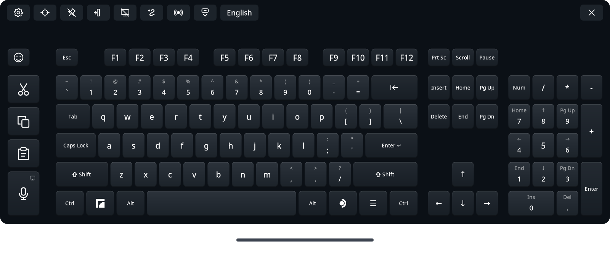

# Full Keyboard for Steam Frame

<p align="center"><a href="README.md">English</a> | <a href="README.ja.md">日本語</a> | <a href="README.zh-Hans.md">简体中文</a> | <a href="README.ru.md">Русский</a> | <a href="README.es.md">Español</a> | <a href="README.pt-BR.md">Português (Brasil)</a> | <b>Deutsch</b> | <a href="README.fr.md">Français</a></p>

Eine vollwertige Alternative zur eingebauten virtuellen Tastatur der Steam Frame, gemacht für den täglichen Einsatz im Headset. Sie bietet richtige Pfeiltasten, einen Ziffernblock, Ctrl und Alt sowie eigene Tasten für Ausschneiden, Kopieren und Einfügen, dazu Wischeingabe, Diktieren und Emojis, in 47 Sprachen.

**Full Keyboard wird standardmäßig von Hand gestartet.** Standardmäßig öffnet die Tastaturtaste von SteamOS die ursprüngliche Tastatur. Die Option **Native Tastatur ersetzen** (Replace native keyboard) unter Einstellungen → Integration leitet unterstützte Anfragen um, solange Full Keyboard läuft. Dafür muss nichts eingerichtet werden: Sie nutzt eine lokale Verbindung, die SteamOS Steam auf jeder Frame bereits bereitstellt, und greift auf die ursprüngliche Tastatur zurück, falls diese einmal nicht verfügbar ist. Aktivieren Sie **Mit SteamOS starten** (Start with SteamOS) in derselben Karte, um den Ersatz bei der Anmeldung im Hintergrund zu starten. Die Tastatur bleibt verborgen, bis sie aufgerufen wird. Siehe [Ersatz der nativen Tastatur](docs/native-replacement.md).



## Was sie kann

- Vollständiges Layout mit F1–F12, Navigationstasten, Pfeiltasten, einem ausblendbaren Ziffernblock, Ctrl, Alt und einer Shift-Taste, die beim Halten einrastet.
- Eigene Tasten für Ausschneiden, Kopieren und Einfügen, die Ctrl+X, Ctrl+C und Ctrl+V senden oder die Tasten eines Terminals, etwa Ctrl+Shift+C und Ctrl+Shift+V.
- Diktieren: Sprechen statt Tippen, erkannt im Headset oder von Ihrem eigenen Whisper-Sprachserver. Korrigieren Sie den Text in einem Editor und senden Sie ihn, oder lassen Sie **Beim Sprechen tippen** (Type as I speak) jeden Satz direkt in die App tippen. Siehe [Diktieren](#dictation).
- Wischeingabe, standardmäßig aus, für Englisch, Deutsch, Französisch, Spanisch, Italienisch, Portugiesisch, Polnisch, Niederländisch, Schwedisch, Ukrainisch, Russisch und chinesisches Pinyin. Die Wischeingabe nutzt die Technologie „FUTO Swipe“.
- Wortvorschläge, standardmäßig an, in den Sprachen mit Wischeingabe: bis zu fünf Ergänzungen des Wortes, das Sie gerade tippen, die meistgenutzten Wörter zuerst.
- Japanische Umwandlung mit Mozc, mit Kandidaten während des Tippens, und eine japanische 12-Tasten-Flick-Tastatur wie auf dem Telefon.
- **Umschalt durch Ziehen**, standardmäßig aus: Ziehen Sie eine Taste nach unten für ihr Umschalt-Zeichen, etwa ^ auf der Taste 6 oder einen Großbuchstaben, solange die Wischeingabe aus ist.
- Eine Emoji-Auswahl mit Zuletzt verwendeten, Favoriten per Drag-and-drop, Kategorien und Hauttönen.
- **Über Apps geöffnet lassen** (Stay open over apps): Die Tastatur bleibt an ihrem Platz, wenn das Dashboard schließt, zum Tippen in Fenster, die im Raum schweben; zeigen Sie auf ein schwebendes Fenster, um es mit dem Laser von SteamVR anzuklicken.
- **Fokusmodus** (Focus mode): Mit nativem Ersatz bleibt die Tastatur offen, wenn ein Textfeld schließt, bereit für das nächste Feld oder die nächste App, und warnt, wenn sie in ein Fenster tippen würde, das Sie nicht sehen.
- Tippen mit dem Controller-Laser, mit haptischen Klicks und Hover-Rückmeldung, dazu optionale Tastentöne mit sechs Effekten.
- Bewegen Sie sie mit dem Griff unter der Tastatur oder durch Greifen, ändern Sie die Größe an einer der unteren Ecken, heften Sie sie an, und lassen Sie sie nach dem Bewegen von der automatischen Ausrichtung geraderücken.
- Folgt dem Dashboard, speichert die Position und lässt sich durch erneutes Starten wieder zentrieren.
- Dreizehn Designs, hell und dunkel und eines mit hohem Kontrast, mit einer durchscheinenden Hintergrund-Option. Layouts, Sprachen und Designs sind bearbeitbare JSON-Dateien, ausgewählt in einem Einstellungsmenü in VR.
- Optionaler Ersatz der nativen Tastatur, Start mit SteamOS und Updates in der App mit automatischem Zurücksetzen.
- Ein experimentelles Integrationsprotokoll, mit dem alternative Steam-Frame-Shells die Tastatur einbinden können: starten, platzieren, gestalten und aktualisieren. Siehe [Shell-Integration](docs/integration.md).
- Englisch, Spanisch, vereinfachtes und traditionelles Chinesisch, Japanisch, Deutsch, Französisch, Portugiesisch, Koreanisch, Arabisch, Italienisch, Hindi, Russisch, Türkisch, Indonesisch, Polnisch, Niederländisch, Vietnamesisch, Thai, Ukrainisch, Schwedisch, Finnisch, Dänisch, Norwegisch, Tschechisch, Ungarisch, Rumänisch, Griechisch, Slowakisch, Hebräisch, Kroatisch, Slowenisch, Malaiisch, Estnisch, Lettisch, Litauisch, Bulgarisch, Katalanisch, Serbisch, Persisch, Filipino, Isländisch, Georgisch, Armenisch, Kasachisch, Aserbaidschanisch, Mazedonisch und Albanisch, jeweils mit dem nationalen Standardlayout und für viele mit regionalen und alternativen Tastaturen. Chinesisch hat vereinfachtes und traditionelles Pinyin, traditionelles Chinesisch zusätzlich Zhuyin, Cangjie und Quick; Koreanisch nutzt Hangul mit zwei Sätzen.


*Wischeingabe, japanische Eingabe, Diktieren, die Emoji-Auswahl und die Einstellungen, aufgenommen auf der Steam Frame mit einer früheren Version von Full Keyboard.*

## Installation als Benutzer, ohne zusätzliche Schritte

- **Kein sudo, kein Root-Zugriff, kein Administratorpasswort.** Full Keyboard wird als Ihr eigener Benutzer in Ihren Home-Ordner installiert. Sie müssen auf der Frame nie ein Passwort festlegen oder den Entwicklermodus einschalten.
- **Einmal von Hand installieren, danach Updates aus der App.** Nach der ersten Installation findet die Einstellungsansicht neue Versionen und installiert sie mit einem Knopf, und sie kehrt zur vorherigen Version zurück, wenn eine neue nicht startet.
- **Es funktioniert einfach.** Das Tippen funktioniert gleich nach der Installation, und auch **Native Tastatur ersetzen** muss nicht eingerichtet werden: Es nutzt eine lokale Verbindung, die SteamOS Steam auf jeder Frame bereits bereitstellt.
- **Übersteht Neustarts und SteamOS-Updates.** Mit **Mit SteamOS starten** startet sie nach jedem Hochfahren verborgen im Hintergrund. SteamOS-Updates lassen Ihren Home-Ordner unberührt, also bleiben die Tastatur und Ihre Einstellungen erhalten.
- **Nicht invasiv.** Sie ändert keine Dateien, Einstellungen, Systemdienste oder Geräteberechtigungen von Steam oder SteamOS. Der Ersatz greift nur in Steams Tastatur ein, solange Full Keyboard läuft, und wenn es endet, kehrt Steams eigene Tastatur von selbst zurück.
- **Sparsam mit Speicher und Akku.** Funktionen werden nur geladen, während Sie sie benutzen, und geben den Speicher frei, wenn Sie aufhören: Die japanische Umwandlung läuft nur, solange Japanisch hinzugefügt ist, die Sprach-Engine des Diktierens startet beim ersten Diktat und endet, wenn das Diktieren ausgeschaltet wird, das Wisch-Modell wird entladen, wenn die Wischeingabe aus ist, die Wortliste der Wortvorschläge wird beim Tippen geladen und nach fünf Minuten ohne Tippen freigegeben, und die Emoji-Auswahl gibt ihre Bilder frei, wenn sie schließt. Die Tastatur zeichnet nur die Tasten neu, die sich ändern, und während sie verborgen oder das Headset abgesetzt ist, verlangsamt sie sich auf vier Aktualisierungen pro Sekunde.
- **Liest nie Ihre Zwischenablage.** Ausschneiden, Kopieren und Einfügen drücken nur ihre Tastenkürzel, und Text erreicht Apps als Text. Full Keyboard schreibt nur dann in die Zwischenablage, wenn Sie Einfügen für das Diktieren oder für KDE-Desktop-Unicode wählen.

## Wo sie funktioniert

Full Keyboard ist für die **Nutzung auf dem Gerät** gemacht: das Frame-Dashboard, Steams eigene Textfelder und Apps, die auf der Frame laufen, einschließlich Desktop-Apps und im Raum schwebender Fenster. Wählen Sie ein Textfeld aus und tippen Sie dann mit dem Controller-Laser.

Normalerweise lebt die Tastatur im Dashboard: Wenn das Dashboard schließt, wird sie ausgeblendet und gibt ihre Eingabe frei, und beim erneuten Öffnen kommt sie zurück. Schalten Sie **Über Apps geöffnet lassen** neben der Pinnnadel ein, damit sie nach dem Schließen des Dashboards im Raum bleibt. Zeigen Sie mit einem der beiden Controller auf eine Taste und ziehen Sie den Abzug; ein Punkt zeigt, wohin jeder zielt. Mit eingeschaltetem **Native Tastatur ersetzen** öffnet eine Tastaturanfrage aus einem im Raum angehefteten Fenster Full Keyboard von selbst dort.

Sie tippt in Apps, die auf der Frame laufen, und in PC-Apps und -Spiele, die über Moonlight gestreamt werden ([gestreamte Spiele](docs/streamed-games.md)). Sie ist **keine Tastatur für VR-Apps, die von einem PC über Steam Link gestreamt werden, etwa VRChat**.

Jede Version besteht automatisierte Testreihen auf dem Entwicklungsrechner und auf der Frame, und ihre Funktionen werden im Headset im Dashboard, in Steams Textfeldern, in Desktop-Apps und in schwebenden Fenstern geprüft. Apps können sich dennoch darin unterscheiden, wie sie den Fokus übernehmen, bei Keymaps außerhalb der USA und bei Eingabemethoden; siehe [Bekannte Einschränkungen und Fehlerbehebung](docs/runtime.md). Rückmeldungen von Personen, die fließend Japanisch, Chinesisch oder Koreanisch schreiben, sind besonders willkommen. Ohne Steam Frame können Sie die Tastatur auf einem Linux-PC im [Desktop-Simulator](docs/simulator.md) ausprobieren.

## Manuelle Installation

Für das Release-Paket sind keine KI-Werkzeuge, keine Kompilierung, kein `sudo` und kein Schreibzugriff auf SteamOS nötig.

1. Öffnen Sie auf der **Steam Frame** die [GitHub-Releases-Seite](https://github.com/TaiKeid/steam-frame-full-keyboard/releases) in einem Browser. Laden Sie `framekeyboard-0.15.0-aarch64.tar.gz` und `SHA256SUMS` aus den Release-Assets in **Downloads** herunter. Laden Sie für diese Installation nicht das automatische Quellcode-Archiv von GitHub herunter.
2. Öffnen Sie ein Terminal in der Desktop-Umgebung der Frame und führen Sie aus:

   ```sh
   cd ~/Downloads
   sha256sum -c SHA256SUMS
   tar -xzf framekeyboard-0.15.0-aarch64.tar.gz
   cd framekeyboard-0.15.0-aarch64
   bash install.sh
   ```

   Fahren Sie nur fort, wenn die Prüfsumme `OK` meldet. Verwenden Sie für eine neuere Version die Namen ihres Archivs und ihres entpackten Ordners.
3. Kehren Sie zum Dashboard der Frame zurück und öffnen Sie **Full Keyboard** aus dem App-Starter. Sie können sie auch aus einem Terminal starten:

   ```sh
   ~/.local/bin/framekeyboard
   ```

Das Installationsprogramm legt einen Desktop-Anwendungseintrag namens **Full Keyboard** an. Wenn Sie zusätzlich eine Verknüpfung in der Steam-Bibliothek möchten, nutzen Sie in Steam die Option **Ein Nicht-Steam-Spiel hinzufügen** und wählen Sie Full Keyboard aus. Eine von Hand erstellte Verknüpfung hat ihren eigenen Namen; benennen Sie eine alte FrameKeyboard-Verknüpfung bei Bedarf in ihren Eigenschaften um.

Alles wird unter Ihrem Home-Verzeichnis installiert. Das Installationsprogramm behält Einstellungen und eigene Profile, ersetzt die aktuelle Produktionsversion und aktiviert weder den Autostart noch ändert es Steam-Dateien. Entwicklungsbereitstellungen und ältere, nicht markierte Release-Ordner bleiben erhalten. Interne Dateinamen und Befehle heißen weiterhin `framekeyboard`.

Die Tastatur sucht alle paar Stunden nach einer neuen stabilen Version und setzt einen Punkt auf den Einstellungsknopf, wenn es eine gibt. Zum Aktualisieren öffnen Sie die Einstellungen und drücken oben in der Mitte **Update herunterladen und installieren** (Download and install update) oder dort **Nach Updates suchen** (Check for updates), um sofort zu suchen. Die Tastatur prüft das Archiv, installiert es und startet neu, wobei Ihre Einstellungen erhalten bleiben. Die alte Produktionsversion bleibt, bis die neue einen fehlerfreien Start bestätigt, und wird dann entfernt. Ein fehlgeschlagener Start wird automatisch zurückgesetzt. Siehe [Updates](docs/updates.md).

Zum Deinstallieren führen Sie `bash ~/.local/share/framekeyboard/current/uninstall.sh` aus. Es beendet die Tastatur und ihre Hilfsprogramme, entfernt die App, ihren Startdienst, den Starter und den Menüeintrag und behält Ihre Einstellungen, sofern Sie nicht `--purge` hinzufügen. Danach wird wieder Steams Tastatur verwendet. Siehe [Zurücksetzen und Entfernen](docs/runtime.md#update-rollback-and-removal).

Beenden Sie Full Keyboard vor einem manuellen Update. Bei aktiviertem nativen Ersatz nutzen Sie Einstellungen → **Full Keyboard beenden** (Quit Full Keyboard). Laden Sie die neuen Release-Assets herunter und wiederholen Sie die Installationsschritte. Das Installationsprogramm erlaubt, dieselbe Version neu zu installieren oder eine ältere zu installieren, und verweigert die Arbeit, solange Full Keyboard läuft. Ein manuelles Zurücksetzen bedeutet, ein älteres Release-Paket neu zu installieren; siehe [Zurücksetzen und Entfernen](docs/runtime.md#update-rollback-and-removal).

## Die Tastatur benutzen

| Aktion | Bedienung |
| --- | --- |
| Tippen | Auf eine Taste zeigen und den Abzug des Controllers drücken |
| Tastenkürzel verwenden | Ctrl, Alt oder Shift antippen, dann eine andere Taste; oder den Modifikator mit einem Controller halten und mit dem anderen eine Taste drücken |
| Super-Kürzel | Das linke Frame-Symbol antippen, dann eine Taste, oder es mit dem anderen Controller halten |
| Anwendungsmenü des Desktops | Das rechte SteamOS-Symbol antippen für ein natives Drücken/Loslassen der rechten Super-Taste; der Desktop bestimmt, was es tut |
| Angetippten Modifikator lösen | Ihn erneut antippen |
| Shift feststellen | Shift eine halbe Sekunde halten; erneut drücken zum Lösen |
| Ein Wort wischen | **Wischeingabe** in der Einstellungskarte **Sprachen und Layouts** einschalten, dann den Abzug halten und über die Buchstaben ziehen. Weitere Vorschläge erscheinen in der Werkzeugleiste |
| Ein Wort ergänzen | Den Anfang tippen; bis zu fünf Ergänzungen erscheinen in der Werkzeugleiste. Eine wählen, um den Rest und ein Leerzeichen zu tippen |
| Umschalt-Zeichen per Ziehen | **Umschalt durch Ziehen** in der Einstellungskarte **Sprachen und Layouts** einschalten, dann eine Taste vor dem Loslassen nach unten ziehen: 6 ergibt ^, und bei ausgeschalteter Wischeingabe ergibt k ein K |
| Ausschneiden / Kopieren / Einfügen | Die Tasten Ausschneiden, Kopieren und Einfügen links nutzen; zum Ausschneiden oder Kopieren zuerst Text markieren |
| Diktieren | Die Mikrofontaste unter Ausschneiden, Kopieren und Einfügen drücken und sprechen. Sätze erscheinen in einem Editor anstelle der Funktionstasten; mit den Tasten korrigieren, dann **Senden** drücken, um den Text in die App zu tippen. Esc beendet das Zuhören |
| Beim Sprechen tippen | In der Einstellungskarte **Diktieren** einschalten. Die Mikrofontaste hört dann auf der normalen Tastatur zu und tippt jeden Satz in die App |
| Emojis tippen | Die Smiley-Taste oben links drücken. Das Raster durch Ziehen oder mit dem Thumbstick blättern, darüber eine Kategorie wählen und den Abzug auf einem Emoji loslassen, um es zu tippen. Ein Emoji mit Hauttönen halten, um einen Hautton zu wählen. Ein Emoji in Zuletzt halten und in die Favoriten ziehen, um es zu behalten. Die Pfeiltaste oben links kehrt zur Tastatur zurück |
| Bewegen / drehen | Lösen, auf die Linie unter der Tastatur zeigen, den Abzug halten, die Hand bewegen, dann loslassen |
| Headset-Cursor nutzen | AUX drücken, um den Kopf-Cursor anzuzeigen. Mit dem Kopf auf Tasten zielen und AUX klicken; AUX auf der Bewegungslinie halten, um die Tastatur zu bewegen |
| Greifen zum Bewegen nutzen | **Greifen zum Bewegen** (Grab to move) in der Einstellungskarte **Allgemein** aktivieren und übernehmen. Irgendwo auf die Tastatur zeigen und Greifen/Griff halten; der Thumbstick derselben Hand ändert den Abstand |
| Versehentliches Bewegen verhindern | Die Pinnnadel umschalten; die Tastatur folgt trotzdem dem Dashboard |
| Ohne Dashboard geöffnet lassen | **Über Apps geöffnet lassen** neben der Pinnnadel umschalten |
| Zwischen Textfeldern geöffnet lassen | Bei eingeschaltetem **Native Tastatur ersetzen** den **Fokusmodus** umschalten, das Fenstersymbol neben **Über Apps geöffnet lassen**. Die Tastatur bleibt, wo sie ist, wenn ein Feld schließt, tippt in das nächste Feld, das Sie auswählen, und sonst in die App mit dem Tastaturfokus; × oder die Tastaturtaste blendet sie weiterhin aus |
| Sprachen zum Wechseln hinzufügen | Einstellungen → **Weitere Sprachen** (Additional languages) öffnen, dann Sprachen antippen oder in die Liste ziehen |
| Zwischen Ihren Sprachen wechseln | Den Sprachknopf drücken, den letzten Knopf der Werkzeugleiste |
| Weiter weg / näher heran | Beim Halten der Bewegungslinie oder beim Greifen den Thumbstick desselben Controllers nach oben / unten drücken |
| Größe ändern | Lösen, mit dem Laser eines der beiden Controller knapp außerhalb einer unteren Ecke der Tastatur zielen, dann den Abzug auf dem eingeblendeten Eckgriff halten und ziehen. Die Tastatur wächst oder schrumpft um ihre Mitte |
| Ziffernblock ausblenden | In den Einstellungen Allgemein → **Ziffernblock ausblenden** anhaken und **Übernehmen und speichern** |
| Hinter die Tastatur sehen | In den Einstellungen Allgemein → **Hintergrund** auf **Halbtransparent** oder **Unsichtbar** stellen und **Übernehmen und speichern** |
| Layout, Sprache oder Design ändern | Das Zahnradsymbol öffnen, Profile wählen, dann **Übernehmen und speichern** (Apply and save) |
| Zentrieren | Das Symbol **Zentrieren** nutzen oder Full Keyboard erneut starten |
| Schließen | Mit × das Panel im Ersatzmodus ausblenden; sonst beendet es die App |
| Ersatzmodus beenden | Einstellungen → **Full Keyboard beenden** öffnen |

**Wenn die Tastatur außer Reichweite geraten ist, starten Sie die App erneut.** Läuft sie bereits, zentriert ein weiterer Start die vorhandene Tastatur unter dem aktuellen Dashboard, statt eine zweite zu öffnen. Ihre Größe bleibt erhalten. Ist das Dashboard geschlossen, wartet das Zentrieren, bis es sich öffnet.

Schließen und erneutes Öffnen stellt die letzte Position, Drehung, Größe und den Num-Lock-Zustand wieder her. Wenn Sie das Dashboard bewegen oder neigen, nimmt es die Tastatur mit. **Automatisch ausrichten** (Auto leveling), in Allgemein standardmäßig an, richtet eine leicht schiefe Tastatur gerade, nachdem Sie sie bewegt haben.

## Sprachen und Anpassung

Wählen Sie in den Einstellungen eine Sprache und **Übernehmen und speichern**. Die Tastatur sendet Zeichen aus diesem Layout unabhängig vom Tastaturlayout des Systems, einschließlich Shift, Caps Lock, AltGr und Akzenten über Tottasten. Weder ein passendes SteamOS-Layout noch ein Neustart sind nötig. Eine frische Installation beginnt mit Englisch; spätere Starts nutzen Ihre gespeicherte Auswahl. Fügen Sie unter **Weitere Sprachen** Paare aus Layout und Sprache hinzu, um über die Werkzeugleiste zwischen ihnen zu wechseln. Siehe [Sprachen einrichten und wechseln](docs/languages.md).

Für Japanisch wählen Sie **Romaji**, **Kana** oder **JIS** im Sprache-Auswahlfeld der Einstellungen oder das Layout **Japanese flick** für Flick-Eingabe wie auf dem Telefon. Romaji, Kana und Flick setzen den Text in der Tastatur zusammen und wandeln ihn mit Mozc, das mit Full Keyboard geliefert wird, in Kanji um, oder mit dem Anthy des Systems, solange Mozc nicht verfügbar ist. Kandidaten erscheinen während des Tippens; die Leertaste wandelt um; Enter bestätigt die Eingabe. Ein weiteres Enter sendet eine normale Enter-Taste. Der JIS-Modus braucht einen vorhandenen IME des Systems. Siehe [Japanische Eingabe](docs/japanese.md).

Chinesisch und Koreanisch werden lokal zusammengesetzt und können neben Englisch und dem eingebauten Japanisch ohne Änderung des Systemlayouts gewählt werden. Koreanisch nutzt Hangul mit zwei Sätzen und tippt jede Silbe, sobald die nächste beginnt, wie am PC; 한/영 an der Stelle der rechten Alt-Taste wechselt zu lateinischen Buchstaben. [Die Sprachanleitung](docs/languages.md#chinese-and-korean-composition) erklärt Kandidaten, Hangul und Einschränkungen der Eingabe.

Kopieren Sie ein mitgeliefertes JSON-Profil aus `~/.local/share/framekeyboard/current/share/framekeyboard/` in den passenden Ordner unten, bearbeiten Sie es und nutzen Sie dann das Symbol **Konfiguration neu laden** (Reload config) in den Einstellungen:

```text
~/.config/framekeyboard/layouts/
~/.config/framekeyboard/languages/
~/.config/framekeyboard/themes/
```

Nutzen Sie eine neue Profil-`id`, um eine Auswahl hinzuzufügen, oder dieselbe `id`, um ein mitgeliefertes Profil zu ersetzen. Die [Konfigurationsreferenz](docs/configuration.md) beschreibt Felder, Favoriten, Prüfung und gespeicherte Platzierung.

<a id="dictation"></a>
## Diktieren

Wählen Sie unter Einstellungen → **Diktieren** einen Modus, dann **Übernehmen und speichern**:

- **Auf dem Gerät** (On device), die Voreinstellung, erkennt Sprache auf der Steam Frame mit einem kleinen mehrsprachigen Whisper-Modell, das nach Ihrer Bestätigung einmal heruntergeladen wird (264 MB). Englisch und Spanisch werden am genauesten erkannt; andere Sprachen funktionieren mit geringerer Genauigkeit.
- **Selbst gehostet** (Self-hosted) sendet die Sprache an einen Whisper-Server, den Sie auf einem Rechner in Ihrem Netzwerk betreiben; das ist in jeder Sprache schneller und genauer. [Die Einrichtung des Sprachservers](docs/speech-server.md) behandelt Linux, macOS und Windows; nur die Schritte für Linux wurden geprüft. **Testen** prüft die Verbindung, und **Auf Gerät ausweichen** (Fall back to on device) nutzt das Headset, wenn der Server nicht erreichbar ist.
- **Aus** blendet die Mikrofontaste aus.

Diktieren funktioniert in jeder mitgelieferten Sprache außer Japanisch JIS. Ein kleines Symbol auf der Mikrofontaste zeigt, wo die Sprache erkannt wird: ein Headset für auf dem Gerät, ein Computer für Ihren Server. Der Controller tickt, wenn das Zuhören beginnt, und pulsiert, wenn es endet.

Datenschutz:

- Auf dem Gerät verlässt der Ton nie die Frame. Selbst gehostet geht er nur an den Server, den Sie eingegeben haben, und nur, während Sie diktieren oder Testen drücken. Eine einfache `host:port`-Adresse ist unverschlüsselt, also halten Sie den Server in Ihrem eigenen Netzwerk; die Einstellungen warnen vor Adressen, die nicht lokal sind.
- Ton und Text bleiben nur im Arbeitsspeicher. Nichts, was Sie sagen oder tippen, wird protokolliert oder gespeichert, abgesehen von den japanischen Sätzen, die das [Lernen](docs/japanese.md#learning) behält, und den Wörtern, die die [Wortvorschläge](docs/configuration.md#typing-suggestions) zählen, und nie aus Passwort-, PIN- oder Terminalfeldern.
- Das Zuhören endet, sobald Sie das Headset absetzen oder es aus dem Ruhezustand erwacht, und nach 60 s Stille.
- Das Mikrofon hört alle in der Nähe. Während ein Spiel läuft, kann auch der Spielton aufgenommen werden, und eine Meldung weist beim Zuhören darauf hin.

Einzelheiten finden Sie unter [Diktieren](docs/dictation.md).

## So funktioniert sie

Die Tastatur ist eine native C++20-App. Cairo/Pango zeichnen die Tasten, Vulkan/OpenVR zeigen das Panel an, und libei sendet native Bedienelemente an den lokalen Gamescope-Compositor der Frame. Ein auf Verfügbarkeit geprüftes Gamescope-Texteingabeprotokoll sendet Zeichen, die aus dem gewählten Layout aufgelöst werden, einschließlich japanischer, chinesischer und koreanischer Zusammensetzung. Sie führt keinen Browser aus. Sie geht nur online, um alle paar Stunden nach Updates zu suchen und eines zu installieren, wenn Sie es verlangen, um das Sprachmodell für das Gerät einmal herunterzuladen und um einen von Ihnen eingerichteten Sprachserver zu erreichen.

Ausschneiden, Kopieren und Einfügen senden Tastenkürzel; die App liest nie den Inhalt der Zwischenablage. Sie schreibt nur in die Zwischenablage, wenn **Senden** beim Diktieren oder Eingabe → **KDE-Desktop-Unicode** auf **Einfügen** steht, und fügt dann mit Ctrl+V oder der eigenen Einfügetaste eines Terminals ein. Sie protokolliert keinen getippten Text und speichert keinen Eingabeverlauf, abgesehen von dem, was das japanische [Lernen](docs/japanese.md#learning) und die [Wortvorschläge](docs/configuration.md#typing-suggestions) behalten; die Emoji-Auswahl behält Ihre zuletzt verwendeten und Lieblings-Emojis lokal, und Leeren löscht die zuletzt verwendeten. Platzierung und Profileinstellungen werden lokal gespeichert.

Das sichtbare Panel fragt Eingaben ab und folgt dem Dashboard mit angestrebten 60 Hz. Wenn es verborgen oder das Headset abgesetzt ist, sinkt die Abfrage auf 4 Hz. Die Textur wird nur neu gezeichnet, wenn sich ihre Anzeige ändert oder eine Tastenanimation läuft. Mit aktiviertem Ersatz bleibt die App beim Schließen des Panels für die nächste native Anfrage im Speicher; Einstellungen → **Full Keyboard beenden** beendet sie. Ohne Ersatz beendet das Schließen der Tastatur den Prozess. Der Einfluss auf den Akku wurde noch nicht gemessen.

## Entwicklung und Rückmeldungen

- [Aus dem Quellcode bauen](docs/building.md)
- [Desktop-Simulator](docs/simulator.md): die Tastatur in einem Fenster auf einem Linux-PC, die in ein eigenes Textfeld tippt
- [Architektur und Code-Übersicht](docs/architecture.md)
- [Betrieb und Fehlerbehebung](docs/runtime.md)
- [Manuelle Abnahmetests](docs/acceptance.md)
- [Roadmap](docs/plan.md) und [Änderungsprotokoll](CHANGELOG.md)
- [Mitwirken und Fehler melden](CONTRIBUTING.md)
- [Release-Checkliste](docs/releasing.md)
- [Pflege von Drittanbietercode und SteamOS-Abhängigkeiten](docs/upkeep.md)
- [Drittanbietercode und Lizenzen](third_party/README.md)

Bitte geben Sie die App-Version, die SteamOS-Version, die betroffene App, ob es ein Desktop- oder schwebendes Fenster ist, und die Schritte zum Nachstellen an. Entfernen Sie private Texte aus Screenshots und Protokollen.

## Lizenz

Der Projektcode steht unter der [MIT-Lizenz](LICENSE). Eingebundene Komponenten behalten ihre [ursprünglichen Lizenzen](third_party/README.md).

## Hinweis: KI-generiertes Projekt

Dieses Projekt ist vollständig KI-generiert. Der Autor kennt sich mit C++ nicht aus, bitte haben Sie also Geduld und Verständnis. Fehler und Ecken und Kanten sind zu erwarten; sorgfältige Reviews, klare Fehlerberichte und Beiträge sind willkommen. Komponenten von Drittanbietern behalten ihre ursprüngliche Urheberschaft und Lizenzen.

Auch die Übersetzungen der Oberfläche sind KI-generiert. Wenn etwas in Ihrer Sprache falsch klingt, sind Korrekturen willkommen.
