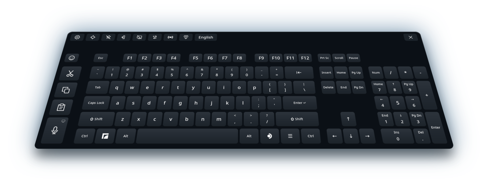

# Full Keyboard for Steam Frame

<p align="center"><a href="README.md">English</a> | <a href="README.ja.md">日本語</a> | <a href="README.zh-Hans.md">简体中文</a> | <a href="README.ru.md">Русский</a> | <b>Español</b> | <a href="README.pt-BR.md">Português (Brasil)</a> | <a href="README.de.md">Deutsch</a> | <a href="README.fr.md">Français</a></p>

Una alternativa de tamaño completo al teclado virtual integrado de Steam Frame, pensada para el uso diario en el visor. Añade teclas de flecha de verdad, teclado numérico, Ctrl y Alt, y teclas dedicadas para Cortar, Copiar y Pegar, además de escritura deslizante, dictado y emojis, en 47 idiomas.



## Instalación rápida

<p align="center"><a href="https://github.com/TaiKeid/steam-frame-full-keyboard/releases/latest/download/Full_Keyboard_installer-aarch64.AppImage"></a></p>
<p align="center"><sub>Este instalador es para el Steam Frame, no para PC.</sub></p>

1. Abre esta página en el navegador del Steam Frame y descarga el instalador con el botón de arriba.
2. Abre la carpeta donde se guardó, normalmente **Descargas**, y haz doble clic en el instalador. El navegador no puede abrirlo.
3. Cuando te pregunte si quieres abrir el archivo, elige sí, y cuando te pregunte si confías en él, elige sí también. Solo ocurre la primera vez.
4. Sigue los pasos del instalador.

Para instalar desde una terminal, consulta [Instalación manual](#instalación-manual).

## Qué hace

- Distribución de tamaño completo con F1–F12, teclas de navegación, flechas, un teclado numérico que puedes ocultar, Ctrl, Alt y un Shift que se bloquea al mantenerlo pulsado.
- Teclas dedicadas de Cortar, Copiar y Pegar que envían Ctrl+X, Ctrl+C y Ctrl+V, o las teclas propias de un terminal, como Ctrl+Shift+C y Ctrl+Shift+V.
- Dictado: habla en lugar de escribir, con reconocimiento en el visor o en tu propio servidor de voz Whisper. Corrige el texto en un editor y envíalo, o deja que **Escribir mientras hablo** (Type as I speak) escriba cada frase directamente en la app. Consulta [dictado](#dictation).
- Escritura deslizante, desactivada tras una instalación manual y a tu elección en el instalador, para inglés, alemán, francés, español, italiano, portugués, polaco, neerlandés, sueco, ucraniano, ruso, chino pinyin y [25 idiomas más](docs/configuration.md#swipe-typing), del checo al árabe y el hebreo. La escritura deslizante funciona con la tecnología "FUTO Swipe".
- Sugerencias de escritura, activadas por defecto, en los idiomas que tienen escritura deslizante: hasta cinco formas de completar la palabra que escribes, con las que más usas primero.
- Conversión de japonés con Mozc, con candidatos mientras escribes, y un teclado flick japonés de 12 teclas como el de los móviles.
- **Tirar para Mayús**, desactivado tras una instalación manual y a tu elección en el instalador: tira de una tecla hacia abajo para obtener su carácter con Mayús; por ejemplo ^ en la tecla 6, o una mayúscula mientras la escritura deslizante está desactivada.
- Un selector de emojis con Recientes, Favoritos que se ordenan arrastrando, categorías y tonos de piel.
- **Mantener abierto sobre apps** (Stay open over apps): el teclado se queda en su sitio cuando se cierra el panel, para escribir en ventanas que flotan en el mundo; apunta a una ventana flotante para hacer clic en ella con el láser de SteamVR.
- **Modo de foco** (Focus mode): con el reemplazo nativo, el teclado sigue visible cuando se cierra un campo de texto, listo para el siguiente campo o app, y avisa cuando escribiría en una ventana que no puedes ver.
- Escritura con el láser del mando, con clics hápticos y respuesta al pasar por encima, además de sonidos de tecla opcionales con seis efectos.
- Muévelo con el asa de debajo del teclado o agarrándolo, cambia su tamaño desde cualquiera de las esquinas inferiores, ánclalo en su sitio y deja que la nivelación automática lo enderece después de moverlo.
- Seguimiento del panel, posición guardada y recuperación volviendo a abrirlo para recentrarlo.
- Trece temas, claros y oscuros y uno de alto contraste, con una opción de Fondo transparente. Las distribuciones, los idiomas y los temas son archivos JSON editables, que se eligen en un menú de ajustes dentro de la RV.
- Reemplazo opcional del teclado nativo, inicio con SteamOS y actualizaciones desde la app con reversión automática.
- Un protocolo de integración experimental que permite a shells alternativos de Steam Frame alojar el teclado: abrirlo, colocarlo, darle estilo y actualizarlo. Consulta [integración con shells](docs/integration.md).
- Inglés, español, chino simplificado y tradicional, japonés, alemán, francés, portugués, coreano, árabe, italiano, hindi, ruso, turco, indonesio, polaco, neerlandés, vietnamita, tailandés, ucraniano, sueco, finés, danés, noruego, checo, húngaro, rumano, griego, eslovaco, hebreo, croata, esloveno, malayo, estonio, letón, lituano, búlgaro, catalán, serbio, persa, filipino, islandés, georgiano, armenio, kazajo, azerí, macedonio y albanés, cada uno con su distribución nacional estándar, y con teclados regionales y alternativos para muchos de ellos. El chino tiene pinyin simplificado y tradicional, y el tradicional también tiene zhuyin, cangjie y quick; el coreano usa hangul de dos grupos.


*Escritura deslizante, entrada en japonés, dictado, el selector de emojis y Ajustes, grabados en Steam Frame con una versión anterior de Full Keyboard.*

## Se instala como usuario, sin pasos adicionales

- **Sin sudo, acceso root ni contraseña de administrador.** Full Keyboard se instala en tu carpeta personal con tu propio usuario. Nunca necesitas poner una contraseña en el Frame ni activar el modo de desarrollador.
- **Una instalación y después actualizaciones desde la propia app.** Tras la primera instalación, Ajustes encuentra las nuevas versiones y las instala con un botón, y vuelve a la versión anterior si una nueva no consigue arrancar.
- **Funciona sin más.** Puedes escribir en cuanto está instalado, y **Reemplazar teclado nativo** tampoco necesita configuración: usa una conexión local que SteamOS ya ofrece a Steam en todos los Frame.
- **Sobrevive a reinicios y actualizaciones de SteamOS.** Con **Iniciar con SteamOS** activado, se inicia oculto en segundo plano tras cada arranque. Las actualizaciones de SteamOS no tocan tu carpeta personal, así que el teclado y tus ajustes se conservan.
- **No es invasivo.** No cambia ningún archivo, ajuste, servicio del sistema ni permiso de dispositivo de Steam o SteamOS. El reemplazo intercepta el teclado de Steam solo mientras Full Keyboard se ejecuta, y si se detiene, el teclado de Steam vuelve por sí solo.
- **Ligero en memoria y batería.** Las funciones se cargan solo mientras las usas y liberan la memoria cuando dejas de hacerlo: la conversión de japonés y de chino solo se ejecuta mientras su idioma está añadido, el motor de voz del dictado se inicia la primera vez que dictas y se cierra cuando se desactiva el dictado, el modelo de deslizamiento se descarga cuando la escritura deslizante está desactivada, la lista de palabras de las sugerencias se carga mientras escribes y se libera tras cinco minutos sin escribir, y el selector de emojis libera sus imágenes al cerrarse. El teclado solo vuelve a dibujar las teclas que cambian, y mientras está oculto o el visor está apagado baja a cuatro actualizaciones por segundo.
- **Nunca lee tu portapapeles.** Cortar, Copiar y Pegar solo pulsan sus atajos, y el texto llega a las apps como texto. Full Keyboard solo escribe en el portapapeles cuando eliges Pegar para el dictado o para Unicode en KDE.

## Dónde funciona

Full Keyboard está hecho para la **experiencia en el propio dispositivo**: el panel del Frame, los campos de texto de Steam y las apps que se ejecutan en el Frame, incluidas las apps de escritorio y las ventanas que flotan en el mundo. Selecciona un campo de texto y escribe con el láser del mando.

**Full Keyboard puede reemplazar el teclado nativo; el instalador pregunta si debe hacerlo.** Con **Reemplazar teclado nativo** (Replace native keyboard) activado en Ajustes → Integración, las solicitudes de teclado compatibles abren Full Keyboard mientras está en ejecución. No hay que configurar nada: usa una conexión local que SteamOS ya ofrece a Steam en todos los Frame, y vuelve al teclado original si alguna vez no está disponible. **Iniciar con SteamOS** (Start with SteamOS), en la misma tarjeta, lo inicia en segundo plano al iniciar sesión, oculto hasta que lo invoques; el instalador lo activa junto con el reemplazo. Tras una instalación manual ambos están desactivados: Full Keyboard se abre a mano y el botón de teclado de SteamOS abre el teclado original. Consulta [sustitución del teclado nativo](docs/native-replacement.md).

Normalmente el teclado vive en el panel: al cerrar el panel se oculta y libera su entrada, y al volver a abrirlo reaparece. Activa **Mantener abierto sobre apps**, junto al anclaje, para mantenerlo en el mundo después de cerrar el panel. Apunta con cualquiera de los mandos a una tecla y aprieta el gatillo; un punto muestra adónde apunta cada uno. Con Reemplazar teclado nativo activado, una solicitud de teclado de una ventana anclada en el mundo abre Full Keyboard allí mismo.

Escribe en las apps que se ejecutan en el Frame y en apps y juegos de PC retransmitidos con Moonlight ([juegos en streaming](docs/streamed-games.md)). **No es un teclado para apps de RV retransmitidas desde un PC mediante Steam Link**.

Cada versión supera conjuntos de pruebas automáticas en el ordenador de desarrollo y en el Frame, y sus funciones se comprueban en el visor en el panel, los campos de texto de Steam, las apps de escritorio y las ventanas flotantes. Aun así, las apps pueden diferir en cómo toman el foco, en los mapas de teclado no estadounidenses y en los métodos de entrada; consulta [limitaciones conocidas y solución de problemas](docs/runtime.md). Los comentarios de usuarios con dominio del japonés, el chino y el coreano son especialmente bienvenidos. Sin un Steam Frame, puedes probar el teclado en un PC con Linux en el [simulador de escritorio](docs/simulator.md).

## Instalación manual

El paquete de la versión no necesita herramientas de IA, compilación, `sudo` ni acceso de escritura a SteamOS.

1. En el **Steam Frame**, abre la [página de versiones de GitHub](https://github.com/TaiKeid/steam-frame-full-keyboard/releases) en un navegador. Descarga `framekeyboard-0.17.0-aarch64.tar.gz` y `SHA256SUMS` de los archivos de la versión en **Descargas**. No descargues para esta instalación el archivo de código fuente que GitHub genera automáticamente.
2. Abre un terminal en el entorno de escritorio del Frame y ejecuta:

   ```sh
   cd ~/Downloads
   sha256sum -c SHA256SUMS
   tar -xzf framekeyboard-0.17.0-aarch64.tar.gz
   cd framekeyboard-0.17.0-aarch64
   bash install.sh
   ```

   Continúa solo si la suma de verificación indica `OK`. Para una versión más reciente, usa los nombres de su archivo y de su directorio extraído.
3. Vuelve al panel del Frame y abre **Full Keyboard** desde el lanzador de apps. También puedes iniciarlo desde un terminal:

   ```sh
   ~/.local/bin/framekeyboard
   ```

La instalación añade una entrada de aplicación de escritorio llamada **Full Keyboard**. Si además quieres un acceso directo en la biblioteca de Steam, usa la opción **Añadir un juego que no es de Steam** (Add a Non-Steam Game) de Steam y selecciona Full Keyboard. Un acceso directo creado a mano tiene su propio nombre; si hace falta, cambia el nombre de un acceso directo antiguo de FrameKeyboard en sus Propiedades.

Todo se instala dentro de tu directorio personal. `install.sh` conserva los ajustes y los perfiles personalizados, sustituye la versión de producción actual y no activa el inicio automático ni modifica archivos de Steam. Se conservan las instalaciones de desarrollo y los directorios de versiones antiguas sin marcar. Los nombres de archivo y los comandos internos siguen siendo `framekeyboard`.

El teclado busca una nueva versión estable cada pocas horas y pone un punto en el botón de Ajustes cuando la hay. Para actualizar, abre Ajustes y pulsa **Descargar e instalar actualización** arriba en el centro, o **Buscar actualizaciones** en el mismo sitio para comprobarlo ahora. El teclado verifica el archivo, lo instala y se reinicia, conservando tus ajustes. La versión de producción anterior se mantiene hasta que la nueva confirma que ha arrancado bien, y entonces se elimina. Si el arranque falla, se revierte automáticamente. Consulta [actualizaciones](docs/updates.md).

Para desinstalarlo, ejecuta `bash ~/.local/share/framekeyboard/current/uninstall.sh`. Detiene el teclado y sus procesos auxiliares, elimina la app, su servicio de inicio, el lanzador y la entrada del menú, y conserva tus ajustes salvo que añadas `--purge`. Se vuelve a usar el teclado de Steam. Consulta [reversión y desinstalación](docs/runtime.md#update-rollback-and-removal). El botón **Desinstalar** del instalador hace lo mismo y pregunta si quieres conservar tus ajustes.

Para una actualización manual, cierra primero Full Keyboard. Con el reemplazo nativo activado, usa Ajustes → Salir de Full Keyboard. Descarga los archivos de la nueva versión y repite los pasos de instalación. `install.sh` permite reinstalar la misma versión o instalar una anterior, y se niega a hacerlo mientras Full Keyboard se está ejecutando. El instalador también reinstala, y antes cierra Full Keyboard si está en marcha. Revertir a mano significa reinstalar un paquete de una versión anterior; consulta [reversión y desinstalación](docs/runtime.md#update-rollback-and-removal).

## Usar el teclado

| Acción | Control |
| --- | --- |
| Escribir | Apunta a una tecla y pulsa el gatillo del mando |
| Usar un atajo | Toca Ctrl, Alt o Shift y después otra tecla; o mantén el modificador con un mando y pulsa una tecla con el otro |
| Atajos con Super | Toca el icono de Frame de la izquierda y después una tecla, o mantenlo con el otro mando |
| Menú de aplicaciones del escritorio | Toca el icono de SteamOS de la derecha para una pulsación nativa de Super derecho; el escritorio decide qué hace |
| Anular un modificador tocado | Vuelve a tocarlo |
| Bloquear Shift | Mantén Shift medio segundo; púlsalo de nuevo para desbloquearlo |
| Deslizar una palabra | Activa **Escritura deslizante** en la tarjeta de ajustes Idiomas y distribuciones, mantén el gatillo y traza sobre las letras. Otras propuestas aparecen en la barra de herramientas |
| Completar una palabra | Escribe su comienzo; aparecen hasta cinco opciones en la barra de herramientas. Elige una para escribir el resto y un espacio |
| Tirar para caracteres con Mayús | Activa **Tirar para Mayús** en la tarjeta de ajustes Idiomas y distribuciones y tira de una tecla hacia abajo antes de soltarla: 6 da ^, y con la escritura deslizante desactivada k da K |
| Cortar / copiar / pegar | Usa las teclas Cortar, Copiar y Pegar de la izquierda; selecciona primero el texto al cortar o copiar |
| Dictar | Pulsa la tecla del micrófono bajo Cortar, Copiar y Pegar y habla. Las frases aparecen en un editor en lugar de las teclas de función; corrígelas con las teclas y pulsa **Enviar** para escribir el texto en la app. Esc deja de escuchar |
| Escribir mientras hablo | Actívalo en la tarjeta de ajustes **Dictado**. La tecla del micrófono escucha entonces con el teclado normal y escribe cada frase en la app |
| Escribir emojis | Pulsa la tecla de la carita arriba a la izquierda. Desplaza la cuadrícula arrastrando o con el joystick, elige una categoría encima y suelta el gatillo sobre un emoji para escribirlo. Mantén un emoji con tonos para elegir el tono de piel. Mantén un emoji en Recientes y arrástralo a Favoritos para conservarlo. La tecla de flecha de arriba a la izquierda vuelve al teclado |
| Mover / girar | Desánclalo, apunta a la línea bajo el teclado, mantén el gatillo, mueve la mano y suelta |
| Usar el cursor del visor | Pulsa AUX para mostrar el cursor de cabeza. Apunta a las teclas con la cabeza y haz clic con AUX; mantén AUX sobre la línea de movimiento para mover el teclado |
| Usar el movimiento por agarre | Activa **Agarrar para mover** en la tarjeta de ajustes **General** y aplica. Apunta a cualquier parte del teclado y mantén el agarre (grip); el joystick de esa misma mano ajusta la distancia |
| Evitar movimientos accidentales | Activa el icono de anclaje; el teclado sigue acompañando al panel |
| Mantenerlo abierto sin el panel | Activa **Mantener abierto sobre apps** junto al icono de anclaje |
| Mantenerlo abierto entre campos de texto | Con Reemplazar teclado nativo activado, activa **Modo de foco**, el icono de ventana junto a Mantener abierto sobre apps. El teclado se queda donde está cuando se cierra un campo, escribe en el siguiente campo que selecciones y, si no, en la app que tiene el foco del teclado; × o el botón de teclado siguen ocultándolo |
| Añadir idiomas entre los que cambiar | Abre Ajustes → **Idiomas adicionales** y toca o arrastra idiomas a la lista |
| Cambiar entre tus idiomas | Pulsa el botón de idioma, el último de los botones de la barra de herramientas |
| Alejar / acercar | Mientras sujetas la línea de movimiento o agarras el teclado, empuja hacia arriba / abajo el joystick de ese mismo mando |
| Cambiar el tamaño | Desánclalo, apunta el láser de cualquiera de los mandos justo por fuera de una esquina inferior del teclado, mantén el gatillo sobre el tirador de esquina que aparece y arrastra. El teclado crece o se encoge alrededor de su centro |
| Ocultar el teclado numérico | En Ajustes, marca General → Ocultar teclado numérico y pulsa Aplicar y guardar |
| Ver detrás del teclado | En Ajustes, pon General → Fondo en Semitransparente o Invisible y pulsa Aplicar y guardar |
| Cambiar distribución, idioma o tema | Abre el icono del engranaje, elige los perfiles y pulsa **Aplicar y guardar** |
| Recentrar | Usa el icono de recentrar o vuelve a abrir Full Keyboard |
| Cerrar | Usa × para ocultar el panel en el modo de reemplazo; si no, cierra la app |
| Salir del modo de reemplazo | Abre Ajustes → Salir de Full Keyboard |

**Si el teclado se ha alejado fuera de tu alcance, vuelve a abrir la app.** Cuando ya se está ejecutando, abrirla de nuevo recentra el teclado existente bajo el panel actual en lugar de abrir otro. Su tamaño se conserva. Si el panel está cerrado, el recentrado espera a que se abra.

Al cerrarlo y volver a abrirlo se restauran la última posición, la rotación, el tamaño y el estado de Bloq Num. Mover o inclinar el panel arrastra el teclado consigo. **Nivelación automática** (Auto leveling), activada por defecto en General, endereza un teclado ligeramente torcido después de moverlo.

## Idiomas y personalización

Selecciona un idioma en Ajustes y pulsa **Aplicar y guardar**. El teclado envía los caracteres de esa distribución con independencia de la distribución de teclado del sistema, incluidos Shift, Bloq Mayús, AltGr y los acentos de teclas muertas. No hace falta una distribución equivalente en SteamOS ni reiniciar. Una instalación nueva usa inglés por defecto; los inicios posteriores usan tu selección guardada. Añade pares de distribución e idioma en **Idiomas adicionales** para cambiar entre ellos desde la barra de herramientas. Consulta [configuración y cambio de idiomas](docs/languages.md).

Para japonés, elige **Romaji**, **Kana** o **JIS** en el desplegable Idioma de Ajustes, o la distribución **Japanese flick** para la entrada flick de estilo móvil. Romaji, Kana y Flick componen el texto en el teclado y lo convierten a kanji con Mozc, que viene con Full Keyboard, o con el Anthy del sistema mientras Mozc no está disponible. Los candidatos aparecen mientras escribes; Espacio convierte; Enter confirma la composición. Otro Enter envía una tecla Enter normal. El modo JIS requiere un IME del sistema ya existente. Consulta [entrada en japonés](docs/japanese.md).

El chino y el coreano se componen localmente y pueden seleccionarse junto al inglés y al japonés integrado sin cambiar la distribución del sistema. El coreano usa hangul de dos grupos y escribe cada sílaba cuando empieza la siguiente, como en un PC; 한/영, en el lugar del Alt derecho, cambia a letras latinas. [La guía de idiomas](docs/languages.md#chinese-and-korean-composition) explica los candidatos, el hangul y las limitaciones de entrada.

Copia un perfil JSON incluido desde `~/.local/share/framekeyboard/current/share/framekeyboard/` a la carpeta correspondiente de abajo, edítalo y usa el icono **Recargar configuración** (Reload config) en Ajustes:

```text
~/.config/framekeyboard/layouts/
~/.config/framekeyboard/languages/
~/.config/framekeyboard/themes/
```

Usa un `id` de perfil nuevo para añadir una opción, o el mismo `id` para sustituir uno incluido. La [referencia de configuración](docs/configuration.md) cubre los campos, los favoritos, la validación y la posición guardada.

<a id="dictation"></a>
## Dictado

Elige un modo en Ajustes → **Dictado** (Dictation) y pulsa **Aplicar y guardar**:

- **En el dispositivo** (On device), el predeterminado, reconoce la voz en el Steam Frame con un pequeño modelo Whisper multilingüe que se descarga una vez (264 MB) tras tu confirmación. El inglés y el español son los más precisos; los demás idiomas funcionan con menos precisión.
- **Autoalojado** (Self-hosted) envía la voz a un servidor Whisper que ejecutas en un ordenador de tu red, lo que es más rápido y más preciso en todos los idiomas. La [configuración del servidor de voz](docs/speech-server.md) cubre Linux, macOS y Windows; solo se han verificado los pasos de Linux. **Probar** comprueba la conexión, y **Recurrir al dispositivo** (Fall back to on device) usa el visor cuando no se puede acceder al servidor.
- **Desactivado** oculta la tecla del micrófono.

El dictado funciona en todos los idiomas incluidos excepto japonés JIS. Un pequeño icono en la tecla del micrófono muestra dónde se reconoce la voz: un visor para el dispositivo, un ordenador para tu servidor. El mando hace un clic cuando empieza la escucha y vibra cuando se detiene.

Privacidad:

- En el dispositivo, el audio nunca sale del Frame. En modo autoalojado, solo va al servidor que hayas introducido, y solo mientras dictas o pulsas Probar. Una dirección `host:port` simple no está cifrada, así que mantén el servidor en tu propia red; Ajustes avisa de las direcciones que no son locales.
- El audio y el texto solo se quedan en memoria. Nada de lo que dices o escribes se registra ni se guarda, salvo las frases en japonés que conserva el [aprendizaje](docs/japanese.md#learning), las conversiones que conserva el [aprendizaje del chino](docs/languages.md#chinese-engines) y las palabras que cuentan las [sugerencias de escritura](docs/configuration.md#typing-suggestions), y nunca de campos marcados como contraseña, PIN o terminal ni de terminales que el teclado reconoce.
- La escucha se detiene en cuanto te quitas el visor o este despierta del modo de suspensión, y tras 60 s de silencio.
- El micrófono oye a todos los que están cerca. Mientras se ejecuta un juego, también puede captar su sonido, y un mensaje lo indica mientras escucha.

Consulta [dictado](docs/dictation.md) para más detalles.

## Cómo funciona

El teclado es una app nativa en C++20. Cairo/Pango dibujan las teclas, Vulkan/OpenVR muestran el panel y libei envía controles nativos al compositor Gamescope local del Frame. Un protocolo de entrada de texto de Gamescope, cuya disponibilidad se comprueba, envía los caracteres resueltos a partir de la distribución seleccionada, incluida la composición en japonés, chino y coreano. No ejecuta ningún navegador. Solo se conecta a internet para buscar actualizaciones cada pocas horas e instalar una cuando lo pides, para descargar una vez el modelo de voz del dispositivo y para llegar al servidor de voz que configures.

Cortar, Copiar y Pegar envían atajos; la app nunca lee el contenido del portapapeles. Solo escribe en el portapapeles cuando **Enviar** del dictado o Escritura → **Unicode en KDE** (KDE Desktop Unicode) están en **Pegar**, y entonces pega con Ctrl+V, o con la tecla de pegar propia de un terminal. No registra el texto escrito ni guarda un historial de composición, salvo lo que conservan el [aprendizaje](docs/japanese.md#learning) del japonés, el [aprendizaje del chino](docs/languages.md#chinese-engines) y las [sugerencias de escritura](docs/configuration.md#typing-suggestions); el selector de emojis guarda tus emojis Recientes y Favoritos localmente, y Borrar vacía Recientes. Las preferencias de posición y de perfil se guardan localmente.

El panel visible consulta la entrada y sigue al panel de Steam con un objetivo de 60 Hz. Mientras está oculto o con el visor apagado, la consulta baja a 4 Hz. Solo vuelve a dibujar la textura cuando cambia lo que muestra o hay una animación de tecla. Con el reemplazo activado, cerrar el panel mantiene la app residente para la siguiente solicitud nativa; Ajustes → Salir de Full Keyboard la cierra. Con el reemplazo desactivado, cerrar el teclado termina el proceso. El impacto en la batería no se ha medido.

## Desarrollo y comentarios

- [Compilar desde el código fuente](docs/building.md)
- [Simulador de escritorio](docs/simulator.md): el teclado en una ventana de un PC con Linux, escribiendo en un campo de texto propio
- [Arquitectura y mapa del código](docs/architecture.md)
- [Funcionamiento y solución de problemas](docs/runtime.md)
- [Pruebas de aceptación manuales](docs/acceptance.md)
- [Hoja de ruta](docs/plan.md) y [registro de cambios](CHANGELOG.md)
- [Contribuir e informar de errores](CONTRIBUTING.md)
- [Lista de comprobación de versiones](docs/releasing.md)
- [Mantenimiento del código de terceros y de las dependencias de SteamOS](docs/upkeep.md)
- [Código de terceros y licencias](third_party/README.md)

Al informar de un problema, indica la versión de la app, la versión de SteamOS, la app afectada, si es una ventana de escritorio o flotante y los pasos para reproducirlo. Quita el texto privado de las capturas de pantalla y los registros.

## Licencia

El código del proyecto está disponible bajo la [licencia MIT](LICENSE). Los componentes incluidos de terceros conservan sus [licencias originales](third_party/README.md).

## Aviso sobre un proyecto generado por IA

Este proyecto está generado íntegramente por IA. El autor no conoce C++, así que te pedimos paciencia y comprensión. Es de esperar que haya errores y detalles sin pulir; las revisiones cuidadosas, los informes de errores claros y las contribuciones son bienvenidos. Los componentes de terceros conservan su autoría y sus licencias originales.

Las traducciones de la interfaz también están hechas por IA. Si algo suena mal en tu idioma, las correcciones son bienvenidas.
