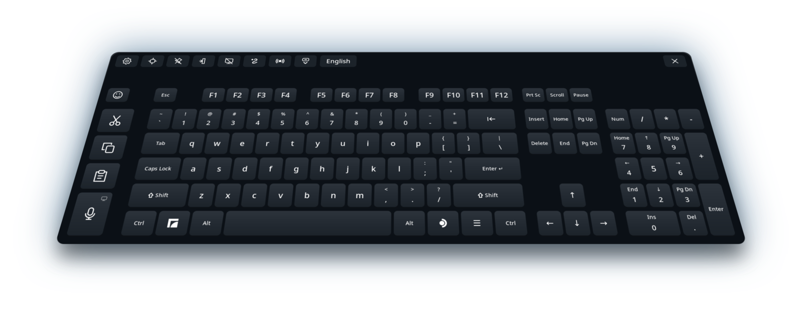
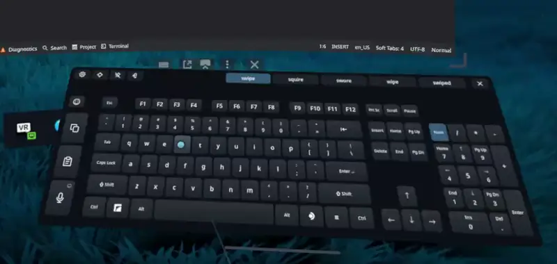

# Full Keyboard for Steam Frame

<p align="center"><a href="README.md">English</a> | <a href="README.ja.md">日本語</a> | <a href="README.zh-Hans.md">简体中文</a> | <a href="README.ru.md">Русский</a> | <a href="README.es.md">Español</a> | <a href="README.pt-BR.md">Português (Brasil)</a> | <a href="README.de.md">Deutsch</a> | <b>Français</b></p>

Une alternative complète au clavier virtuel intégré de la Steam Frame, conçue pour un usage quotidien dans le casque. Elle ajoute de vraies touches fléchées, un pavé numérique, Ctrl et Alt, et des touches dédiées Couper, Copier et Coller, ainsi que la saisie gestuelle, la dictée et les emoji, dans 47 langues.



## Installation rapide

<p align="center"><a href="https://github.com/TaiKeid/steam-frame-full-keyboard/releases/latest/download/Full_Keyboard_installer-aarch64.AppImage"></a></p>
<p align="center"><sub>Cet installateur est pour la Steam Frame, pas pour un PC.</sub></p>

1. Ouvrez cette page dans le navigateur de la Steam Frame et téléchargez l'installateur avec le bouton ci-dessus.
2. Ouvrez le dossier où il a été enregistré, en général **Téléchargements**, et double-cliquez sur l'installateur. Le navigateur ne peut pas le lancer.
3. Quand on vous demande si vous voulez lancer le fichier, répondez oui, et quand on vous demande si vous lui faites confiance, répondez oui aussi. Cela n'arrive que la première fois.
4. Suivez ensuite les étapes de l'installateur.

Pour installer depuis un terminal, voir [Installation manuelle](#installation-manuelle).

## Ce qu'il fait

- Disposition complète avec F1–F12, touches de navigation, touches fléchées, un pavé numérique que vous pouvez masquer, Ctrl, Alt et un Shift qui se verrouille quand on le maintient.
- Des touches dédiées Couper, Copier et Coller qui envoient Ctrl+X, Ctrl+C et Ctrl+V, ou les touches propres à un terminal, comme Ctrl+Shift+C et Ctrl+Shift+V.
- La dictée : parlez au lieu de taper, avec une reconnaissance dans le casque ou par votre propre serveur vocal Whisper. Corrigez le texte dans un éditeur et envoyez-le, ou laissez **Taper en parlant** (Type as I speak) taper chaque phrase directement dans l'appli. Voir [la dictée](#dictation).
- La saisie gestuelle, désactivée après une installation manuelle et au choix dans l'installateur, pour l'anglais, l'allemand, le français, l'espagnol, l'italien, le portugais, le polonais, le néerlandais, le suédois, l'ukrainien, le russe, le pinyin chinois et [25 autres langues](docs/configuration.md#swipe-typing), du tchèque à l'arabe et à l'hébreu. La saisie gestuelle repose sur la technologie « FUTO Swipe ».
- Les suggestions de saisie, activées par défaut, dans les langues qui ont la saisie gestuelle : jusqu'à cinq complétions du mot que vous tapez, les mots que vous utilisez le plus en premier.
- La conversion japonaise avec Mozc, avec des candidats pendant la frappe, et un clavier japonais à 12 touches avec effleurement, comme sur un téléphone.
- **Tirer pour Maj**, désactivé après une installation manuelle et au choix dans l'installateur : tirez une touche vers le bas pour obtenir son caractère Maj, par exemple ^ sur la touche 6, ou une majuscule quand la saisie gestuelle est désactivée.
- Un sélecteur d'emoji avec Récents, des Favoris par glisser-déposer, des catégories et des teintes de peau.
- **Rester ouvert sur les applis** (Stay open over apps) : le clavier reste en place quand le tableau de bord se ferme, pour taper dans des fenêtres qui flottent dans l'espace ; pointez une fenêtre flottante pour cliquer dessus avec le laser de SteamVR.
- **Mode focus** (Focus mode) : avec le remplacement natif, le clavier reste affiché quand un champ de texte se ferme, prêt pour le champ ou l'appli suivants, et vous avertit quand il taperait dans une fenêtre que vous ne voyez pas.
- La frappe au laser de la manette, avec des clics haptiques et un retour au survol, et des sons de touches facultatifs avec six effets.
- Déplacez-le avec la poignée sous le clavier ou en le saisissant, redimensionnez-le depuis l'un des coins inférieurs, épinglez-le, et laissez la mise à l'horizontale automatique le redresser après un déplacement.
- Il suit le tableau de bord, mémorise sa position et se recentre en le relançant.
- Treize thèmes, clairs et sombres dont un à contraste élevé, avec une option d'arrière-plan transparent. Les dispositions, les langues et les thèmes sont des fichiers JSON modifiables, choisis dans un menu de paramètres en VR.
- Le remplacement facultatif du clavier natif, le lancement avec SteamOS, et des mises à jour dans l'appli avec retour arrière automatique.
- Un protocole d'intégration expérimental qui permet à d'autres shells pour Steam Frame d'héberger le clavier : le lancer, le placer, le styliser et le mettre à jour. Voir [intégration aux shells](docs/integration.md).
- Anglais, espagnol, chinois simplifié et traditionnel, japonais, allemand, français, portugais, coréen, arabe, italien, hindi, russe, turc, indonésien, polonais, néerlandais, vietnamien, thaï, ukrainien, suédois, finnois, danois, norvégien, tchèque, hongrois, roumain, grec, slovaque, hébreu, croate, slovène, malais, estonien, letton, lituanien, bulgare, catalan, serbe, persan, filipino, islandais, géorgien, arménien, kazakh, azerbaïdjanais, macédonien et albanais, chacun sur sa disposition nationale standard, avec des claviers régionaux et alternatifs pour beaucoup d'entre eux. Le chinois a le pinyin simplifié et traditionnel, et le traditionnel a aussi le zhuyin, le cangjie et le quick ; le coréen utilise le hangeul à deux jeux.



*La saisie gestuelle, la saisie japonaise, la dictée, le sélecteur d'emoji et les paramètres, enregistrés sur la Steam Frame avec une version antérieure de Full Keyboard.*

## S'installe en tant qu'utilisateur, sans étape supplémentaire

- **Ni sudo, ni accès root, ni mot de passe administrateur.** Full Keyboard s'installe dans votre dossier personnel, sous votre propre utilisateur. Vous n'avez jamais besoin de définir un mot de passe sur la Frame ni d'activer le mode développeur.
- **Une installation, puis des mises à jour depuis l'appli.** Après la première installation, les paramètres trouvent les nouvelles versions et les installent d'un seul bouton, puis reviennent à la version précédente si une nouvelle ne démarre pas.
- **Ça marche, tout simplement.** La frappe fonctionne dès l'installation, et **Remplacer le clavier natif** ne demande aucune configuration non plus : il utilise une connexion locale que SteamOS fournit déjà à Steam sur chaque Frame.
- **Résiste aux redémarrages et aux mises à jour de SteamOS.** Avec **Lancer avec SteamOS**, il démarre masqué en arrière-plan après chaque démarrage. Les mises à jour de SteamOS ne touchent pas à votre dossier personnel : le clavier et vos paramètres restent.
- **Non intrusif.** Il ne modifie aucun fichier, paramètre, service système ni droit d'accès aux périphériques de Steam ou de SteamOS. Le remplacement n'intercepte le clavier de Steam que pendant que Full Keyboard tourne, et s'il s'arrête, le clavier de Steam revient de lui-même.
- **Léger pour la mémoire et la batterie.** Les fonctions ne se chargent que pendant que vous les utilisez et libèrent la mémoire quand vous arrêtez : les conversions japonaise et chinoise ne tournent que tant que leur langue est ajoutée, le moteur vocal de la dictée démarre à la première dictée et s'arrête quand la dictée est désactivée, le modèle de saisie gestuelle est déchargé quand celle-ci est désactivée, la liste de mots des suggestions se charge pendant la frappe et repart après cinq minutes sans frappe, et le sélecteur d'emoji libère ses images à sa fermeture. Le clavier ne redessine que les touches qui changent, et quand il est masqué ou que le casque est retiré, il ralentit à quatre mises à jour par seconde.
- **Ne lit jamais votre presse-papiers.** Couper, Copier et Coller ne font qu'appuyer sur leurs raccourcis, et le texte arrive dans les applis en tant que texte. Full Keyboard n'écrit dans le presse-papiers que lorsque vous choisissez Coller pour la dictée ou pour Unicode bureau KDE.

## Où il fonctionne

Full Keyboard est conçu pour l'**usage sur l'appareil** : le tableau de bord de la Frame, les champs de texte de Steam et les applis qui tournent sur la Frame, y compris les applis de bureau et les fenêtres flottant dans l'espace. Sélectionnez un champ de texte, puis tapez avec le laser de la manette.

**Full Keyboard peut remplacer le clavier natif ; l'installateur demande s'il doit le faire.** Avec **Remplacer le clavier natif** (Replace native keyboard) activé dans Paramètres → Intégration, les demandes de clavier prises en charge ouvrent Full Keyboard tant qu'il est lancé. Rien à configurer : il utilise une connexion locale que SteamOS fournit déjà à Steam sur chaque Frame, et revient au clavier d'origine si celle-ci n'est pas disponible. **Lancer avec SteamOS** (Start with SteamOS), dans la même carte, le démarre en arrière-plan à l'ouverture de session, masqué jusqu'à ce qu'on l'appelle ; l'installateur l'active avec le remplacement. Après une installation manuelle, les deux sont désactivés : Full Keyboard se lance à la main, et le bouton clavier de SteamOS ouvre le clavier d'origine. Voir [remplacement du clavier natif](docs/native-replacement.md).

Normalement, le clavier vit dans le tableau de bord : fermer le tableau de bord le masque et libère sa saisie, et le rouvrir le fait revenir. Activez **Rester ouvert sur les applis**, à côté de l'épingle, pour le garder dans l'espace après la fermeture du tableau de bord. Pointez une touche avec l'une ou l'autre manette et appuyez sur la gâchette ; un point montre où chacune vise. Avec **Remplacer le clavier natif** activé, une demande de clavier venant d'une fenêtre épinglée dans l'espace y ouvre Full Keyboard de lui-même.

Il tape dans les applis qui tournent sur la Frame, et dans les applis et jeux PC diffusés via Moonlight. Avec **Prise en charge du streaming** (Streaming support) activé dans Paramètres → Intégration, il tape aussi dans les jeux et applis que Steam lui-même diffuse depuis votre PC : l'option est désactivée après une installation manuelle et au choix dans l'installateur, installe une bibliothèque supplémentaire sans modifier aucun fichier de Steam ou de SteamOS, et fonctionne après un redémarrage de SteamOS ([jeux en streaming](docs/streamed-games.md)). Ce **n'est pas un clavier pour les applis VR diffusées depuis un PC via Steam Link**.

Chaque version passe des séries de tests automatisés sur l'ordinateur de développement et sur la Frame, et ses fonctions sont vérifiées dans le casque dans le tableau de bord, les champs de texte de Steam, les applis de bureau et les fenêtres flottantes. Les applis peuvent toutefois différer dans leur façon de prendre le focus, avec les dispositions non américaines et avec les méthodes de saisie ; voir [limites connues et dépannage](docs/runtime.md). Les retours de personnes qui écrivent couramment le japonais, le chinois ou le coréen sont particulièrement bienvenus. Sans Steam Frame, vous pouvez essayer le clavier sur un PC Linux dans le [simulateur de bureau](docs/simulator.md).

## Installation manuelle

Le paquet de version ne demande ni outils d'IA, ni compilation, ni `sudo`, ni accès en écriture à SteamOS.

1. Sur la **Steam Frame**, ouvrez la [page des versions GitHub](https://github.com/TaiKeid/steam-frame-full-keyboard/releases) dans un navigateur. Téléchargez `framekeyboard-0.17.0-aarch64.tar.gz` et `SHA256SUMS` depuis les fichiers de la version dans **Téléchargements**. Ne téléchargez pas l'archive automatique du code source de GitHub pour cette installation.
2. Ouvrez un terminal dans l'environnement de bureau de la Frame et lancez :

   ```sh
   cd ~/Downloads
   sha256sum -c SHA256SUMS
   tar -xzf framekeyboard-0.17.0-aarch64.tar.gz
   cd framekeyboard-0.17.0-aarch64
   bash install.sh
   ```

   Ne continuez que si la somme de contrôle indique `OK`. Pour une version plus récente, utilisez les noms de son archive et de son dossier extrait.
3. Revenez au tableau de bord de la Frame et ouvrez **Full Keyboard** depuis le lanceur d'applis. Vous pouvez aussi le lancer depuis un terminal :

   ```sh
   ~/.local/bin/framekeyboard
   ```

L'installation ajoute une entrée d'application de bureau nommée **Full Keyboard**. Si vous voulez aussi un raccourci dans la bibliothèque Steam, utilisez l'option **Ajouter un jeu non-Steam** de Steam et sélectionnez Full Keyboard. Un raccourci créé à la main a son propre nom ; renommez au besoin un ancien raccourci FrameKeyboard dans ses propriétés.

Tout s'installe dans votre dossier personnel. `install.sh` conserve les paramètres et les profils personnalisés, remplace la version de production actuelle, et n'active pas le lancement automatique ni ne modifie les fichiers de Steam. Les déploiements de développement et les anciens dossiers de version non marqués sont conservés. Les noms de fichiers et les commandes internes restent `framekeyboard`.

Le clavier vérifie toutes les quelques heures s'il existe une nouvelle version stable et met un point sur le bouton Paramètres quand il y en a une. Pour mettre à jour, ouvrez les paramètres et appuyez sur **Télécharger et installer la mise à jour** (Download and install update) en haut au centre, ou sur **Rechercher des mises à jour** (Check for updates) au même endroit pour vérifier tout de suite. Le clavier vérifie l'archive, l'installe et redémarre en conservant vos paramètres. L'ancienne version de production reste jusqu'à ce que la nouvelle confirme un démarrage sain, puis elle est supprimée. Un démarrage raté revient automatiquement en arrière. Voir [mises à jour](docs/updates.md).

Pour désinstaller, lancez `bash ~/.local/share/framekeyboard/current/uninstall.sh`. Cela arrête le clavier et ses programmes d'aide, supprime l'appli, son service de démarrage, son lanceur et son entrée de menu, et garde vos paramètres, sauf si vous ajoutez `--purge`. Le clavier de Steam est de nouveau utilisé. Voir [retour arrière et désinstallation](docs/runtime.md#update-rollback-and-removal). **Désinstaller** dans l'installateur fait de même et demande s'il faut conserver vos paramètres.

Pour une mise à jour manuelle, quittez d'abord Full Keyboard. Avec le remplacement natif activé, utilisez Paramètres → **Quitter Full Keyboard** (Quit Full Keyboard). Téléchargez les fichiers de la nouvelle version et répétez les étapes d'installation. `install.sh` permet de réinstaller la même version ou d'en installer une plus ancienne, et refuse tant que Full Keyboard tourne. L'installateur réinstalle aussi, et ferme d'abord Full Keyboard s'il tourne. Revenir manuellement en arrière veut dire réinstaller un paquet de version plus ancien ; voir [retour arrière et désinstallation](docs/runtime.md#update-rollback-and-removal).

## Utiliser le clavier

| Action | Commande |
| --- | --- |
| Taper | Pointer une touche et appuyer sur la gâchette de la manette |
| Utiliser un raccourci | Toucher Ctrl, Alt ou Shift, puis une autre touche ; ou maintenir le modificateur avec une manette et appuyer sur une touche avec l'autre |
| Raccourcis Super | Toucher l'icône Frame de gauche, puis une touche, ou la maintenir avec l'autre manette |
| Menu des applications du bureau | Toucher l'icône SteamOS de droite pour un appui/relâchement natif de la touche Super droite ; le bureau décide de son action |
| Annuler un modificateur touché | Le toucher à nouveau |
| Verrouiller Shift | Maintenir Shift une demi-seconde ; appuyer à nouveau pour déverrouiller |
| Tracer un mot | Activer **Saisie gestuelle** dans la carte de paramètres **Langues et dispositions**, puis maintenir la gâchette et passer sur les lettres. D'autres propositions apparaissent dans la barre d'outils |
| Compléter un mot | Taper son début ; jusqu'à cinq complétions apparaissent dans la barre d'outils. En choisir une pour taper la suite et une espace |
| Tirer pour le caractère Maj | Activer **Tirer pour Maj** dans la carte de paramètres **Langues et dispositions**, puis tirer une touche vers le bas avant de la relâcher : 6 donne ^, et avec la saisie gestuelle désactivée k donne K |
| Couper / copier / coller | Utiliser les touches Couper, Copier et Coller à gauche ; sélectionner d'abord le texte pour couper ou copier |
| Dicter | Appuyer sur la touche micro sous Couper, Copier et Coller et parler. Les phrases apparaissent dans un éditeur à la place des touches de fonction ; les corriger avec les touches, puis appuyer sur **Envoyer** pour taper le texte dans l'appli. Esc arrête l'écoute |
| Taper en parlant | L'activer dans la carte de paramètres **Dictée**. La touche micro écoute alors sur le clavier normal et tape chaque phrase dans l'appli |
| Taper des emoji | Appuyer sur la touche smiley en haut à gauche. Faire défiler la grille en la faisant glisser ou avec le joystick, choisir une catégorie au-dessus, et relâcher la gâchette sur un emoji pour le taper. Maintenir un emoji à teintes pour choisir une teinte de peau. Maintenir un emoji dans Récents et le faire glisser dans les Favoris pour le garder. La touche flèche en haut à gauche revient au clavier |
| Déplacer / tourner | Désépingler, pointer la ligne sous le clavier, maintenir la gâchette, bouger la main, puis relâcher |
| Utiliser le curseur du casque | Appuyer sur AUX pour afficher le curseur de tête. Viser les touches avec la tête et cliquer avec AUX ; maintenir AUX sur la ligne de déplacement pour déplacer le clavier |
| Utiliser le déplacement par saisie | Activer **Saisir pour déplacer** (Grab to move) dans la carte de paramètres **Général** et appliquer. Pointer n'importe où sur le clavier et maintenir la poignée ; le joystick de la même main règle la distance |
| Empêcher les déplacements accidentels | Basculer l'icône d'épingle ; le clavier suit quand même le tableau de bord |
| Le garder ouvert sans le tableau de bord | Basculer **Rester ouvert sur les applis** à côté de l'icône d'épingle |
| Le garder ouvert entre les champs de texte | Avec **Remplacer le clavier natif** activé, basculer le **Mode focus**, l'icône de fenêtre à côté de **Rester ouvert sur les applis**. Le clavier reste où il est quand un champ se ferme, tape dans le prochain champ que vous sélectionnez, et sinon dans l'appli qui a le focus clavier ; × ou le bouton clavier le masque toujours |
| Ajouter des langues entre lesquelles basculer | Ouvrir Paramètres → **Langues supplémentaires** (Additional languages), puis toucher des langues ou les faire glisser dans la liste |
| Basculer entre vos langues | Appuyer sur le bouton de langue, le dernier des boutons de la barre d'outils |
| Éloigner / rapprocher | En tenant la ligne de déplacement ou en saisissant le clavier, pousser le joystick de cette même manette vers le haut / le bas |
| Changer la taille | Désépingler, viser avec le laser de l'une ou l'autre manette juste à l'extérieur d'un coin inférieur du clavier, puis maintenir la gâchette sur la poignée de coin qui apparaît et faire glisser. Le clavier grandit ou rétrécit autour de son centre |
| Masquer le pavé numérique | Dans les paramètres, cocher Général → **Masquer le pavé numérique** puis **Appliquer et enregistrer** |
| Voir derrière le clavier | Dans les paramètres, régler Général → **Arrière-plan** sur **Semi-transparent** ou **Invisible** puis **Appliquer et enregistrer** |
| Changer de disposition, de langue ou de thème | Ouvrir l'icône d'engrenage, choisir les profils, puis **Appliquer et enregistrer** (Apply and save) |
| Recentrer | Utiliser l'icône **Recentrer**, ou relancer Full Keyboard |
| Fermer | Utiliser × pour masquer le panneau en mode remplacement ; sinon, cela quitte l'appli |
| Quitter le mode remplacement | Ouvrir Paramètres → **Quitter Full Keyboard** |

**Si le clavier a dérivé hors de portée, relancez l'appli.** S'il tourne déjà, un nouveau lancement recentre le clavier existant sous le tableau de bord actuel au lieu d'en ouvrir un second. Sa taille est conservée. Si le tableau de bord est fermé, le recentrage attend qu'il s'ouvre.

Fermer et rouvrir restaure la dernière position, la rotation, la taille et l'état de Num Lock. Déplacer ou incliner le tableau de bord emporte le clavier avec lui. **Mise à l'horizontale auto** (Auto leveling), activée par défaut dans Général, redresse un clavier légèrement de travers après que vous l'avez déplacé.

## Langues et personnalisation

Choisissez une langue dans les paramètres puis **Appliquer et enregistrer**. Le clavier envoie les caractères de cette disposition indépendamment de la disposition du clavier du système, y compris Shift, Caps Lock, AltGr et les accents par touches mortes. Aucune disposition SteamOS correspondante ni aucun relancement n'est nécessaire. Une nouvelle installation commence en anglais ; les lancements suivants utilisent votre sélection enregistrée. Ajoutez des paires disposition et langue dans **Langues supplémentaires** pour basculer entre elles depuis la barre d'outils. Voir [configuration et changement de langue](docs/languages.md).

Pour le japonais, choisissez **Romaji**, **Kana** ou **JIS** dans la liste Langue des paramètres, ou la disposition **Japanese flick** pour une saisie par effleurement comme sur un téléphone. Romaji, Kana et Flick composent le texte dans le clavier et le convertissent en kanji avec Mozc, fourni avec Full Keyboard, ou avec l'Anthy du système tant que Mozc n'est pas disponible. Les candidats apparaissent pendant la frappe ; Espace convertit ; Enter valide la composition. Une autre pression sur Enter envoie une touche Enter normale. Le mode JIS nécessite un IME du système déjà présent. Voir [saisie japonaise](docs/japanese.md).

Le chinois et le coréen se composent localement et peuvent être choisis à côté de l'anglais et du japonais intégré sans changer la disposition du système. Le coréen utilise le hangeul à deux jeux et tape chaque syllabe dès que la suivante commence, comme sur un PC ; 한/영 à la place de l'Alt droit bascule vers les lettres latines. [Le guide des langues](docs/languages.md#chinese-and-korean-composition) explique les candidats, le hangeul et les limites de saisie.

Copiez un profil JSON fourni depuis `~/.local/share/framekeyboard/current/share/framekeyboard/` dans le dossier correspondant ci-dessous, modifiez-le, puis utilisez l'icône **Recharger la config** (Reload config) dans les paramètres :

```text
~/.config/framekeyboard/layouts/
~/.config/framekeyboard/languages/
~/.config/framekeyboard/themes/
```

Utilisez un nouvel `id` de profil pour ajouter un choix, ou le même `id` pour remplacer un profil fourni. La [référence de configuration](docs/configuration.md) décrit les champs, les favoris, la validation et le placement enregistré.

<a id="dictation"></a>
## Dictée

Choisissez un mode dans Paramètres → **Dictée**, puis **Appliquer et enregistrer** :

- **Sur l'appareil** (On device), le choix par défaut, reconnaît la parole sur la Steam Frame avec un petit modèle Whisper multilingue, téléchargé une seule fois (264 Mo) après votre confirmation. L'anglais et l'espagnol sont les plus précis ; les autres langues fonctionnent avec une précision moindre.
- **Auto-hébergé** (Self-hosted) envoie la parole à un serveur Whisper que vous faites tourner sur un ordinateur de votre réseau, ce qui est plus rapide et plus précis dans toutes les langues. [La configuration du serveur vocal](docs/speech-server.md) couvre Linux, macOS et Windows ; seules les étapes pour Linux ont été vérifiées. **Tester** vérifie la connexion, et **Repli sur l'appareil** (Fall back to on device) utilise le casque quand le serveur est injoignable.
- **Désactivée** masque la touche micro.

La dictée fonctionne dans toutes les langues fournies sauf le japonais JIS. Une petite icône sur la touche micro indique où la parole est reconnue : un casque pour l'appareil, un ordinateur pour votre serveur. La manette émet un tic quand l'écoute commence et une pulsation quand elle s'arrête.

Confidentialité :

- Sur l'appareil, le son ne quitte jamais la Frame. En auto-hébergé, il ne va qu'au serveur que vous avez saisi, et seulement pendant que vous dictez ou appuyez sur Tester. Une simple adresse `host:port` n'est pas chiffrée, gardez donc le serveur sur votre propre réseau ; les paramètres avertissent pour les adresses qui ne sont pas locales.
- Le son et le texte restent uniquement en mémoire. Rien de ce que vous dites ou tapez n'est journalisé ni enregistré, à part les phrases japonaises que l'[apprentissage](docs/japanese.md#learning) conserve, les conversions que l'[apprentissage du chinois](docs/languages.md#chinese-engines) conserve et les mots que les [suggestions de saisie](docs/configuration.md#typing-suggestions) comptent, et jamais depuis des champs signalés comme mot de passe, code PIN ou terminal, ni depuis les terminaux que le clavier reconnaît.
- L'écoute s'arrête dès que vous retirez le casque ou qu'il sort de veille, et après 60 s de silence.
- Le micro entend tout le monde autour. Pendant qu'un jeu tourne, le son du jeu peut aussi être capté, et un message le signale pendant l'écoute.

Voir [dictée](docs/dictation.md) pour les détails.

## Comment ça marche

Le clavier est une appli native en C++20. Cairo/Pango dessinent les touches, Vulkan/OpenVR affichent le panneau, et libei envoie des commandes natives au compositeur Gamescope local de la Frame. Un protocole de saisie de texte Gamescope, dont la présence est vérifiée, envoie les caractères résolus depuis la disposition choisie, y compris la composition japonaise, chinoise et coréenne. Il n'exécute pas de navigateur. Il ne se connecte à Internet que pour chercher des mises à jour toutes les quelques heures et en installer une quand vous le demandez, pour télécharger une seule fois le modèle vocal de l'appareil, et pour joindre un serveur vocal que vous avez mis en place.

Couper, Copier et Coller envoient des raccourcis ; l'appli ne lit jamais le contenu du presse-papiers. Elle n'écrit dans le presse-papiers que lorsque **Envoyer** de la dictée ou Saisie → **Unicode bureau KDE** est réglé sur **Coller**, puis colle avec Ctrl+V, ou la touche de collage propre à un terminal. Elle ne journalise pas le texte tapé et n'enregistre pas d'historique de composition, à part ce que l'[apprentissage](docs/japanese.md#learning) japonais, l'[apprentissage du chinois](docs/languages.md#chinese-engines) et les [suggestions de saisie](docs/configuration.md#typing-suggestions) conservent ; le sélecteur d'emoji garde vos emoji Récents et Favoris en local, et Effacer vide les Récents. Le placement et les préférences de profil sont stockés en local.

Le panneau visible interroge la saisie et suit le tableau de bord à 60 Hz visés. Masqué ou casque retiré, l'interrogation tombe à 4 Hz. Il ne redessine la texture que lorsque son affichage change ou qu'une animation de touche est en cours. Avec le remplacement activé, fermer le panneau garde l'appli résidente pour la prochaine demande native ; Paramètres → **Quitter Full Keyboard** la quitte. Sans remplacement, fermer le clavier quitte le processus. L'impact sur la batterie n'a pas été mesuré.

## Développement et retours

- [Compiler depuis les sources](docs/building.md)
- [Simulateur de bureau](docs/simulator.md) : le clavier dans une fenêtre sur un PC Linux, qui tape dans son propre champ de texte
- [Architecture et plan du code](docs/architecture.md)
- [Fonctionnement et dépannage](docs/runtime.md)
- [Vérifications d’acceptation manuelles](docs/acceptance.md)
- [Feuille de route](docs/plan.md) et [journal des modifications](CHANGELOG.md)
- [Contribuer et signaler des bugs](CONTRIBUTING.md)
- [Liste de contrôle de publication](docs/releasing.md)
- [Maintenance du code tiers et des dépendances SteamOS](docs/upkeep.md)
- [Code tiers et licences](third_party/README.md)

Indiquez la version de l'appli, la version de SteamOS, l'appli concernée, s'il s'agit d'une fenêtre de bureau ou flottante, et les étapes pour reproduire. Retirez les textes privés des captures d'écran et des journaux.

## Licence

Le code du projet est disponible sous la [licence MIT](LICENSE). Les composants intégrés gardent leurs [licences d’origine](third_party/README.md).

## Avertissement : projet généré par IA

Ce projet est entièrement généré par IA. L'auteur ne connaît pas le C++, merci donc de votre patience et de votre compréhension. Des bugs et des imperfections sont à prévoir ; les relectures attentives, les rapports de bugs clairs et les contributions sont les bienvenus. Les composants tiers conservent leurs auteurs et licences d'origine.

Les traductions de l'interface sont elles aussi réalisées par IA. Si quelque chose sonne faux dans votre langue, les corrections sont les bienvenues.
