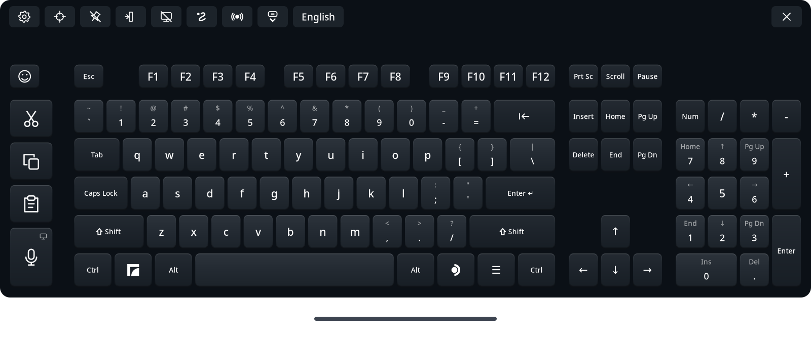

# Full Keyboard for Steam Frame

<p align="center"><a href="README.md">English</a> | <b>日本語</b> | <a href="README.zh-Hans.md">简体中文</a> | <a href="README.ru.md">Русский</a> | <a href="README.es.md">Español</a> | <a href="README.pt-BR.md">Português (Brasil)</a> | <a href="README.de.md">Deutsch</a> | <a href="README.fr.md">Français</a></p>

Steam Frame に標準で入っている仮想キーボードの代わりに使える、フルサイズのキーボードです。ヘッドセットで毎日使うことを考えて作りました。矢印キー、テンキー、Ctrl・Alt、専用の切り取り（Cut）・コピー（Copy）・貼り付け（Paste）キーに加えて、スワイプ入力、音声入力、絵文字に対応し、47 言語で使えます。

**Full Keyboard は、初期状態では手動で起動します。** そのため、SteamOS のキーボードボタンでは元のキーボードが開きます。設定（Settings）→「連携」の **ネイティブキーボードを置き換え**（Replace native keyboard）をオンにすると、Full Keyboard の起動中は対応する入力要求がこちらに回ってきます。事前の準備は要りません。SteamOS がどの Frame でも Steam に用意しているローカル接続を使い、それが使えない場合は元のキーボードに戻ります。同じカードの **SteamOS と同時に起動**（Start with SteamOS）をオンにすると、ログイン時に置き換えモードのままバックグラウンドで起動し、呼び出すまで表示されません。詳しくは [native replacement](docs/native-replacement.md) を参照してください。

詳しいドキュメント（`docs/` 以下）は英語のみです。



## できること

- F1〜F12、ナビゲーションキー、矢印キー、非表示にできるテンキー、Ctrl、Alt、長押しでロックできる Shift を備えたフルサイズ配列です。
- Ctrl+X、Ctrl+C、Ctrl+V を送る専用の切り取り・コピー・貼り付けキーがあります。ターミナルでは Ctrl+Shift+C・Ctrl+Shift+V など、そのターミナル自身のキーを送ります。
- 音声入力：ヘッドセット上、または自分で用意した Whisper 音声サーバーで認識します。エディターで修正してから送信することも、**話しながら入力**（Type as I speak）でフレーズごとにアプリへ直接入力することもできます。詳しくは[音声入力](#音声入力)を参照してください。
- スワイプ入力（初期状態ではオフ）：英語、ドイツ語、フランス語、スペイン語、イタリア語、ポルトガル語、ポーランド語、オランダ語、スウェーデン語、ウクライナ語、ロシア語、中国語ピンインに対応しています。スワイプ入力には「FUTO Swipe」の技術を使っています。
- 入力補完（初期状態ではオン）：スワイプ入力に対応した言語で、入力中の単語の候補を最大 5 つ表示します。よく使う単語ほど上に出ます。
- Mozc で日本語を変換します。入力中から変換候補が出ます。スマートフォン風の 12 キーフリック入力もあります。
- **下に引いて Shift**（初期状態ではオフ）：キーを下に引くと Shift 側の文字を入力できます。たとえば 6 のキーで ^、スワイプ入力がオフなら英字の大文字です。
- 最近使った絵文字、ドラッグ＆ドロップで並べられるお気に入り、カテゴリー、肌の色を備えた絵文字ピッカーがあります。
- **アプリの上で開いたままにする**（Stay open over apps）：ダッシュボードを閉じてもキーボードがその場に残り、空間に浮かぶウィンドウに入力できます。浮いているウィンドウを指せば、SteamVR のレーザーでクリックもできます。
- **フォーカスモード**（Focus mode）：標準キーボードの置き換えと組み合わせると、入力欄が閉じてもキーボードが出たままになり、次の入力欄やアプリにそのまま入力できます。見えていないウィンドウに入力しそうなときは警告します。
- コントローラーのレーザーで入力します。キーを押したときと指したときにコントローラーが振動し、キー音（6 種類から選択、オフにもできます）も使えます。
- キーボード下のハンドルを使うか、キーボードをつかんで移動できます。左右どちらの下隅からでもサイズを変えられ、ピン留めもできます。移動したあとは **自動水平調整**（Auto leveling）が傾きを直します。
- ダッシュボードに追従し、位置を保存します。アプリをもう一度起動すれば、手元に呼び戻せます。
- ライト、ダーク、ハイコントラストを合わせて 13 のテーマと、背景を透けさせる「背景」（Background）設定があります。配列・言語・テーマは編集できる JSON ファイルで、VR 内の設定メニューから選べます。
- 標準キーボードの置き換え（任意）、SteamOS と一緒に起動する設定、自動ロールバック付きのアプリ内アップデートに対応しています。
- 別の Steam Frame 用シェルがキーボードを組み込めるようにする、実験的な連携プロトコル（起動・配置・スタイル・アップデート）もあります。詳しくは [shell integration](docs/integration.md) を参照してください。
- 英語、スペイン語、中国語（簡体字・繁体字）、日本語、ドイツ語、フランス語、ポルトガル語、韓国語、アラビア語、イタリア語、ヒンディー語、ロシア語、トルコ語、インドネシア語、ポーランド語、オランダ語、ベトナム語、タイ語、ウクライナ語、スウェーデン語、フィンランド語、デンマーク語、ノルウェー語、チェコ語、ハンガリー語、ルーマニア語、ギリシャ語、スロバキア語、ヘブライ語、クロアチア語、スロベニア語、マレー語、エストニア語、ラトビア語、リトアニア語、ブルガリア語、カタルーニャ語、セルビア語、ペルシャ語、フィリピノ語、アイスランド語、ジョージア語、アルメニア語、カザフ語、アゼルバイジャン語、マケドニア語、アルバニア語に対応しています。それぞれ標準の国別配列で、多くの言語には地域別の配列や別配列もあります。中国語は簡体字と繁体字のピンイン、繁体字では注音・倉頡・速成にも対応しています。韓国語は 2 ボル式ハングルです。


*スワイプ入力、日本語入力、音声入力、絵文字ピッカー、設定画面。Steam Frame 上で、以前のバージョンの Full Keyboard を使って録画しました。*

## ユーザー権限でインストール、追加の手順は不要

- **sudo も root 権限も管理者パスワードも不要。** Full Keyboard は自分のユーザー権限でホームフォルダーにインストールされます。Frame にパスワードを設定したり、開発者モードをオンにしたりする必要はありません。
- **手動インストールは最初の 1 回だけ。あとはアプリ内でアップデート。** 初回インストール後は、設定画面が新しいバージョンを見つけてボタンひとつでインストールします。新しいバージョンが起動しなければ、元のバージョンに戻します。
- **入れればすぐ使える。** インストールしてすぐに入力でき、**ネイティブキーボードを置き換え** も事前の準備は要りません。SteamOS がどの Frame でも Steam に用意しているローカル接続を使います。
- **再起動や SteamOS のアップデート後もそのまま。** **SteamOS と同時に起動** をオンにすると、起動のたびにバックグラウンドで非表示のまま起動します。SteamOS のアップデートはホームフォルダーに手を付けないので、キーボードも設定も残ります。
- **システムに手を加えません。** Steam や SteamOS のファイル、設定、システムサービス、デバイスの権限を一切変更しません。置き換えで Steam のキーボードにフックするのは Full Keyboard の起動中だけで、Full Keyboard が止まれば Steam 本来のキーボードが自動で戻ります。
- **メモリとバッテリーにやさしい。** 機能は使っている間だけ読み込み、使い終わればメモリから外します。日本語変換は日本語を追加している間だけ動き、音声入力のエンジンは最初に音声入力したときに起動して音声入力をオフにすると終了します。スワイプのモデルはスワイプ入力をオフにすると解放され、入力補完の単語リストは入力を始めると読み込まれて 5 分間入力がなければ解放され、絵文字ピッカーは閉じると画像を解放します。描き直すのは変化したキーだけで、非表示のときやヘッドセットを外しているときは 1 秒に 4 回まで更新を減らします。
- **クリップボードを読みません。** 切り取り・コピー・貼り付けはショートカットを押すだけです。入力した文字はクリップボードを経由せず、テキストとしてアプリに直接届きます。クリップボードに書き込むのは、音声入力か「KDE の Unicode」（KDE Desktop Unicode）で「貼り付け」を選んだときだけです。

## 使える場所

Full Keyboard は**ヘッドセット上での利用**のために作られています。Frame のダッシュボード、Steam の入力欄、Frame 上で動くアプリ（デスクトップアプリや空間に浮かぶウィンドウを含む）で使えます。入力欄を選んでから、コントローラーのレーザーで入力してください。

通常、キーボードはダッシュボードの中にあり、ダッシュボードを閉じると隠れ（押していたキーも解除され）、開き直すと戻ってきます。ダッシュボードを閉じたあとも空間に残しておきたいときは、ピンの隣の **アプリの上で開いたままにする** をオンにしてください。どちらのコントローラーでもキーを指してトリガーを引けば入力でき、それぞれの狙っている位置に点が表示されます。「ネイティブキーボードを置き換え」がオンなら、空間にピン留めしたウィンドウがキーボードを要求したとき、その場で自動的に Full Keyboard が開きます。

入力できるのは Frame 上で動くアプリと、Moonlight でストリーミングしている PC のアプリやゲームです（[ストリーミング](docs/streamed-games.md)）。**VRChat など、Steam Link で PC からストリーミングしている VR アプリ用のキーボードではありません。**

各リリースは開発用 PC と Frame の両方で自動テストを通し、ダッシュボード、Steam の入力欄、デスクトップアプリ、浮かぶウィンドウでの動作をヘッドセットで確認しています。それでも、フォーカスの取り方、米国以外のキーマップ、入力メソッドの扱いはアプリによって異なります。[既知の制限とトラブルシューティング](docs/runtime.md)を参照してください。日本語・中国語・韓国語に堪能な方からのフィードバックは特に歓迎します。Steam Frame がなくても、Linux PC の[デスクトップシミュレーター](docs/simulator.md)で試せます。

## 手動インストール

リリースパッケージの導入に、AI ツール、コンパイル、`sudo`、SteamOS への書き込み権限は要りません。

1. **Steam Frame** のブラウザーで [GitHub の Releases ページ](https://github.com/TaiKeid/steam-frame-full-keyboard/releases)を開き、リリースのアセットから `framekeyboard-0.15.0-aarch64.tar.gz` と `SHA256SUMS` を **Downloads** フォルダーにダウンロードします。GitHub が自動で作るソースコードのアーカイブはダウンロードしないでください。
2. Frame のデスクトップ環境でターミナルを開き、次を実行します。

   ```sh
   cd ~/Downloads
   sha256sum -c SHA256SUMS
   tar -xzf framekeyboard-0.15.0-aarch64.tar.gz
   cd framekeyboard-0.15.0-aarch64
   bash install.sh
   ```

   チェックサムが `OK` と表示された場合だけ先に進んでください。新しいバージョンでは、そのアーカイブ名と展開されたフォルダー名に置き換えてください。
3. Frame のダッシュボードに戻り、アプリランチャーから **Full Keyboard** を開きます。ターミナルから起動することもできます。

   ```sh
   ~/.local/bin/framekeyboard
   ```

インストーラーは **Full Keyboard** という名前のデスクトップアプリ項目を追加します。Steam のライブラリにもショートカットが欲しい場合は、Steam の **Add a Non-Steam Game**（Steam 以外のゲームを追加）から Full Keyboard を選んでください。手動で作ったショートカットの名前は自動では変わらないため、古い FrameKeyboard のショートカットは必要に応じてプロパティで名前を変えてください。

すべてホームフォルダーの下にインストールされます。インストーラーは設定とカスタムプロファイルを残したまま現在のリリース版を入れ替え、自動起動を有効にしたり Steam のファイルを変更したりはしません。開発用のデプロイや、マークのない古いリリースフォルダーも残します。内部のファイル名とコマンドは `framekeyboard` のままです。

キーボードは数時間ごとに新しい安定版を確認し、見つかると設定ボタンに点を付けます。アップデートするには、設定を開いて上部中央の **アップデートをダウンロードしてインストール**（Download and install update）を押します。今すぐ確認したいときは、同じ場所の **アップデートを確認**（Check for updates）を押してください。キーボードはアーカイブを検証してインストールし、設定を残したまま再起動します。古いリリース版は、新しいバージョンが正常に起動したことを確認してから削除されます。起動に失敗した場合は自動で元に戻ります。詳しくは [updates](docs/updates.md) を参照してください。

アンインストールするには `bash ~/.local/share/framekeyboard/current/uninstall.sh` を実行します。キーボードと補助プロセスを止め、アプリ、起動用サービス、ランチャー、メニュー項目を削除します。設定は残りますが、`--purge` を付けると設定も削除します。以降は Steam のキーボードが使われます。詳しくは [rollback and removal](docs/runtime.md#update-rollback-and-removal) を参照してください。

手動でアップデートする場合は、先に Full Keyboard を終了してください。ネイティブキーボードの置き換えを使っているときは、設定 →「Full Keyboard を終了」（Quit Full Keyboard）で終了します。新しいリリースのアセットをダウンロードし、インストール手順を繰り返してください。インストーラーは同じバージョンの再インストールや古いバージョンへの入れ替えにも対応していますが、Full Keyboard の起動中は実行を拒否します。手動でのロールバックは、古いリリースパッケージを入れ直すことを指します。[rollback and removal](docs/runtime.md#update-rollback-and-removal) を参照してください。

## 使い方

| 操作 | 方法 |
| --- | --- |
| 入力する | キーを指して、コントローラーのトリガーを引く |
| ショートカットを使う | Ctrl、Alt、Shift をタップしてから別のキーを押す。または片方のコントローラーで修飾キーを押さえたまま、もう片方でキーを押す |
| Super キーのショートカット | 左の Frame アイコンをタップしてからキーを押す。または、もう片方のコントローラーで押さえたままにする |
| デスクトップのアプリメニュー | 右の SteamOS アイコンをタップすると、右 Super キーの押下・解放を送る。何が起きるかはデスクトップ側の設定による |
| タップした修飾キーを解除する | もう一度タップする |
| Shift をロックする | Shift を 0.5 秒長押しする。もう一度押すと解除 |
| 単語をスワイプする | 設定の「言語とレイアウト」カードで **スワイプ入力**（Swipe typing）をオンにし、トリガーを引いたまま文字をなぞる。ほかの候補はツールバーに出る |
| 単語を補完する | 単語の最初の文字を入力すると、ツールバーに候補が最大 5 つ出る。選ぶと残りの文字とスペースが入力される |
| 下に引いて Shift 側の文字を入力する | 設定の「言語とレイアウト」カードで **下に引いて Shift** をオンにし、キーを下に引いてから離す。6 なら ^、スワイプ入力がオフなら k で K |
| 切り取り・コピー・貼り付け | 左側の切り取り・コピー・貼り付けキーを使う。切り取りとコピーは、先に文字を選択しておく |
| 音声入力する | 切り取り・コピー・貼り付けの下のマイクキーを押して話す。フレーズはファンクションキーの位置に出るエディターに表示されるので、キーで修正してから **送信**（Send）を押してアプリに入力する。Esc で聞き取りを止める |
| 話しながら入力 | 設定の **音声入力**（Dictation）カードでオンにする。マイクキーを押すと、キーボードはそのままで聞き取り、フレーズごとにアプリへ入力する |
| 絵文字を入力する | 左上のスマイルキーを押す。グリッドはドラッグかサムスティックでスクロールし、上のカテゴリーを選んで、絵文字の上でトリガーを離すと入力される。肌の色がある絵文字は長押しで色を選ぶ。「最近使用」（Recent）の絵文字を長押しして「お気に入り」（Favorites）にドラッグすると保存できる。左上の矢印キーでキーボードに戻る |
| 移動・回転する | ピン留めを外し、キーボード下の線を指してトリガーを引いたまま手を動かし、離す |
| ヘッドセットのカーソルを使う | AUX を押すと頭の向きのカーソルが出る。頭でキーを狙って AUX でクリックする。移動用の線の上で AUX を押さえたままにするとキーボードを動かせる |
| つかんで移動する | **一般**（General）カードで **つかんで移動**（Grab to move）をオンにして適用する。キーボードのどこかを指してグリップを握ると、同じ手のサムスティックで奥行きを調整できる |
| うっかり動かさないようにする | ピンアイコンを切り替える。ピン留めしていてもダッシュボードには追従する |
| ダッシュボードなしで出したままにする | ピンアイコンの隣の **アプリの上で開いたままにする** を切り替える |
| 入力欄の間で出したままにする | 「ネイティブキーボードを置き換え」がオンのとき、「アプリの上で開いたままにする」の隣のウィンドウアイコン **フォーカスモード** を切り替える。入力欄が閉じてもキーボードはその場に残り、次に選んだ入力欄に入力する。それ以外はキーボードフォーカスのあるアプリに入力する。× かキーボードボタンで隠せる |
| 切り替える言語を追加する | 設定 → **追加の言語**（Additional languages）を開き、言語をタップするかドラッグしてリストに入れる |
| 言語を切り替える | ツールバーの一番最後にある言語ボタンを押す |
| 遠ざける・近づける | 移動用の線を押さえているかつかんでいる間に、同じコントローラーのサムスティックを上・下に倒す |
| サイズを変える | ピン留めを外し、どちらかのコントローラーのレーザーをキーボード下隅のすぐ外に向ける。浮かび上がるリサイズ用の角でトリガーを引いたままドラッグすると、キーボードが中心を基準に大きく・小さくなる |
| テンキーを隠す | 設定で「一般」→「テンキーを隠す」をオンにし、「適用して保存」を押す |
| キーボードの向こうを見る | 設定で「一般」→「背景」を「半透明」か「非表示」にして、「適用して保存」を押す |
| 配列・言語・テーマを変える | 歯車アイコンを開いてプロファイルを選び、**適用して保存**（Apply and save）を押す |
| 位置をリセットする | 再センタリングのアイコンを使うか、Full Keyboard をもう一度起動する |
| 閉じる | 置き換えモードでは × でパネルを隠す。それ以外では × でアプリが終了する |
| 置き換えモードを終了する | 設定 →「Full Keyboard を終了」を押す |

**キーボードが手の届かない所へ行ってしまったら、アプリをもう一度起動してください。** すでに起動していれば、2 つ目を開く代わりに、今のダッシュボードの下へキーボードを呼び戻します。サイズはそのままです。ダッシュボードが閉じている場合は、開くまで待ってから呼び戻します。

閉じて開き直すと、前回の位置、向き、サイズ、Num Lock の状態が戻ります。ダッシュボードを動かしたり傾けたりすると、キーボードも一緒に動きます。「一般」で初期状態からオンの **自動水平調整** は、移動したあとにわずかに傾いたキーボードをまっすぐに直します。

## 言語とカスタマイズ

設定で言語を選び、**適用して保存** を押します。キーボードはシステムのキー配列とは関係なく、選んだ配列どおりの文字を送ります。Shift、Caps Lock、AltGr、デッドキーによるアクセント記号も含みます。SteamOS 側で配列を合わせたり再起動したりする必要はありません。新規インストールでは英語になり、次回からは保存した選択が使われます。**追加の言語** に配列と言語の組み合わせを追加すると、ツールバーから切り替えられます。詳しくは [language setup and switching](docs/languages.md) を参照してください。

日本語は、設定の「言語」で **日本語 ローマ字**（Romaji）、**日本語 かな**（Kana）、**日本語 JIS**（JIS）のいずれかを選ぶか、スマートフォン風のフリック入力なら **Japanese flick** 配列を選びます。ローマ字・かな・フリックでは、キーボード内で読みを入力し、Full Keyboard に同梱の Mozc で漢字に変換します。Mozc が使えないときはシステムの Anthy で変換します。変換候補は入力中から出ます。Space で変換、Enter で確定し、もう一度 Enter を押すと通常の Enter キーを送ります。JIS モードには、システムにすでに設定された IME が必要です。詳しくは [Japanese input](docs/japanese.md) を参照してください。

中国語と韓国語はキーボード内で文字を組み立てるので、システムの配列を変えずに、英語や日本語と並べて選べます。韓国語は 2 ボル式ハングルで、PC と同じように次の音節を打ち始めた時点で前の音節を確定します。右 Alt の位置にある 한/영 でアルファベットに切り替えられます。[language guide](docs/languages.md#chinese-and-korean-composition) で、変換候補、ハングル、入力の制限について説明しています。

同梱の JSON プロファイルを `~/.local/share/framekeyboard/current/share/framekeyboard/` から次の対応するフォルダーにコピーして編集し、設定の **設定を再読み込み**（Reload config）アイコンを押します。

```text
~/.config/framekeyboard/layouts/
~/.config/framekeyboard/languages/
~/.config/framekeyboard/themes/
```

新しい選択肢を追加するにはプロファイルに新しい `id` を、同梱のものを上書きするには同じ `id` を付けます。フィールド、お気に入り、検証、保存される位置については [configuration reference](docs/configuration.md) を参照してください。

## 音声入力

設定 → **音声入力** でモードを選び、**適用して保存** を押します。

- **デバイス上**（On device、初期設定）：小さな多言語 Whisper モデルで、Steam Frame 上で音声を認識します。モデル（264 MB）は確認後に一度だけダウンロードされます。英語とスペイン語が最も正確で、ほかの言語は精度が下がります。
- **セルフホスト**（Self-hosted）：同じネットワーク上の PC で動かす Whisper サーバーに音声を送ります。どの言語でもより速く、より正確です。[speech server setup](docs/speech-server.md) で Linux、macOS、Windows での設定を説明していますが、確認済みなのは Linux の手順だけです。**テスト**（Test）で接続を確認でき、**デバイス認識で代替**（Fall back to on device）をオンにするとサーバーにつながらないときにヘッドセットで認識します。
- **オフ**（Off）：マイクキーを隠します。

音声入力は、同梱のすべての言語（日本語 JIS を除く）で使えます。マイクキーの小さなアイコンで、どこで認識しているかがわかります。ヘッドセットのアイコンは Frame 本体、PC のアイコンは自分のサーバーです。聞き取りを始めるとコントローラーが軽く振動し、止めると脈打つように振動します。

プライバシー：

- 「デバイス上」では、音声が Frame の外に出ることはありません。「セルフホスト」では、音声は設定したサーバーにだけ、それも音声入力中か「テスト」を押したときだけ送られます。`host:port` のままのアドレスは暗号化されないので、サーバーは自分のネットワーク内に置いてください。ローカルでないアドレスには設定画面が警告を出します。
- 音声と文字はメモリ上にだけ置かれます。日本語の[学習](docs/japanese.md#learning)が記録するフレーズと、[入力補完](docs/configuration.md#typing-suggestions)が数える単語を除き、話した内容や入力した内容は記録も保存もされません。パスワード、PIN、ターミナル用と示された入力欄からは何も記録しません。
- ヘッドセットを外したとき、スリープから復帰したとき、60 秒間無音が続いたときは、すぐに聞き取りを止めます。
- マイクは周りの人の声も拾います。ゲーム中はゲームの音を拾うこともあり、そのときは聞き取り中にメッセージで知らせます。

詳しくは [dictation](docs/dictation.md) を参照してください。

## 仕組み

キーボードはネイティブの C++20 アプリです。Cairo/Pango でキーを描き、Vulkan/OpenVR でパネルを表示し、libei で Frame のローカルの Gamescope コンポジターに操作を送ります。機能を確認したうえで Gamescope のテキスト入力プロトコルを使い、選んだ配列から決まる文字を送ります。日本語・中国語・韓国語で組み立てた文字もこの方法で送ります。ブラウザーは使いません。ネットに接続するのは、数時間ごとのアップデート確認と、指示されたときのアップデートのインストール、Frame 本体の音声モデルの初回ダウンロード、自分で設定した音声サーバーとの通信のときだけです。

切り取り・コピー・貼り付けはショートカットを送るだけで、アプリがクリップボードの内容を読むことはありません。クリップボードに書き込むのは、音声入力の **送信** か「入力」→ **KDE の Unicode** を **貼り付け** にしたときだけで、そのあと Ctrl+V（ターミナルではそのターミナル自身の貼り付けキー）で貼り付けます。入力した文字を記録したり、変換の履歴を保存したりはしません（日本語の[学習](docs/japanese.md#learning)と[入力補完](docs/configuration.md#typing-suggestions)が記録するものを除く）。絵文字ピッカーは最近使った絵文字とお気に入りを Frame 本体に保存し、クリア（Clear）で最近使った絵文字を消せます。配置とプロファイルの設定も Frame 本体に保存されます。

表示中のパネルは、目標 60 Hz で入力を確認し、ダッシュボードに追従します。非表示のときやヘッドセットを外しているときは 4 Hz に落とします。テクスチャを描き直すのは、表示が変わったときかキーのアニメーション中だけです。置き換えを有効にしている場合、パネルを閉じても次の入力要求に備えてアプリは常駐し、設定 →「Full Keyboard を終了」で終了します。置き換えがオフなら、キーボードを閉じるとプロセスも終了します。バッテリーへの影響はまだ計測していません。

## 開発とフィードバック

- [ソースからのビルド](docs/building.md)
- [デスクトップシミュレーター](docs/simulator.md)：Linux PC のウィンドウでキーボードを動かし、専用の入力欄に入力できます
- [アーキテクチャとコードの構成](docs/architecture.md)
- [実行時の動作とトラブルシューティング](docs/runtime.md)
- [手動での受け入れ確認](docs/acceptance.md)
- [ロードマップ](docs/plan.md)と[変更履歴](CHANGELOG.md)
- [コントリビュートと不具合の報告](CONTRIBUTING.md)
- [リリースのチェックリスト](docs/releasing.md)
- [サードパーティのコードと SteamOS の依存関係の保守](docs/upkeep.md)
- [サードパーティのコードとライセンス](third_party/README.md)

リンク先のドキュメントは英語です。不具合を報告するときは、アプリのバージョン、SteamOS のバージョン、問題が起きたアプリ、デスクトップのウィンドウか浮かぶウィンドウか、再現手順を書いてください。スクリーンショットやログからは個人的な内容を消してください。

## ライセンス

プロジェクトのコードは [MIT License](LICENSE) で公開しています。同梱のコンポーネントは、それぞれの[上流のライセンス](third_party/README.md)に従います。

## AI 生成プロジェクトについて

このプロジェクトはすべて AI によって生成されています。作者は C++ に詳しくないため、ご理解とご容赦をお願いします。不具合や粗い部分はあると思います。丁寧なレビュー、わかりやすい不具合報告、コントリビュートを歓迎します。サードパーティのコンポーネントは、元の作者とライセンスに従います。

インターフェースの翻訳も AI によるものです。お使いの言語で不自然な表現があれば、修正を歓迎します。
