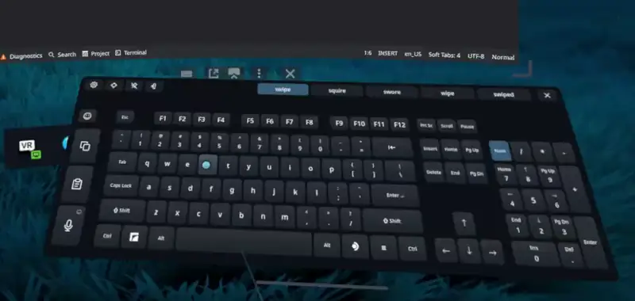

# Full Keyboard for Steam Frame

A full-size alternative to Steam Frame's built-in virtual keyboard, made for everyday use on the headset. It adds proper arrow keys, a numpad, Ctrl and Alt, and dedicated Copy and Paste buttons, plus swipe typing, dictation and emoji, in 37 languages.

**Full Keyboard is launched manually by default.** By default, SteamOS's keyboard button opens the original keyboard. The **Replace native keyboard** option in Settings → Integration redirects supported requests while Full Keyboard is running. It requires Steam Developer Mode and falls back to the original keyboard when unavailable. Enable **Start with SteamOS** in the same card to start replacement in the background at login. It stays hidden until summoned. See [native replacement](docs/native-replacement.md).



*Swipe typing, Japanese input, dictation, the emoji picker and Settings, recorded on Steam Frame.*

## What it does

- Full-size layout with F1–F12, navigation keys, arrow keys, a numpad you can hide, Ctrl, Alt, and a Shift that locks when held.
- Dedicated Copy and Paste keys that send Ctrl+C and Ctrl+V.
- Dictation: speak instead of typing, recognized on the headset or by your own Whisper speech server. Correct the text in an editor and send it, or let **Type as I speak** type each phrase straight into the app. See [dictation](#dictation).
- Swipe typing, off by default, for English, German, French, Spanish, Italian, Brazilian Portuguese, Polish, Dutch, Swedish, Ukrainian, Russian and Chinese Pinyin. Swipe typing is powered by "FUTO Swipe" technology.
- Phone-style flick keyboards: Japanese 12-key kana and Korean 12-key 천지인.
- An emoji picker with Recent, drag-and-drop Favorites, categories and skin tones.
- **Stay open over apps**: the keyboard stays in place when the dashboard closes, for typing into windows floating in the world; point at a floating window to click it with SteamVR's laser.
- **Focus mode**: with native replacement, the keyboard stays up when a text field closes, ready for the next field or app, and warns when it would type into a window you cannot see.
- Controller laser typing with haptic clicks and hover feedback.
- Move it with the handle below the keyboard or by grabbing it, resize it from either bottom corner, pin it in place, and let auto leveling straighten it after a move.
- Dashboard following, saved placement, and relaunch-to-recenter recovery.
- Twelve themes, light and dark, with a see-through Background option. Layouts, languages and themes are editable JSON files, chosen in a settings menu inside VR.
- Optional native keyboard replacement, start with SteamOS, and in-app updates with automatic rollback.
- An experimental integration protocol that lets alternative Steam Frame shells host the keyboard: launching, placing, styling and updating it. See [shell integration](docs/integration.md).
- English, Spanish, Simplified and Traditional Chinese, Japanese, German, French (France and Canada), Brazilian Portuguese, Korean, Arabic, Italian, Hindi, Russian, Turkish, Indonesian, Polish, Dutch, Vietnamese, Thai, Ukrainian, Swedish, Finnish, Danish, Norwegian, Czech, Hungarian, Romanian, Greek, Slovak, Hebrew, Croatian, Slovenian, Malay, Estonian, Latvian and Lithuanian, each on its standard national layout. Chinese has Simplified and Traditional Pinyin; Korean uses two-set Hangul or a 12-key 천지인 keyboard.

## Where it works

Full Keyboard is made for the **on-device experience**: the Frame dashboard, Steam's own text fields, and apps running on the Frame, including desktop apps and windows floating in the world. Focus a text field, then type with the controller laser.

Normally the keyboard lives in the dashboard: closing the dashboard hides it and releases its input, and reopening brings it back. Turn on **Stay open over apps**, beside the pin, to keep it in the world after the dashboard closes. Point either controller at a key and pull the trigger; a dot shows where each one aims. With Replace native keyboard on, a keyboard request from a window pinned in the world opens Full Keyboard there by itself.

It types only into apps running on the Frame. It is **not a keyboard for VR apps streamed from a PC, such as VRChat**.

Every release passes automated test suites on the development computer and on the Frame, and its features are checked in the headset across the dashboard, Steam's text fields, desktop apps and floating windows. Apps can still differ in how they take focus, non-US keymaps and input methods; see [known limitations and troubleshooting](docs/runtime.md). Feedback from fluent Japanese, Chinese and Korean users is especially welcome.

## Install manually

No AI tools, compilation, `sudo`, or SteamOS write access are needed for the release package.

1. On the **Steam Frame**, open the [GitHub Releases page](https://github.com/TaiKeid/steam-frame-full-keyboard/releases) in a browser. Download `framekeyboard-0.12.0-aarch64.tar.gz` and `SHA256SUMS` from the release assets into **Downloads**. Do not download GitHub's automatic source-code archive for this installation.
2. Open a terminal in the Frame's desktop environment and run:

   ```sh
   cd ~/Downloads
   sha256sum -c SHA256SUMS
   tar -xzf framekeyboard-0.12.0-aarch64.tar.gz
   cd framekeyboard-0.12.0-aarch64
   bash install.sh
   ```

   Continue only if the checksum reports `OK`. For a newer version, use its archive and extracted directory names.
3. Return to the Frame's dashboard and open **Full Keyboard** from the app launcher. You can also launch it from a terminal:

   ```sh
   ~/.local/bin/framekeyboard
   ```

The installer adds a desktop application entry named **Full Keyboard**. If you also want a Steam Library shortcut, use Steam's **Add a Non-Steam Game** option and select Full Keyboard. A manually created shortcut has its own name; rename an old FrameKeyboard shortcut in its Properties if needed.

Everything installs under your home directory. The installer preserves settings and custom profiles, replaces the current production release, and does not enable autostart or alter Steam files. Development deployments and older unmarked release directories are preserved. Internal filenames and commands remain `framekeyboard`.

To update from the installed keyboard, open Settings and press **Check for updates** at the top center. If a newer stable release is available, press **Download and install update**. The keyboard verifies the archive, installs it and restarts, preserving your settings. The old production release stays until the new one confirms a healthy start, then is removed. A failed start rolls back automatically. See [updates](docs/updates.md).

To uninstall, run `bash ~/.local/share/framekeyboard/current/uninstall.sh`. It stops the keyboard and its helpers, removes the app, its startup service, launcher and menu entry, and keeps your settings unless you add `--purge`. Steam's keyboard is used again. See [rollback and removal](docs/runtime.md#update-rollback-and-removal).

For a manual update, quit Full Keyboard first. With native replacement enabled, use Settings → Quit Full Keyboard. Download the new release assets and repeat the installation steps. The installer supports reinstalling the same version or installing an older one, and refuses while Full Keyboard is running. Manual rollback means reinstalling an older release package; see [rollback and removal](docs/runtime.md#update-rollback-and-removal).

## Use the keyboard

| Action | Control |
| --- | --- |
| Type | Point at a key and press the controller trigger |
| Use a shortcut | Tap Ctrl, Alt, or Shift, then another key; or hold the modifier with one controller and press a key with the other |
| Super shortcuts | Tap the left Frame icon, then a key, or hold it with the other controller |
| Desktop application menu | Tap the right SteamOS icon for a native right Super press/release; the desktop controls its action |
| Clear a tapped modifier | Tap it again |
| Lock Shift | Hold Shift for half a second; press it again to unlock |
| Swipe a word | Turn on **Swipe typing** in the Languages and Layouts settings card, then hold the trigger and draw across the letters. Other guesses appear in the toolbar |
| Copy / paste | Use the two icons on the left; select text first when copying |
| Dictate | Press the mic key below Copy and Paste and speak. Phrases appear in an editor in place of the function keys; correct them with the keys, then press **Send** to type the text into the app. Esc stops listening |
| Type as I speak | Turn it on in the **Dictation** settings card. The mic key then listens on the normal keyboard and types each phrase into the app |
| Type emoji | Press the smiley key at the top left. Scroll the grid by dragging or with the thumbstick, choose a category above it, and release the trigger on an emoji to type it. Hold a toned emoji to choose a skin tone. Hold an emoji in Recent and drag it into Favorites to keep it. The arrow key at the top left returns to the keyboard |
| Move / rotate | Unpin, point at the line below the keyboard, hold the trigger, move your hand, then release |
| Use the headset cursor | Press AUX to show the head cursor. Aim at keys with your head and click AUX; hold AUX on the movement line to move the keyboard |
| Use grab movement | Enable **Use Drag to Move** in the **General** settings card and apply. Point anywhere on the keyboard and hold grab/grip; the same hand's thumbstick adjusts depth |
| Prevent accidental movement | Toggle the pin icon; the keyboard still follows the dashboard |
| Keep it open without the dashboard | Toggle **Stay open over apps** beside the pin icon |
| Keep it open between text fields | With Replace native keyboard on, toggle **Focus mode**, the window icon beside Stay open over apps. The keyboard stays where it is when a field closes, types into the next field you select, and otherwise types into the app with keyboard focus; × or the keyboard button still hides it |
| Cycle favorite layouts and languages | Press the language abbreviation beside the pin icon |
| Move farther / closer | While holding the movement line or grabbing, push that same controller's thumbstick up / down |
| Change size | Unpin, aim either controller's laser just outside a bottom corner of the keyboard, then hold the trigger on the corner resizer that fades in and drag. The keyboard grows or shrinks around its center |
| Hide the numpad | In Settings, check General → Hide numpad and Apply and save |
| See behind the keyboard | In Settings, set General → Background to Semi-transparent or Invisible (or Disabled, which also lets the laser through the gaps) and Apply and save |
| Change layout, language, or theme | Open the gear icon, choose profiles, then **Apply and save** |
| Recenter | Use the recenter icon, or launch Full Keyboard again |
| Close | Use × to hide the panel in replacement mode; otherwise it exits the app |
| Quit replacement mode | Open Settings → Quit Full Keyboard |

**If the keyboard has drifted out of reach, launch the app again.** When it is already running, another launch recenters the existing keyboard beneath the current dashboard instead of opening a second one. Its size is preserved. If the dashboard is closed, recentering waits until it opens.

Closing and reopening restores the last position, rotation, size and Num Lock state. Moving or tilting the dashboard carries the keyboard with it. **Auto leveling**, on by default in General, straightens a slightly crooked keyboard after you move it.

## Languages and customization

Select a language in Settings and **Apply and save**. The keyboard sends characters from that layout independently of the system keyboard layout, including Shift, Caps Lock, AltGr and dead-key accents. No matching SteamOS layout or relaunch is needed. A fresh install defaults to English; later launches use your saved selection. Save layout and language pairs as favorites to switch between them from the toolbar. See [language setup and switching](docs/languages.md).

For Japanese, pick **Romaji**, **Kana**, or **JIS** from the Language dropdown in Settings, or the **Japanese flick 12-key** layout for phone-style flick input. Romaji, Kana and Flick compose text in the keyboard and use the system Anthy dictionary for kanji conversion. Space converts; Enter commits the composition. Another Enter sends a normal Enter key. JIS mode requires an existing system IME. See [Japanese input](docs/japanese.md).

Chinese and Korean compose locally and can be selected alongside English and integrated Japanese without a system layout change. Korean offers two-set Hangul or the **Korean 12-key (천지인)** layout, with flick shortcuts. [The language guide](docs/languages.md#chinese-and-korean-composition) explains candidates, Hangul, and input limitations.

Copy a bundled JSON profile from `~/.local/share/framekeyboard/current/share/framekeyboard/` into the matching folder below, edit it, then use the **Reload config** icon in Settings:

```text
~/.config/framekeyboard/layouts/
~/.config/framekeyboard/languages/
~/.config/framekeyboard/themes/
```

Use a new profile `id` to add a choice, or the same `id` to override a bundled one. [Configuration reference](docs/configuration.md) covers fields, favorites, validation, and saved placement.

## Dictation

Choose a mode in Settings → **Dictation**, then **Apply and save**:

- **On device**, the default, recognizes speech on the Steam Frame with a small multilingual Whisper model, downloaded once (264 MB) after you confirm. English and Spanish are the most accurate; other languages work with lower accuracy.
- **Self-hosted** sends speech to a Whisper server you run on a computer on your network, which is faster and more accurate in every language. [Speech server setup](docs/speech-server.md) covers Linux, macOS and Windows; only the Linux steps have been verified. **Test** checks the connection, and **Fall back to on device** uses the headset when the server cannot be reached.
- **Off** hides the mic key.

Dictation works in every bundled language except Japanese JIS. A small icon on the mic key shows where speech is recognized: a headset for on device, a computer for your server. The controller ticks when listening starts and pulses when it stops.

Privacy:

- On device, audio never leaves the Frame. Self-hosted, it goes only to the server you entered, and only while you dictate or press Test. A plain `host:port` address is unencrypted, so keep the server on your own network; Settings warns about addresses that are not local.
- Audio and text stay in memory only. Nothing you say or type is logged or saved.
- Listening stops as soon as you take the headset off or it wakes from sleep, and after 60 s of silence.
- The microphone hears everyone nearby. While a game runs, game sound may be picked up too, and the status line says so while listening.

See [dictation](docs/dictation.md) for the details.

## How it works

The keyboard is a native C++20 app. Cairo/Pango draw the keys, Vulkan/OpenVR display the panel, and libei sends native controls to the Frame's local Gamescope compositor. A feature-checked Gamescope text-input protocol sends characters resolved from the selected layout, including Japanese, Chinese and Korean composition. It does not run a browser. It goes online only to check for and install updates when you ask, to download the on-device speech model once, and to reach a speech server you set up.

Copy and Paste send shortcuts; the app never reads clipboard contents. It writes to the clipboard only when dictation's **Send** or General → **KDE Desktop Unicode** is set to **Paste**, and then pastes with Ctrl+V. It does not log typed text or save composition history; the emoji picker keeps your Recent and Favorites emoji locally, and Clear empties Recent. Placement and profile preferences are stored locally.

The visible panel polls input and follows the dashboard at a target 60 Hz. While hidden, polling drops to 4 Hz. It redraws the texture only when its display changes or a key animation runs. With replacement enabled, closing the panel keeps the app resident for the next native request; Settings → Quit Full Keyboard exits it. With replacement off, closing the keyboard exits the process. Battery impact has not been benchmarked.

## Development and feedback

- [Build from source](docs/building.md)
- [Architecture and code map](docs/architecture.md)
- [Runtime and troubleshooting](docs/runtime.md)
- [Manual acceptance checks](docs/acceptance.md)
- [Roadmap](docs/plan.md) and [changelog](CHANGELOG.md)
- [Contributing and bug reports](CONTRIBUTING.md)
- [Release checklist](docs/releasing.md)
- [Upkeep of third-party code and SteamOS dependencies](docs/upkeep.md)
- [Third-party code and licenses](third_party/README.md)

Please report the app version, SteamOS version, affected app, whether it is a desktop or floating window, and steps to reproduce. Remove private text from screenshots and logs.

## License

Project code is available under the [MIT License](LICENSE). Vendored components keep their [upstream licenses](third_party/README.md).

## AI-generated project disclaimer

This project is fully AI-generated. The author is unfamiliar with C++, so please have patience and understanding. Bugs and rough edges are expected; careful reviews, clear bug reports, and contributions are welcome. Third-party components retain their original authorship and licenses.
