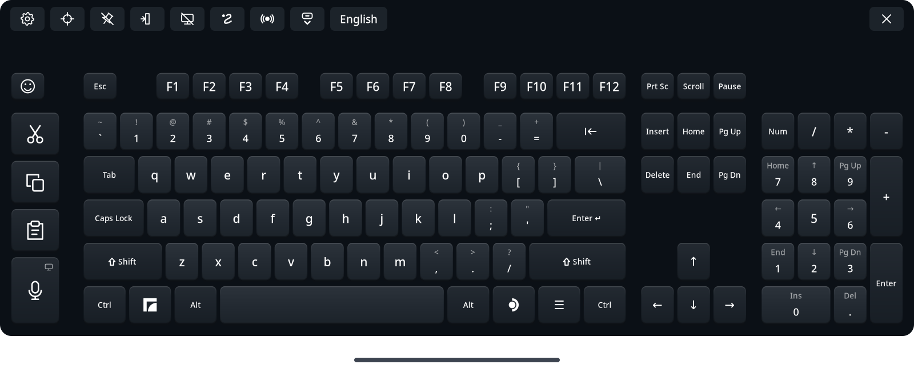

# Full Keyboard for Steam Frame

<p align="center"><a href="README.md">English</a> | <a href="README.ja.md">日本語</a> | <a href="README.zh-Hans.md">简体中文</a> | <a href="README.ru.md">Русский</a> | <a href="README.es.md">Español</a> | <b>Português (Brasil)</b> | <a href="README.de.md">Deutsch</a> | <a href="README.fr.md">Français</a></p>

Uma alternativa em tamanho completo ao teclado virtual integrado do Steam Frame, feita para o uso diário no headset. Ela traz setas de verdade, teclado numérico, Ctrl e Alt, e teclas próprias para Recortar, Copiar e Colar, além de digitação por deslize, ditado e emojis, em 47 idiomas.

**Após uma instalação manual, o Full Keyboard é aberto manualmente; o instalador pergunta se ele deve substituir o teclado nativo.** Por padrão, o botão de teclado do SteamOS abre o teclado original. A opção **Substituir teclado nativo** (Replace native keyboard), em Configurações → Integração, redireciona as solicitações compatíveis enquanto o Full Keyboard está em execução. Não é preciso configurar nada: ela usa uma conexão local que o SteamOS já oferece ao Steam em todo Frame e volta ao teclado original se ela ficar indisponível. Ative **Iniciar com o SteamOS** (Start with SteamOS) no mesmo cartão para iniciar a substituição em segundo plano ao entrar no sistema. O teclado fica oculto até ser chamado. Veja [substituição do teclado nativo](docs/native-replacement.md).



## Instalação rápida

<p align="center"><a href="https://github.com/TaiKeid/steam-frame-full-keyboard/releases/latest/download/Full_Keyboard_installer-aarch64.AppImage"></a></p>

1. Abra esta página no navegador do Steam Frame e baixe o instalador com o botão acima.
2. Abra a pasta onde ele foi salvo, normalmente **Downloads**, e clique duas vezes no instalador. O navegador não consegue abri-lo.
3. Quando perguntar se você quer abrir o arquivo, escolha sim, e quando perguntar se você confia nele, escolha sim também. Isso só acontece na primeira vez.
4. Siga os passos do instalador.

Para instalar pelo terminal, veja [Instalação manual](#instalação-manual).

## O que ele faz

- Layout em tamanho completo com F1–F12, teclas de navegação, setas, um teclado numérico que pode ser ocultado, Ctrl, Alt e um Shift que trava quando mantido pressionado.
- Teclas próprias de Recortar, Copiar e Colar que enviam Ctrl+X, Ctrl+C e Ctrl+V, ou as teclas próprias de um terminal, como Ctrl+Shift+C e Ctrl+Shift+V.
- Ditado: fale em vez de digitar, com reconhecimento no headset ou no seu próprio servidor de voz Whisper. Corrija o texto em um editor e envie, ou deixe **Digitar enquanto falo** (Type as I speak) digitar cada frase direto no app. Veja [ditado](#dictation).
- Digitação por deslize, desativada após uma instalação manual e à sua escolha no instalador, para inglês, alemão, francês, espanhol, italiano, português, polonês, holandês, sueco, ucraniano, russo, chinês pinyin e [mais 25 idiomas](docs/configuration.md#swipe-typing), do tcheco ao árabe e ao hebraico. A digitação por deslize usa a tecnologia "FUTO Swipe".
- Sugestões de digitação, ativadas por padrão, nos idiomas que têm digitação por deslize: até cinco formas de completar a palavra que você está digitando, com as que você mais usa primeiro.
- Conversão de japonês com o Mozc, com candidatos enquanto você digita, e um teclado flick japonês de 12 teclas no estilo dos celulares.
- **Puxar para Shift**, desativado após uma instalação manual e à sua escolha no instalador: puxe uma tecla para baixo para obter o caractere com Shift dela; por exemplo ^ na tecla 6, ou uma maiúscula enquanto a digitação por deslize está desativada.
- Um seletor de emojis com Recentes, Favoritos organizados arrastando, categorias e tons de pele.
- **Manter aberto sobre apps** (Stay open over apps): o teclado fica no lugar quando o painel fecha, para digitar em janelas flutuando no mundo; aponte para uma janela flutuante para clicar nela com o laser do SteamVR.
- **Modo de foco** (Focus mode): com a substituição nativa, o teclado continua aberto quando um campo de texto fecha, pronto para o próximo campo ou app, e avisa quando digitaria em uma janela que você não está vendo.
- Digitação com o laser do controle, com cliques hápticos e retorno ao passar o laser, além de sons de tecla opcionais com seis efeitos.
- Mova o teclado pela alça abaixo dele ou agarrando-o, redimensione-o por qualquer canto inferior, fixe-o no lugar e deixe o nivelamento automático endireitá-lo depois de mover.
- Acompanhamento do painel, posição salva e recuperação abrindo o app de novo para recentralizar.
- Treze temas, claros e escuros e um de alto contraste, com uma opção de Fundo transparente. Layouts, idiomas e temas são arquivos JSON editáveis, escolhidos em um menu de configurações dentro da RV.
- Substituição opcional do teclado nativo, início com o SteamOS e atualizações pelo app com reversão automática.
- Um protocolo de integração experimental que permite que shells alternativos do Steam Frame hospedem o teclado: abrindo, posicionando, estilizando e atualizando-o. Veja [integração com shells](docs/integration.md).
- Inglês, espanhol, chinês simplificado e tradicional, japonês, alemão, francês, português, coreano, árabe, italiano, hindi, russo, turco, indonésio, polonês, holandês, vietnamita, tailandês, ucraniano, sueco, finlandês, dinamarquês, norueguês, tcheco, húngaro, romeno, grego, eslovaco, hebraico, croata, esloveno, malaio, estoniano, letão, lituano, búlgaro, catalão, sérvio, persa, filipino, islandês, georgiano, armênio, cazaque, azerbaijano, macedônio e albanês, cada um no seu layout nacional padrão, com teclados regionais e alternativos para muitos deles. O chinês tem pinyin simplificado e tradicional, e o tradicional também tem zhuyin, cangjie e quick; o coreano usa hangul de dois conjuntos.


*Digitação por deslize, entrada em japonês, ditado, o seletor de emojis e Configurações, gravados no Steam Frame com uma versão anterior do Full Keyboard.*

## Instala como usuário, sem passos extras

- **Sem sudo, acesso root ou senha de administrador.** O Full Keyboard é instalado na sua pasta pessoal, com o seu próprio usuário. Você nunca precisa definir uma senha no Frame nem ativar o Modo Desenvolvedor.
- **Uma instalação, depois atualizações de dentro do app.** Após a primeira instalação, as Configurações encontram novas versões e as instalam com um botão, e voltam para a versão anterior se uma nova não conseguir iniciar.
- **Simplesmente funciona.** A digitação funciona assim que ele é instalado, e **Substituir teclado nativo** também não precisa de configuração: usa uma conexão local que o SteamOS já oferece ao Steam em todo Frame.
- **Sobrevive a reinicializações e atualizações do SteamOS.** Com **Iniciar com o SteamOS** ativado, ele inicia oculto em segundo plano após cada inicialização. As atualizações do SteamOS não mexem na sua pasta pessoal, então o teclado e suas configurações continuam lá.
- **Não é invasivo.** Ele não altera nenhum arquivo, configuração, serviço do sistema ou permissão de dispositivo do Steam ou do SteamOS. A substituição intercepta o teclado do Steam só enquanto o Full Keyboard está em execução e, se ele parar, o teclado do próprio Steam volta sozinho.
- **Leve na memória e na bateria.** Os recursos só são carregados enquanto você os usa e liberam a memória quando você para: a conversão de japonês e de chinês só roda enquanto o idioma está adicionado, o mecanismo de voz do ditado inicia quando você dita pela primeira vez e fecha quando o ditado é desativado, o modelo de deslize é descarregado quando a digitação por deslize está desativada, a lista de palavras das sugestões carrega enquanto você digita e é liberada após cinco minutos sem digitação, e o seletor de emojis libera suas imagens ao fechar. O teclado só redesenha as teclas que mudam e, enquanto está oculto ou o headset está desligado, cai para quatro atualizações por segundo.
- **Nunca lê sua área de transferência.** Recortar, Copiar e Colar só pressionam seus atalhos, e o texto chega aos apps como texto. O Full Keyboard só escreve na área de transferência quando você escolhe Colar para o ditado ou para Unicode no KDE.

## Onde funciona

O Full Keyboard é feito para a **experiência no próprio dispositivo**: o painel do Frame, os campos de texto do Steam e os apps rodando no Frame, incluindo apps de desktop e janelas flutuando no mundo. Selecione um campo de texto e digite com o laser do controle.

Normalmente o teclado vive no painel: fechar o painel oculta o teclado e libera sua entrada, e reabrir o traz de volta. Ative **Manter aberto sobre apps**, ao lado do alfinete, para mantê-lo no mundo depois que o painel fecha. Aponte qualquer um dos controles para uma tecla e puxe o gatilho; um ponto mostra para onde cada um está mirando. Com Substituir teclado nativo ativado, uma solicitação de teclado vinda de uma janela fixada no mundo abre o Full Keyboard ali mesmo.

Ele digita em apps rodando no Frame e em apps e jogos de PC transmitidos pelo Moonlight ([jogos por streaming](docs/streamed-games.md)). Ele **não é um teclado para apps de RV transmitidos de um PC pelo Steam Link**.

Cada versão passa por conjuntos de testes automáticos no computador de desenvolvimento e no Frame, e seus recursos são verificados no headset no painel, nos campos de texto do Steam, em apps de desktop e em janelas flutuantes. Ainda assim, os apps podem diferir em como recebem o foco, em mapas de teclado fora do padrão americano e em métodos de entrada; veja [limitações conhecidas e solução de problemas](docs/runtime.md). Comentários de usuários fluentes em japonês, chinês e coreano são especialmente bem-vindos. Sem um Steam Frame, você pode experimentar o teclado em um PC com Linux no [simulador de desktop](docs/simulator.md).

## Instalação manual

O pacote da versão não precisa de ferramentas de IA, compilação, `sudo` nem acesso de escrita ao SteamOS.

1. No **Steam Frame**, abra a [página de versões no GitHub](https://github.com/TaiKeid/steam-frame-full-keyboard/releases) em um navegador. Baixe `framekeyboard-0.17.0-aarch64.tar.gz` e `SHA256SUMS` dos arquivos da versão para **Downloads**. Não baixe o arquivo de código-fonte gerado automaticamente pelo GitHub para esta instalação.
2. Abra um terminal no ambiente de desktop do Frame e execute:

   ```sh
   cd ~/Downloads
   sha256sum -c SHA256SUMS
   tar -xzf framekeyboard-0.17.0-aarch64.tar.gz
   cd framekeyboard-0.17.0-aarch64
   bash install.sh
   ```

   Continue somente se a soma de verificação informar `OK`. Para uma versão mais nova, use os nomes do arquivo e do diretório extraído dela.
3. Volte ao painel do Frame e abra o **Full Keyboard** pelo inicializador de apps. Você também pode abri-lo por um terminal:

   ```sh
   ~/.local/bin/framekeyboard
   ```

A instalação adiciona uma entrada de aplicativo de desktop chamada **Full Keyboard**. Se você também quiser um atalho na Biblioteca do Steam, use a opção **Adicionar um jogo não Steam** (Add a Non-Steam Game) do Steam e selecione o Full Keyboard. Um atalho criado manualmente tem um nome próprio; se precisar, renomeie um atalho antigo do FrameKeyboard nas Propriedades dele.

Tudo é instalado dentro do seu diretório pessoal. O `install.sh` preserva as configurações e os perfis personalizados, substitui a versão de produção atual e não ativa a inicialização automática nem altera arquivos do Steam. Instalações de desenvolvimento e diretórios de versões antigas sem marcação são preservados. Os nomes de arquivo e os comandos internos continuam sendo `framekeyboard`.

O teclado procura uma nova versão estável a cada poucas horas e coloca um ponto no botão de Configurações quando há uma. Para atualizar, abra as Configurações e pressione **Baixar e instalar atualização** no topo, ao centro, ou **Verificar atualizações** no mesmo lugar para verificar agora. O teclado verifica o arquivo, instala e reinicia, preservando suas configurações. A versão de produção anterior permanece até a nova confirmar que iniciou corretamente e então é removida. Uma falha ao iniciar é revertida automaticamente. Veja [atualizações](docs/updates.md).

Para desinstalar, execute `bash ~/.local/share/framekeyboard/current/uninstall.sh`. Ele encerra o teclado e seus processos auxiliares, remove o app, seu serviço de inicialização, o inicializador e a entrada do menu, e mantém suas configurações, a menos que você adicione `--purge`. O teclado do Steam volta a ser usado. Veja [reversão e remoção](docs/runtime.md#update-rollback-and-removal). O botão **Desinstalar** do instalador faz o mesmo e pergunta se você quer manter suas configurações.

Para uma atualização manual, feche primeiro o Full Keyboard. Com a substituição nativa ativada, use Configurações → Sair do Full Keyboard. Baixe os arquivos da nova versão e repita os passos de instalação. O `install.sh` permite reinstalar a mesma versão ou instalar uma mais antiga, e se recusa a continuar enquanto o Full Keyboard está em execução. O instalador também reinstala, e antes fecha o Full Keyboard se estiver em execução. Reverter manualmente significa reinstalar o pacote de uma versão mais antiga; veja [reversão e remoção](docs/runtime.md#update-rollback-and-removal).

## Usar o teclado

| Ação | Controle |
| --- | --- |
| Digitar | Aponte para uma tecla e pressione o gatilho do controle |
| Usar um atalho | Toque em Ctrl, Alt ou Shift e depois em outra tecla; ou segure o modificador com um controle e pressione uma tecla com o outro |
| Atalhos com Super | Toque no ícone do Frame à esquerda e depois em uma tecla, ou segure-o com o outro controle |
| Menu de aplicativos do desktop | Toque no ícone do SteamOS à direita para um pressionar e soltar nativo do Super direito; o desktop decide a ação |
| Cancelar um modificador tocado | Toque nele de novo |
| Travar o Shift | Segure o Shift por meio segundo; pressione-o de novo para destravar |
| Deslizar uma palavra | Ative **Digitação por deslize** no cartão de configurações Idiomas e layouts, depois segure o gatilho e desenhe sobre as letras. Outras sugestões aparecem na barra de ferramentas |
| Completar uma palavra | Digite o começo; até cinco opções aparecem na barra de ferramentas. Escolha uma para digitar o resto e um espaço |
| Puxar para caracteres com Shift | Ative **Puxar para Shift** no cartão de configurações Idiomas e layouts, depois puxe uma tecla para baixo antes de soltar: 6 dá ^, e com a digitação por deslize desativada k dá K |
| Recortar / copiar / colar | Use as teclas Recortar, Copiar e Colar à esquerda; selecione o texto antes de recortar ou copiar |
| Ditar | Pressione a tecla do microfone abaixo de Recortar, Copiar e Colar e fale. As frases aparecem em um editor no lugar das teclas de função; corrija-as com as teclas e pressione **Enviar** para digitar o texto no app. Esc para de ouvir |
| Digitar enquanto falo | Ative no cartão de configurações **Ditado**. A tecla do microfone passa a ouvir no teclado normal e digita cada frase no app |
| Digitar emojis | Pressione a tecla da carinha no canto superior esquerdo. Role a grade arrastando ou com o direcional analógico, escolha uma categoria acima dela e solte o gatilho sobre um emoji para digitá-lo. Segure um emoji com tons para escolher o tom de pele. Segure um emoji em Recentes e arraste-o para Favoritos para guardá-lo. A tecla de seta no canto superior esquerdo volta ao teclado |
| Mover / girar | Desafixe, aponte para a linha abaixo do teclado, segure o gatilho, mova a mão e solte |
| Usar o cursor do headset | Pressione AUX para mostrar o cursor de cabeça. Mire nas teclas com a cabeça e clique com AUX; segure AUX sobre a linha de movimento para mover o teclado |
| Usar o movimento por agarre | Ative **Agarrar para mover** no cartão de configurações **Geral** e aplique. Aponte para qualquer lugar do teclado e segure o grip; o direcional analógico da mesma mão ajusta a distância |
| Evitar movimentos acidentais | Ative o ícone de alfinete; o teclado continua acompanhando o painel |
| Mantê-lo aberto sem o painel | Ative **Manter aberto sobre apps** ao lado do ícone de alfinete |
| Mantê-lo aberto entre campos de texto | Com Substituir teclado nativo ativado, ative o **Modo de foco**, o ícone de janela ao lado de Manter aberto sobre apps. O teclado fica onde está quando um campo fecha, digita no próximo campo que você selecionar e, fora isso, digita no app que tem o foco do teclado; × ou o botão de teclado ainda o ocultam |
| Adicionar idiomas para alternar | Abra Configurações → **Idiomas adicionais** e toque ou arraste idiomas para a lista |
| Alternar entre seus idiomas | Pressione o botão de idioma, o último dos botões da barra de ferramentas |
| Afastar / aproximar | Enquanto segura a linha de movimento ou agarra o teclado, empurre o direcional analógico desse mesmo controle para cima / para baixo |
| Mudar o tamanho | Desafixe, mire o laser de qualquer controle logo fora de um canto inferior do teclado, segure o gatilho na alça de canto que aparece e arraste. O teclado cresce ou encolhe em torno do centro |
| Ocultar o teclado numérico | Nas Configurações, marque Geral → Ocultar teclado numérico e use Aplicar e salvar |
| Ver atrás do teclado | Nas Configurações, defina Geral → Fundo como Semitransparente ou Invisível e use Aplicar e salvar |
| Mudar layout, idioma ou tema | Abra o ícone de engrenagem, escolha os perfis e depois **Aplicar e salvar** |
| Recentralizar | Use o ícone de recentralizar ou abra o Full Keyboard de novo |
| Fechar | Use × para ocultar o painel no modo de substituição; caso contrário, ele fecha o app |
| Sair do modo de substituição | Abra Configurações → Sair do Full Keyboard |

**Se o teclado se afastou para fora do seu alcance, abra o app de novo.** Quando ele já está em execução, abrir de novo recentraliza o teclado existente abaixo do painel atual, em vez de abrir um segundo. O tamanho é preservado. Se o painel estiver fechado, a recentralização espera até ele abrir.

Fechar e reabrir restaura a última posição, rotação, tamanho e estado do Num Lock. Mover ou inclinar o painel leva o teclado junto. O **Nivelamento automático** (Auto leveling), ativado por padrão em Geral, endireita um teclado levemente torto depois que você o move.

## Idiomas e personalização

Selecione um idioma nas Configurações e use **Aplicar e salvar**. O teclado envia os caracteres desse layout independentemente do layout de teclado do sistema, incluindo Shift, Caps Lock, AltGr e acentos de teclas mortas. Não é preciso um layout correspondente no SteamOS nem reiniciar. Uma instalação nova usa inglês por padrão; as próximas aberturas usam a seleção salva. Adicione pares de layout e idioma em **Idiomas adicionais** para alternar entre eles pela barra de ferramentas. Veja [configuração e troca de idiomas](docs/languages.md).

Para japonês, escolha **Romaji**, **Kana** ou **JIS** na lista Idioma das Configurações, ou o layout **Japanese flick** para entrada flick no estilo dos celulares. Romaji, Kana e Flick compõem o texto no teclado e o convertem em kanji com o Mozc, que vem com o Full Keyboard, ou com o Anthy do sistema enquanto o Mozc não está disponível. Os candidatos aparecem enquanto você digita; Espaço converte; Enter confirma a composição. Outro Enter envia uma tecla Enter normal. O modo JIS exige um IME do sistema já existente. Veja [entrada em japonês](docs/japanese.md).

Chinês e coreano são compostos localmente e podem ser selecionados junto com o inglês e o japonês integrado sem mudar o layout do sistema. O coreano usa hangul de dois conjuntos e digita cada sílaba quando a próxima começa, como em um PC; 한/영, no lugar do Alt direito, alterna para letras latinas. [O guia de idiomas](docs/languages.md#chinese-and-korean-composition) explica os candidatos, o hangul e as limitações de entrada.

Copie um perfil JSON incluído de `~/.local/share/framekeyboard/current/share/framekeyboard/` para a pasta correspondente abaixo, edite-o e use o ícone **Recarregar configuração** (Reload config) nas Configurações:

```text
~/.config/framekeyboard/layouts/
~/.config/framekeyboard/languages/
~/.config/framekeyboard/themes/
```

Use um `id` de perfil novo para adicionar uma opção, ou o mesmo `id` para substituir um incluído. A [referência de configuração](docs/configuration.md) cobre os campos, os favoritos, a validação e a posição salva.

<a id="dictation"></a>
## Ditado

Escolha um modo em Configurações → **Ditado** (Dictation) e depois **Aplicar e salvar**:

- **No dispositivo** (On device), o padrão, reconhece a voz no Steam Frame com um pequeno modelo Whisper multilíngue, baixado uma vez (264 MB) depois que você confirma. Inglês e espanhol são os mais precisos; os outros idiomas funcionam com menos precisão.
- **Servidor próprio** (Self-hosted) envia a voz para um servidor Whisper que você roda em um computador da sua rede, o que é mais rápido e mais preciso em todos os idiomas. A [configuração do servidor de voz](docs/speech-server.md) cobre Linux, macOS e Windows; só os passos do Linux foram verificados. **Testar** verifica a conexão, e **Usar o dispositivo se falhar** (Fall back to on device) usa o headset quando o servidor não pode ser alcançado.
- **Desativado** oculta a tecla do microfone.

O ditado funciona em todos os idiomas incluídos, exceto japonês JIS. Um pequeno ícone na tecla do microfone mostra onde a voz é reconhecida: um headset para o dispositivo, um computador para o seu servidor. O controle dá um clique quando a escuta começa e pulsa quando ela para.

Privacidade:

- No dispositivo, o áudio nunca sai do Frame. No servidor próprio, ele vai só para o servidor que você informou, e só enquanto você dita ou pressiona Testar. Um endereço `host:port` simples não é criptografado, então mantenha o servidor na sua própria rede; as Configurações avisam sobre endereços que não são locais.
- Áudio e texto ficam só na memória. Nada do que você fala ou digita é registrado ou salvo, exceto as frases em japonês que o [aprendizado](docs/japanese.md#learning) guarda, as conversões que o [aprendizado do chinês](docs/languages.md#chinese-engines) guarda e as palavras que as [sugestões de digitação](docs/configuration.md#typing-suggestions) contam, e nunca de campos marcados como senha, PIN ou terminal nem de terminais que o teclado reconhece.
- A escuta para assim que você tira o headset ou quando ele acorda do modo de suspensão, e após 60 s de silêncio.
- O microfone ouve todos que estão por perto. Enquanto um jogo está rodando, o som dele também pode ser captado, e uma mensagem avisa isso durante a escuta.

Veja [ditado](docs/dictation.md) para os detalhes.

## Como funciona

O teclado é um app nativo em C++20. Cairo/Pango desenham as teclas, Vulkan/OpenVR exibem o painel e a libei envia controles nativos ao compositor Gamescope local do Frame. Um protocolo de entrada de texto do Gamescope, cuja disponibilidade é verificada, envia os caracteres obtidos a partir do layout selecionado, incluindo a composição em japonês, chinês e coreano. Ele não roda um navegador. Ele só se conecta à internet para procurar atualizações a cada poucas horas e instalar uma quando você pede, para baixar uma vez o modelo de voz do dispositivo e para alcançar um servidor de voz que você configurou.

Recortar, Copiar e Colar enviam atalhos; o app nunca lê o conteúdo da área de transferência. Ele só escreve na área de transferência quando **Enviar** do ditado ou Digitação → **Unicode no KDE** (KDE Desktop Unicode) está em **Colar**, e então cola com Ctrl+V, ou com a tecla de colar própria de um terminal. Ele não registra o texto digitado nem salva um histórico de composição, exceto o que o [aprendizado](docs/japanese.md#learning) do japonês, o [aprendizado do chinês](docs/languages.md#chinese-engines) e as [sugestões de digitação](docs/configuration.md#typing-suggestions) guardam; o seletor de emojis guarda seus emojis Recentes e Favoritos localmente, e Limpar esvazia Recentes. As preferências de posição e de perfil são armazenadas localmente.

O painel visível consulta a entrada e acompanha o painel do Steam com uma meta de 60 Hz. Enquanto está oculto ou com o headset desligado, a consulta cai para 4 Hz. Ele só redesenha a textura quando o que exibe muda ou quando uma animação de tecla está em andamento. Com a substituição ativada, fechar o painel mantém o app residente para a próxima solicitação nativa; Configurações → Sair do Full Keyboard o encerra. Com a substituição desativada, fechar o teclado encerra o processo. O impacto na bateria não foi medido.

## Desenvolvimento e feedback

- [Compilar a partir do código-fonte](docs/building.md)
- [Simulador de desktop](docs/simulator.md): o teclado em uma janela de um PC com Linux, digitando em um campo de texto próprio
- [Arquitetura e mapa do código](docs/architecture.md)
- [Execução e solução de problemas](docs/runtime.md)
- [Verificações manuais de aceitação](docs/acceptance.md)
- [Roteiro](docs/plan.md) e [registro de alterações](CHANGELOG.md)
- [Como contribuir e relatar bugs](CONTRIBUTING.md)
- [Checklist de lançamento](docs/releasing.md)
- [Manutenção do código de terceiros e das dependências do SteamOS](docs/upkeep.md)
- [Código de terceiros e licenças](third_party/README.md)

Ao relatar um problema, informe a versão do app, a versão do SteamOS, o app afetado, se é uma janela de desktop ou flutuante e os passos para reproduzir. Remova textos privados de capturas de tela e logs.

## Licença

O código do projeto está disponível sob a [Licença MIT](LICENSE). Os componentes de terceiros incluídos mantêm suas [licenças originais](third_party/README.md).

## Aviso sobre projeto gerado por IA

Este projeto foi totalmente gerado por IA. O autor não conhece C++, então pedimos paciência e compreensão. Bugs e detalhes imperfeitos são esperados; revisões cuidadosas, relatos de bugs claros e contribuições são bem-vindos. Os componentes de terceiros mantêm sua autoria e suas licenças originais.

As traduções da interface também foram feitas por IA. Se algo soar errado no seu idioma, correções são bem-vindas.
