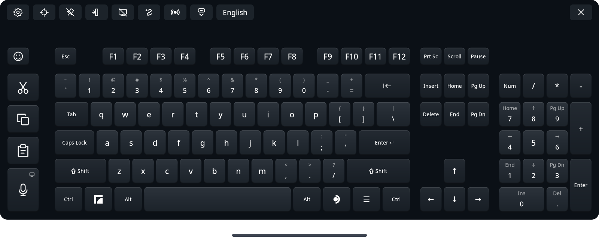

# Full Keyboard for Steam Frame

<p align="center"><a href="README.md">English</a> | <a href="README.ja.md">日本語</a> | <a href="README.zh-Hans.md">简体中文</a> | <b>Русский</b> | <a href="README.es.md">Español</a> | <a href="README.pt-BR.md">Português (Brasil)</a> | <a href="README.de.md">Deutsch</a> | <a href="README.fr.md">Français</a></p>

Полноразмерная замена встроенной виртуальной клавиатуре Steam Frame для повседневной работы в гарнитуре. В ней есть нормальные клавиши-стрелки, цифровой блок, Ctrl и Alt, отдельные клавиши «Вырезать», «Копировать» и «Вставить», а также ввод свайпом, диктовка и эмодзи — на 47 языках.

**По умолчанию Full Keyboard запускается вручную.** Кнопка клавиатуры в SteamOS по умолчанию открывает стандартную клавиатуру. Параметр **«Заменить встроенную клавиатуру»** (Replace native keyboard) в разделе «Настройки» → «Интеграция» перенаправляет поддерживаемые запросы, пока Full Keyboard запущена. Ничего настраивать не нужно: она использует локальное соединение, которое SteamOS и так даёт Steam на каждом Frame, а если оно недоступно, возвращается стандартная клавиатура. Включите **«Запуск вместе с SteamOS»** (Start with SteamOS) в том же разделе, чтобы замена запускалась в фоне при входе в систему. Клавиатура остаётся скрытой, пока её не вызовут. Подробнее: [замена встроенной клавиатуры](docs/native-replacement.md).



## Возможности

- Полноразмерная раскладка с F1–F12, клавишами навигации, стрелками, скрываемым цифровым блоком, Ctrl, Alt и Shift, который фиксируется при удержании.
- Отдельные клавиши «Вырезать», «Копировать» и «Вставить», которые отправляют Ctrl+X, Ctrl+C и Ctrl+V или собственные сочетания терминала, например Ctrl+Shift+C и Ctrl+Shift+V.
- Диктовка: говорите вместо того, чтобы печатать, — речь распознаётся в гарнитуре или на вашем собственном сервере распознавания речи Whisper. Исправьте текст в редакторе и отправьте его или включите **«Печатать, пока говорю»** (Type as I speak), чтобы каждая фраза сразу вводилась в приложение. Подробнее: [диктовка](#dictation).
- Ввод свайпом, по умолчанию выключен, для английского, немецкого, французского, испанского, итальянского, португальского, польского, нидерландского, шведского, украинского, русского и китайского пиньиня. Ввод свайпом работает на технологии «FUTO Swipe».
- Подсказки при вводе, по умолчанию включены, на тех же языках, что и ввод свайпом: до пяти вариантов завершения набираемого слова, самые частые — первыми.
- Японское преобразование с Mozc и вариантами по мере ввода, а также японская 12-клавишная флик-клавиатура, как на телефоне.
- **Shift оттягиванием**, по умолчанию выключено: потяните клавишу вниз, чтобы ввести её символ с Shift, например ^ на клавише 6 или заглавную букву, пока ввод свайпом выключен.
- Панель эмодзи с недавними, избранным (перетаскиванием), категориями и оттенками кожи.
- **«Оставаться поверх приложений»** (Stay open over apps): клавиатура остаётся на месте, когда панель Steam закрывается, чтобы печатать в окна, парящие в пространстве; наведите луч SteamVR на парящее окно, чтобы щёлкнуть по нему.
- **Режим фокуса** (Focus mode): при замене встроенной клавиатуры клавиатура остаётся открытой, когда текстовое поле закрывается, и ждёт следующего поля или приложения, а также предупреждает, если будет печатать в окно, которого не видно.
- Ввод лучом контроллера с тактильными щелчками и откликом при наведении, а также необязательные звуки клавиш с шестью эффектами.
- Перемещайте клавиатуру за полосу под ней или хватом, меняйте размер за любой нижний угол, закрепляйте на месте, а автовыравнивание выпрямит её после перемещения.
- Следование за панелью Steam, сохранение положения и возврат в центр повторным запуском.
- Тринадцать тем, светлых и тёмных, включая одну высококонтрастную, и параметр «Фон» с прозрачностью. Раскладки, языки и темы — редактируемые файлы JSON, выбираемые в меню настроек прямо в VR.
- Необязательная замена встроенной клавиатуры, запуск вместе с SteamOS и обновления из приложения с автоматическим откатом.
- Экспериментальный протокол интеграции, который позволяет альтернативным оболочкам Steam Frame встраивать клавиатуру: запускать, размещать, оформлять и обновлять её. Подробнее: [интеграция с оболочкой](docs/integration.md).
- Английский, испанский, упрощённый и традиционный китайский, японский, немецкий, французский, португальский, корейский, арабский, итальянский, хинди, русский, турецкий, индонезийский, польский, нидерландский, вьетнамский, тайский, украинский, шведский, финский, датский, норвежский, чешский, венгерский, румынский, греческий, словацкий, иврит, хорватский, словенский, малайский, эстонский, латышский, литовский, болгарский, каталанский, сербский, персидский, филиппинский, исландский, грузинский, армянский, казахский, азербайджанский, македонский и албанский — каждый в стандартной национальной раскладке, для многих есть региональные и альтернативные клавиатуры. Для китайского есть упрощённый и традиционный пиньинь, а для традиционного также чжуинь, цанцзе и «быстрый» ввод; корейский использует двухрядный хангыль.


*Ввод свайпом, японский ввод, диктовка, панель эмодзи и настройки, записано на Steam Frame с более ранней версией Full Keyboard.*

## Устанавливается от имени пользователя, без лишних шагов

- **Без sudo, прав root и пароля администратора.** Full Keyboard устанавливается в вашу домашнюю папку от вашего пользователя. Задавать пароль на Frame или включать режим разработчика не нужно.
- **Одна ручная установка, дальше обновления из приложения.** После первой установки настройки сами находят новые версии и устанавливают их одной кнопкой, а если новая версия не запускается, возвращают предыдущую.
- **Просто работает.** Ввод работает сразу после установки, и **«Заменить встроенную клавиатуру»** тоже ничего не требует: она использует локальное соединение, которое SteamOS и так даёт Steam на каждом Frame.
- **Переживает перезагрузки и обновления SteamOS.** С включённым параметром **«Запуск вместе с SteamOS»** клавиатура запускается скрытой в фоне после каждой загрузки. Обновления SteamOS не трогают домашнюю папку, поэтому клавиатура и ваши настройки сохраняются.
- **Ничего не ломает.** Она не меняет ни файлы, ни настройки, ни системные службы, ни права устройств Steam и SteamOS. Замена перехватывает клавиатуру Steam только пока работает Full Keyboard, а если она остановится, клавиатура Steam вернётся сама.
- **Бережёт память и батарею.** Функции загружаются, только пока вы ими пользуетесь, и освобождают память, когда перестаёте: японское преобразование работает, только пока добавлен японский; движок распознавания речи запускается при первой диктовке и завершается, когда диктовку выключают; модель свайпа выгружается, когда ввод свайпом выключен; список слов для подсказок загружается при наборе и выгружается через пять минут без ввода; панель эмодзи освобождает изображения при закрытии. Клавиатура перерисовывает только изменившиеся клавиши, а пока она скрыта или гарнитура снята, обновляется четыре раза в секунду.
- **Никогда не читает буфер обмена.** «Вырезать», «Копировать» и «Вставить» только нажимают свои сочетания клавиш, а текст попадает в приложения как текст. Full Keyboard записывает в буфер обмена, только если вы выбрали «Вставка» для диктовки или для «Unicode в KDE».

## Где работает

Full Keyboard сделана для **работы на самом устройстве**: панели Frame, текстовых полей Steam и приложений, запущенных на Frame, включая приложения рабочего стола и окна, парящие в пространстве. Выберите текстовое поле и печатайте лучом контроллера.

Обычно клавиатура живёт в панели Steam: закрытие панели скрывает её и освобождает ввод, а повторное открытие возвращает её. Включите **«Оставаться поверх приложений»** рядом с булавкой, чтобы клавиатура оставалась в пространстве после закрытия панели. Наведите любой контроллер на клавишу и нажмите спусковой крючок; точка показывает, куда направлен каждый луч. Когда включён параметр «Заменить встроенную клавиатуру», запрос клавиатуры из окна, закреплённого в пространстве, сам открывает там Full Keyboard.

Она печатает в приложения, запущенные на Frame, а также в приложения и игры с ПК, транслируемые через Moonlight ([транслируемые игры](docs/streamed-games.md)). Это **не клавиатура для VR-приложений, транслируемых с ПК через Steam Link, например VRChat**.

Каждый выпуск проходит автоматические наборы тестов на компьютере разработки и на Frame, а его функции проверяются в гарнитуре на панели Steam, в текстовых полях Steam, в приложениях рабочего стола и в парящих окнах. Приложения всё же могут отличаться в том, как получают фокус, в неамериканских раскладках и методах ввода; см. [известные ограничения и устранение неполадок](docs/runtime.md). Особенно приветствуются отзывы тех, кто свободно владеет японским, китайским и корейским. Без Steam Frame клавиатуру можно попробовать на ПК с Linux в [симуляторе для рабочего стола](docs/simulator.md).

## Ручная установка

Для пакета выпуска не нужны ни инструменты ИИ, ни компиляция, ни `sudo`, ни права на запись в SteamOS.

1. На **Steam Frame** откройте в браузере [страницу выпусков на GitHub](https://github.com/TaiKeid/steam-frame-full-keyboard/releases). Скачайте `framekeyboard-0.16.0-aarch64.tar.gz` и `SHA256SUMS` из файлов выпуска в папку **Downloads**. Не скачивайте для этой установки автоматический архив исходного кода GitHub.
2. Откройте терминал в режиме рабочего стола Frame и выполните:

   ```sh
   cd ~/Downloads
   sha256sum -c SHA256SUMS
   tar -xzf framekeyboard-0.16.0-aarch64.tar.gz
   cd framekeyboard-0.16.0-aarch64
   bash install.sh
   ```

   Продолжайте, только если проверка контрольной суммы выдала `OK`. Для более новой версии подставьте имена её архива и распакованной папки.
3. Вернитесь в панель Frame и откройте **Full Keyboard** из списка приложений. Её также можно запустить из терминала:

   ```sh
   ~/.local/bin/framekeyboard
   ```

Установщик добавляет ярлык приложения рабочего стола с названием **Full Keyboard**. Если вам нужен ещё и ярлык в библиотеке Steam, воспользуйтесь пунктом Steam **«Добавить стороннюю игру»** и выберите Full Keyboard. У созданного вручную ярлыка своё название; при необходимости переименуйте старый ярлык FrameKeyboard в его свойствах.

Всё устанавливается в вашу домашнюю папку. Установщик сохраняет настройки и собственные профили, заменяет текущий рабочий выпуск, не включает автозапуск и не меняет файлы Steam. Развёртывания для разработки и старые неотмеченные папки выпусков сохраняются. Внутренние имена файлов и команды остаются `framekeyboard`.

Клавиатура раз в несколько часов проверяет, вышел ли новый стабильный выпуск, и ставит точку на кнопке настроек, если он есть. Чтобы обновиться, откройте «Настройки» и нажмите **«Скачать и установить обновление»** вверху по центру или **«Проверить обновления»** там же, чтобы проверить прямо сейчас. Клавиатура проверяет архив, устанавливает его и перезапускается, сохраняя ваши настройки. Старый рабочий выпуск остаётся, пока новый не подтвердит успешный запуск, а затем удаляется. При неудачном запуске выполняется автоматический откат. Подробнее: [обновления](docs/updates.md).

Чтобы удалить клавиатуру, выполните `bash ~/.local/share/framekeyboard/current/uninstall.sh`. Скрипт останавливает клавиатуру и её вспомогательные процессы, удаляет приложение, его службу автозапуска, ярлык и пункт меню и сохраняет ваши настройки, если не добавить `--purge`. Снова будет использоваться клавиатура Steam. Подробнее: [откат и удаление](docs/runtime.md#update-rollback-and-removal).

Перед ручным обновлением сначала закройте Full Keyboard. Если включена замена встроенной клавиатуры, используйте «Настройки» → «Выйти из Full Keyboard». Скачайте файлы нового выпуска и повторите шаги установки. Установщик позволяет переустановить ту же версию или установить более старую и отказывается работать, пока Full Keyboard запущена. Ручной откат — это переустановка более старого пакета выпуска; см. [откат и удаление](docs/runtime.md#update-rollback-and-removal).

## Как пользоваться

| Действие | Управление |
| --- | --- |
| Печатать | Наведите луч на клавишу и нажмите спусковой крючок контроллера |
| Сочетание клавиш | Коснитесь Ctrl, Alt или Shift, затем другой клавиши; или удерживайте модификатор одним контроллером и нажмите клавишу другим |
| Сочетания с Super | Коснитесь левого значка Frame, затем клавиши, или удерживайте его другим контроллером |
| Меню приложений рабочего стола | Коснитесь правого значка SteamOS — это нажатие и отпускание правой Super; что произойдёт, решает рабочий стол |
| Сбросить нажатый модификатор | Коснитесь его ещё раз |
| Зафиксировать Shift | Удерживайте Shift полсекунды; нажмите ещё раз, чтобы снять фиксацию |
| Ввести слово свайпом | Включите **«Ввод свайпом»** в разделе настроек «Языки и раскладки», затем удерживайте спусковой крючок и проведите по буквам. Другие варианты появятся на панели инструментов |
| Дополнить слово | Наберите начало слова; на панели инструментов появится до пяти вариантов. Выберите один, чтобы ввести остаток и пробел |
| Ввести символ с Shift | Включите **«Shift оттягиванием»** в разделе настроек «Языки и раскладки», затем потяните клавишу вниз, прежде чем отпустить: 6 даёт ^, а при выключенном вводе свайпом k даёт K |
| Вырезать / копировать / вставить | Используйте клавиши «Вырезать», «Копировать» и «Вставить» слева; перед вырезанием или копированием выделите текст |
| Диктовать | Нажмите клавишу микрофона под «Вырезать», «Копировать» и «Вставить» и говорите. Фразы появляются в редакторе на месте функциональных клавиш; исправьте их клавишами, затем нажмите **«Отправить»**, чтобы ввести текст в приложение. Esc останавливает запись |
| Печатать, пока говорю | Включите в разделе настроек **«Диктовка»**. Тогда клавиша микрофона слушает на обычной клавиатуре и вводит каждую фразу в приложение |
| Ввести эмодзи | Нажмите клавишу со смайликом слева вверху. Прокручивайте сетку перетаскиванием или стиком, выберите категорию над ней и отпустите спусковой крючок на эмодзи, чтобы ввести его. Удерживайте эмодзи с оттенками, чтобы выбрать оттенок кожи. Удерживайте эмодзи в недавних и перетащите в избранное, чтобы сохранить его. Клавиша со стрелкой слева вверху возвращает к клавиатуре |
| Переместить / повернуть | Открепите клавиатуру, наведите луч на полосу под ней, удерживайте спусковой крючок, двигайте рукой, затем отпустите |
| Курсор гарнитуры | Нажмите AUX, чтобы показать курсор головы. Наводитесь на клавиши головой и нажимайте AUX; удерживайте AUX на полосе перемещения, чтобы двигать клавиатуру |
| Перемещение хватом | Включите **«Перемещение хватом»** в разделе настроек **«Общие»** и примените. Наведите луч на любое место клавиатуры и удерживайте кнопку хвата; стик той же руки меняет расстояние |
| Защита от случайного перемещения | Нажмите значок булавки; клавиатура всё равно следует за панелью Steam |
| Оставить открытой без панели Steam | Включите **«Оставаться поверх приложений»** рядом со значком булавки |
| Оставить открытой между текстовыми полями | При включённой замене встроенной клавиатуры включите **«Режим фокуса»** — значок окна рядом с «Оставаться поверх приложений». Клавиатура остаётся на месте, когда поле закрывается, печатает в следующее выбранное поле, а иначе — в приложение с фокусом клавиатуры; × или кнопка клавиатуры по-прежнему скрывает её |
| Добавить языки для переключения | Откройте «Настройки» → **«Дополнительные языки»**, затем коснитесь языков или перетащите их в список |
| Переключаться между языками | Нажмите кнопку языка — последнюю из кнопок панели инструментов |
| Отодвинуть / приблизить | Удерживая полосу перемещения или хват, отклоняйте стик того же контроллера вверх / вниз |
| Изменить размер | Открепите клавиатуру, наведите луч любого контроллера чуть за нижний угол клавиатуры, затем удерживайте спусковой крючок на появившемся маркере угла и тяните. Клавиатура увеличивается или уменьшается относительно центра |
| Скрыть цифровой блок | В настройках отметьте «Общие» → «Скрыть цифровой блок» и нажмите «Применить и сохранить» |
| Видеть, что за клавиатурой | В настройках выберите «Общие» → «Фон»: «Полупрозрачный» или «Невидимый» и нажмите «Применить и сохранить» |
| Сменить раскладку, язык или тему | Нажмите значок шестерёнки, выберите профили, затем **«Применить и сохранить»** |
| Отцентрировать | Нажмите значок «Отцентрировать» или снова запустите Full Keyboard |
| Закрыть | × скрывает панель в режиме замены; иначе он закрывает приложение |
| Выйти из режима замены | Откройте «Настройки» → «Выйти из Full Keyboard» |

**Если клавиатура уплыла вне досягаемости, снова запустите приложение.** Если оно уже работает, повторный запуск не открывает вторую клавиатуру, а возвращает существующую под текущую панель Steam. Размер сохраняется. Если панель закрыта, возврат подождёт, пока она откроется.

Закрытие и повторное открытие восстанавливают последнее положение, поворот, размер и состояние Num Lock. Перемещение или наклон панели Steam переносит клавиатуру вместе с ней. **«Автовыравнивание»** (Auto leveling), по умолчанию включённое в разделе «Общие», выпрямляет слегка перекошенную клавиатуру после перемещения.

## Языки и настройка

Выберите язык в настройках и нажмите **«Применить и сохранить»**. Клавиатура отправляет символы этой раскладки независимо от системной раскладки, включая Shift, Caps Lock, AltGr и мёртвые клавиши для диакритики. Не нужны ни соответствующая раскладка SteamOS, ни перезапуск. После новой установки по умолчанию выбран английский; при следующих запусках используется сохранённый выбор. Добавьте пары раскладки и языка в **«Дополнительные языки»**, чтобы переключаться между ними с панели инструментов. Подробнее: [настройка и переключение языков](docs/languages.md).

Для японского выберите **Romaji**, **Kana** или **JIS** в списке «Язык» в настройках или раскладку **Japanese flick** для флик-ввода, как на телефоне. Romaji, Kana и Flick составляют текст в самой клавиатуре и преобразуют его в кандзи с помощью Mozc, который поставляется с Full Keyboard, или системного Anthy, пока Mozc недоступен. Варианты появляются по мере ввода; Space преобразует, Enter подтверждает набранное. Ещё одно нажатие Enter отправляет обычный Enter. Режиму JIS нужен уже установленный системный IME. Подробнее: [японский ввод](docs/japanese.md).

Китайский и корейский составляются локально, и их можно выбрать вместе с английским и встроенным японским без смены системной раскладки. Корейский использует двухрядный хангыль и вводит каждый слог, когда начинается следующий, как на ПК; 한/영 на месте правого Alt переключает на латиницу. [Руководство по языкам](docs/languages.md#chinese-and-korean-composition) рассказывает о вариантах, хангыле и ограничениях ввода.

Скопируйте встроенный профиль JSON из `~/.local/share/framekeyboard/current/share/framekeyboard/` в соответствующую папку ниже, отредактируйте его, затем нажмите значок **«Перезагрузить конфигурацию»** в настройках:

```text
~/.config/framekeyboard/layouts/
~/.config/framekeyboard/languages/
~/.config/framekeyboard/themes/
```

Укажите новый `id` профиля, чтобы добавить вариант, или тот же `id`, чтобы заменить встроенный. [Справочник по конфигурации](docs/configuration.md) описывает поля, избранное, проверку и сохранение положения.

<a id="dictation"></a>
## Диктовка

Выберите режим в разделе «Настройки» → **«Диктовка»**, затем нажмите **«Применить и сохранить»**:

- **«На устройстве»** (On device), режим по умолчанию, распознаёт речь на Steam Frame небольшой многоязычной моделью Whisper, которая скачивается один раз (264 МБ) после вашего подтверждения. Точнее всего распознаются английский и испанский; остальные языки работают, но с более низким качеством.
- **«Свой сервер»** (Self-hosted) отправляет речь на сервер Whisper, запущенный на компьютере в вашей сети: это быстрее и точнее на любом языке. [Настройка сервера распознавания речи](docs/speech-server.md) описывает Linux, macOS и Windows; проверены только шаги для Linux. **«Проверить»** проверяет соединение, а **«Резерв: на устройстве»** (Fall back to on device) распознаёт речь в гарнитуре, если сервер недоступен.
- **«Выкл.»** скрывает клавишу микрофона.

Диктовка работает на всех встроенных языках, кроме японского JIS. Маленький значок на клавише микрофона показывает, где распознаётся речь: гарнитура — на устройстве, компьютер — на вашем сервере. Контроллер щёлкает, когда запись начинается, и вибрирует, когда она останавливается.

Конфиденциальность:

- В режиме «На устройстве» звук никогда не покидает Frame. В режиме «Свой сервер» он отправляется только на указанный вами сервер и только пока вы диктуете или нажимаете «Проверить». Простой адрес `host:port` не шифруется, поэтому держите сервер в своей сети; настройки предупреждают об адресах вне локальной сети.
- Звук и текст хранятся только в памяти. Ничего из сказанного или напечатанного не записывается в журналы и не сохраняется, кроме японских фраз, которые запоминает [обучение](docs/japanese.md#learning), и слов, которые считают [подсказки при вводе](docs/configuration.md#typing-suggestions), — и никогда из полей, отмеченных как пароль, PIN-код или терминал.
- Запись останавливается, как только вы снимаете гарнитуру или она выходит из спящего режима, а также после 60 секунд тишины.
- Микрофон слышит всех рядом. Пока идёт игра, может улавливаться и её звук; во время записи об этом сообщает уведомление.

Подробнее: [диктовка](docs/dictation.md).

## Как это устроено

Клавиатура — нативное приложение на C++20. Cairo/Pango рисуют клавиши, Vulkan/OpenVR показывают панель, а libei отправляет нативные нажатия локальному композитору Gamescope на Frame. Протокол текстового ввода Gamescope, проверяемый перед использованием, отправляет символы, полученные из выбранной раскладки, включая японский, китайский и корейский ввод. Браузер не используется. В сеть клавиатура выходит, только чтобы раз в несколько часов проверять обновления и устанавливать их по вашей команде, чтобы один раз скачать модель речи для устройства и чтобы связаться с настроенным вами сервером распознавания речи.

«Вырезать», «Копировать» и «Вставить» отправляют сочетания клавиш; приложение никогда не читает содержимое буфера обмена. Оно записывает в буфер обмена, только если для **«Отправить»** в диктовке или для «Ввод» → **«Unicode в KDE»** выбрана **«Вставка»**, и затем вставляет через Ctrl+V или собственную клавишу вставки терминала. Оно не записывает в журналы набранный текст и не хранит историю ввода, кроме того, что сохраняют японское [обучение](docs/japanese.md#learning) и [подсказки при вводе](docs/configuration.md#typing-suggestions); панель эмодзи хранит ваши недавние и избранные эмодзи локально, а «Очистить» очищает недавние. Положение и выбранные профили хранятся локально.

Видимая панель опрашивает ввод и следует за панелью Steam с целевой частотой 60 Гц. Пока клавиатура скрыта или гарнитура снята, опрос снижается до 4 Гц. Текстура перерисовывается, только когда меняется изображение или идёт анимация клавиши. При включённой замене закрытие панели оставляет приложение работать для следующего запроса; «Настройки» → «Выйти из Full Keyboard» завершает его. Когда замена выключена, закрытие клавиатуры завершает процесс. Влияние на батарею не измерялось.

## Разработка и обратная связь

- [Сборка из исходного кода](docs/building.md)
- [Симулятор для рабочего стола](docs/simulator.md): клавиатура в окне на ПК с Linux, печатающая в собственное текстовое поле
- [Архитектура и карта кода](docs/architecture.md)
- [Работа и устранение неполадок](docs/runtime.md)
- [Ручные приёмочные проверки](docs/acceptance.md)
- [План развития](docs/plan.md) и [список изменений](CHANGELOG.md)
- [Участие и сообщения об ошибках](CONTRIBUTING.md)
- [Чек-лист выпуска](docs/releasing.md)
- [Сопровождение стороннего кода и зависимостей SteamOS](docs/upkeep.md)
- [Сторонний код и лицензии](third_party/README.md)

Пожалуйста, указывайте версию приложения, версию SteamOS, затронутое приложение, было ли это окно рабочего стола или парящее окно, и шаги для воспроизведения. Уберите личный текст со снимков экрана и из журналов.

## Лицензия

Код проекта распространяется по [лицензии MIT](LICENSE). Включённые сторонние компоненты сохраняют свои [исходные лицензии](third_party/README.md).

## Предупреждение: проект создан ИИ

Этот проект полностью создан ИИ. Автор не знаком с C++, поэтому, пожалуйста, отнеситесь с терпением и пониманием. Ошибки и шероховатости ожидаемы; внимательные ревью, понятные сообщения об ошибках и вклад в проект приветствуются. Сторонние компоненты сохраняют своё авторство и лицензии.

Переводы интерфейса тоже сделаны ИИ. Если что-то на вашем языке звучит неправильно, исправления приветствуются.
