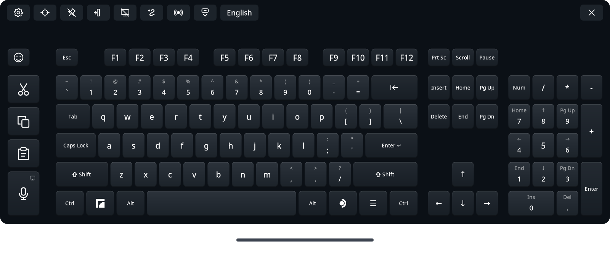

# Full Keyboard for Steam Frame

<p align="center"><a href="README.md">English</a> | <a href="README.ja.md">日本語</a> | <b>简体中文</b> | <a href="README.ru.md">Русский</a> | <a href="README.es.md">Español</a> | <a href="README.pt-BR.md">Português (Brasil)</a> | <a href="README.de.md">Deutsch</a> | <a href="README.fr.md">Français</a></p>

一款全尺寸键盘，可替代 Steam Frame 内置的虚拟键盘，专为在头显中日常使用而设计。它提供完整的方向键、数字小键盘、Ctrl 和 Alt，以及独立的剪切、复制和粘贴键，还支持滑动输入、语音输入和表情符号，覆盖 47 种语言。

**Full Keyboard 默认需要手动启动。** 默认情况下，SteamOS 的键盘按钮打开的是原来的键盘。在“设置”→“系统集成”中开启 **替换原生键盘**（Replace native keyboard）后，Full Keyboard 运行期间会接管受支持的键盘请求。此功能无需任何设置：它使用 SteamOS 在每台 Frame 上本来就提供给 Steam 的本地连接，一旦该连接不可用，就会回退到原来的键盘。在同一卡片中开启 **随 SteamOS 启动**（Start with SteamOS），即可在登录时于后台启动替换功能。键盘会一直隐藏，直到被调出。参见 [原生键盘替换](docs/native-replacement.md)。



## 功能

- 全尺寸布局，包含 F1–F12、导航键、方向键、可隐藏的数字小键盘、Ctrl、Alt，以及按住即锁定的 Shift。
- 独立的剪切、复制和粘贴键，发送 Ctrl+X、Ctrl+C 和 Ctrl+V，或终端自己的按键，例如 Ctrl+Shift+C 和 Ctrl+Shift+V。
- 语音输入：用说话代替打字，可在头显上识别，也可由您自己的 Whisper 语音服务器识别。在编辑器中修改文本后发送，或者开启 **边说边输入**（Type as I speak），让每个短语直接输入到应用中。参见[语音输入](#dictation)。
- 滑动输入，默认关闭，支持英语、德语、法语、西班牙语、意大利语、葡萄牙语、波兰语、荷兰语、瑞典语、乌克兰语、俄语和中文拼音。滑动输入由“FUTO Swipe”技术提供支持。
- 输入建议，默认开启，支持滑动输入所支持的语言：最多显示五个正在输入的词的补全，最常用的词排在前面。
- 使用 Mozc 的日语转换，输入时即显示候选词，并提供手机式的日语十二键轻划键盘。
- 下拉输入 Shift 字符，默认关闭：将按键向下拉即可输入其 Shift 字符，例如在 6 键上输入 ^，或在关闭滑动输入时输入大写字母。
- 表情面板，包含“最近使用”、可拖放的收藏、分类和肤色。
- **在应用上方保持打开**（Stay open over apps）：仪表板关闭时键盘留在原处，可向漂浮在空间中的窗口输入；指向漂浮窗口即可用 SteamVR 的激光点击它。
- **焦点模式**（Focus mode）：开启原生键盘替换后，文本框关闭时键盘仍保持显示，随时可用于下一个文本框或应用；如果它将要输入的窗口不在您的视野中，还会发出提醒。
- 使用手柄激光输入，带触觉点击和悬停反馈，还可选用六种效果的按键音效。
- 可通过键盘下方的手柄条或直接抓取来移动键盘，从任一下角调整大小，固定位置，并在移动后由自动调平将其摆正。
- 跟随仪表板、保存位置，以及通过重新启动来重新居中。
- 十三种主题，包括浅色、深色和一款高对比度主题，并提供可透视的“背景”选项。布局、语言和主题都是可编辑的 JSON 文件，可在 VR 内的设置菜单中选择。
- 可选的原生键盘替换、随 SteamOS 启动，以及带自动回滚的应用内更新。
- 一个实验性的集成协议，可让其他 Steam Frame 外壳程序托管键盘：启动、放置、设置样式和更新键盘。参见 [宿主程序集成](docs/integration.md)。
- 英语、西班牙语、简体和繁体中文、日语、德语、法语、葡萄牙语、韩语、阿拉伯语、意大利语、印地语、俄语、土耳其语、印度尼西亚语、波兰语、荷兰语、越南语、泰语、乌克兰语、瑞典语、芬兰语、丹麦语、挪威语、捷克语、匈牙利语、罗马尼亚语、希腊语、斯洛伐克语、希伯来语、克罗地亚语、斯洛文尼亚语、马来语、爱沙尼亚语、拉脱维亚语、立陶宛语、保加利亚语、加泰罗尼亚语、塞尔维亚语、波斯语、菲律宾语、冰岛语、格鲁吉亚语、亚美尼亚语、哈萨克语、阿塞拜疆语、马其顿语和阿尔巴尼亚语，均使用各自的标准国家布局，其中许多语言还提供地区和替代键盘。中文提供简体拼音和繁体拼音，繁体还提供注音、仓颉和速成；韩语使用两套式韩文。


*滑动输入、日语输入、语音输入、表情面板和设置，使用早期版本的 Full Keyboard 在 Steam Frame 上录制。*

## 以普通用户安装，无需额外步骤

- **无需 sudo、root 权限或管理员密码。** Full Keyboard 以您自己的用户身份安装到主文件夹中。您无需在 Frame 上设置密码，也无需开启开发者模式。
- **手动安装一次，之后在应用内更新。** 首次安装后，“设置”会发现新版本并一键安装；如果新版本无法启动，则会回到上一个版本。
- **开箱即用。** 安装后即可输入，**替换原生键盘** 也无需任何设置：它使用 SteamOS 在每台 Frame 上本来就提供给 Steam 的本地连接。
- **重启和 SteamOS 更新后依然保留。** 开启 **随 SteamOS 启动** 后，每次开机它都会在后台隐藏启动。SteamOS 更新不会改动您的主文件夹，因此键盘和您的设置都会保留。
- **无侵入性。** 它不修改 Steam 或 SteamOS 的任何文件、设置、系统服务或设备权限。替换功能仅在 Full Keyboard 运行时接管 Steam 的键盘；一旦它停止，Steam 自己的键盘会自动恢复。
- **节省内存和电量。** 各项功能只在使用时加载，停用后即释放内存：日语转换仅在添加了日语时运行；语音输入的识别引擎在首次语音输入时启动，并在关闭语音输入时退出；关闭滑动输入时卸载滑动模型；输入建议的词表在打字时加载，五分钟不打字后释放；表情面板关闭时释放其图片。键盘只重绘发生变化的按键；隐藏时或头显关闭时，每秒只更新四次。
- **从不读取您的剪贴板。** 剪切、复制和粘贴只会按下对应的快捷键，文本以文本形式送达应用。只有当您为语音输入或 KDE 桌面 Unicode 选择“粘贴”时，Full Keyboard 才会写入剪贴板。

## 适用范围

Full Keyboard 专为 **设备端体验** 而设计：Frame 仪表板、Steam 自己的文本框，以及在 Frame 上运行的应用，包括桌面应用和漂浮在空间中的窗口。先让文本框获得焦点，然后用手柄激光输入。

通常，键盘位于仪表板中：关闭仪表板会将其隐藏并释放其输入，重新打开则会恢复。开启固定按钮旁边的 **在应用上方保持打开**，即可在仪表板关闭后将键盘留在空间中。用任一手柄指向按键并扣动扳机；一个圆点会显示每个手柄的瞄准位置。开启替换原生键盘后，固定在空间中的窗口发出键盘请求时，Full Keyboard 会自动在那里打开。

它可以向在 Frame 上运行的应用输入，也可以向通过 Moonlight 串流的 PC 应用和游戏输入（[串流游戏](docs/streamed-games.md)）。它 **不适用于通过 Steam Link 从 PC 串流的 VR 应用，例如 VRChat**。

每个版本都会在开发电脑和 Frame 上通过自动化测试套件，其功能也会在头显中针对仪表板、Steam 的文本框、桌面应用和漂浮窗口进行检查。不过，各应用在获取焦点、非美式键盘映射和输入法方面仍可能有所不同；参见 [已知限制与故障排除](docs/runtime.md)。特别欢迎熟练使用日语、中文和韩语的用户提供反馈。如果没有 Steam Frame，也可以在 Linux PC 上通过 [桌面模拟器](docs/simulator.md) 试用键盘。

## 手动安装

安装发布包不需要任何 AI 工具、编译、`sudo` 或 SteamOS 写入权限。

1. 在 **Steam Frame** 上，用浏览器打开 [GitHub 发布页面](https://github.com/TaiKeid/steam-frame-full-keyboard/releases)。从发布资源中将 `framekeyboard-0.15.0-aarch64.tar.gz` 和 `SHA256SUMS` 下载到 **Downloads**。本次安装请勿下载 GitHub 自动生成的源代码压缩包。
2. 在 Frame 的桌面环境中打开终端并运行：

   ```sh
   cd ~/Downloads
   sha256sum -c SHA256SUMS
   tar -xzf framekeyboard-0.15.0-aarch64.tar.gz
   cd framekeyboard-0.15.0-aarch64
   bash install.sh
   ```

   只有在校验和显示 `OK` 时才继续。安装更新的版本时，请使用对应的压缩包和解压后的目录名称。
3. 返回 Frame 的仪表板，从应用启动器中打开 **Full Keyboard**。也可以从终端启动：

   ```sh
   ~/.local/bin/framekeyboard
   ```

安装程序会添加一个名为 **Full Keyboard** 的桌面应用条目。如果您还想在 Steam 库中添加快捷方式，请使用 Steam 的 **添加非 Steam 游戏**（Add a Non-Steam Game）选项并选择 Full Keyboard。手动创建的快捷方式有其自己的名称；如有需要，可在其“属性”中重命名旧的 FrameKeyboard 快捷方式。

所有内容都安装在您的主目录下。安装程序会保留设置和自定义配置，替换当前的正式版本，并且不会启用自动启动或改动 Steam 文件。开发部署和较旧的未标记发布目录会被保留。内部文件名和命令仍为 `framekeyboard`。

键盘每隔几小时检查一次新的稳定版本，有新版本时会在设置按钮上显示一个圆点。要更新，请打开“设置”，按下顶部中央的 **下载并安装更新**（Download and install update），或按同一位置的 **检查更新**（Check for updates）立即检查。键盘会验证压缩包、安装并重启，同时保留您的设置。旧的正式版本会一直保留，直到新版本确认正常启动后才会删除。启动失败时会自动回滚。参见 [更新](docs/updates.md)。

要卸载，请运行 `bash ~/.local/share/framekeyboard/current/uninstall.sh`。它会停止键盘及其辅助程序，删除应用、启动服务、启动器和菜单条目，并保留您的设置，除非您加上 `--purge`。之后将重新使用 Steam 的键盘。参见 [回滚与卸载](docs/runtime.md#update-rollback-and-removal)。

手动更新时，请先退出 Full Keyboard。如果已开启原生键盘替换，请使用“设置”→ **退出 Full Keyboard**（Quit Full Keyboard）。下载新的发布资源并重复安装步骤。安装程序支持重新安装同一版本或安装较旧的版本，但在 Full Keyboard 运行时会拒绝安装。手动回滚即重新安装较旧的发布包；参见 [回滚与卸载](docs/runtime.md#update-rollback-and-removal)。

## 使用键盘

| 操作 | 方法 |
| --- | --- |
| 输入 | 指向按键并按下手柄扳机 |
| 使用快捷键 | 点按 Ctrl、Alt 或 Shift，再按另一个键；或用一只手柄按住修饰键，用另一只手柄按键 |
| Super 快捷键 | 点按左侧的 Frame 图标，再按一个键；或用另一只手柄按住它 |
| 桌面应用菜单 | 点按右侧的 SteamOS 图标，发送原生的右 Super 按下/松开；具体操作由桌面决定 |
| 取消已点按的修饰键 | 再点按一次 |
| 锁定 Shift | 按住 Shift 半秒；再按一次即可解锁 |
| 滑动输入单词 | 在“语言和布局”设置卡片中开启 **滑动输入**，然后按住扳机划过各个字母。其他候选会显示在工具栏中 |
| 补全单词 | 输入单词开头；工具栏中会显示最多五个补全。选择其中一个即可输入其余部分和一个空格 |
| 下拉输入 Shift 字符 | 在“语言和布局”设置卡片中开启 **下拉输入 Shift 字符**，然后在松开前将按键向下拉：6 输入 ^；关闭滑动输入时，k 输入 K |
| 剪切 / 复制 / 粘贴 | 使用左侧的剪切、复制和粘贴键；剪切或复制前请先选中文本 |
| 语音输入 | 按下剪切、复制和粘贴下方的麦克风键并说话。短语会出现在替代功能键位置的编辑器中；用按键修改后，按 **发送**（Send）将文本输入到应用中。Esc 停止录音 |
| 边说边输入 | 在 **语音输入** 设置卡片中开启。之后麦克风键会在普通键盘上收音，并将每个短语输入到应用中 |
| 输入表情符号 | 按下左上角的笑脸键。拖动或用摇杆滚动表情网格，在上方选择分类，在表情上松开扳机即可输入。按住带肤色的表情可选择肤色。按住“最近使用”中的表情并拖到收藏中即可保留。左上角的箭头键返回键盘 |
| 移动 / 旋转 | 取消固定，指向键盘下方的横条，按住扳机，移动手，然后松开 |
| 使用头显光标 | 按 AUX 显示头部光标。用头部瞄准按键并点击 AUX；在移动横条上按住 AUX 可移动键盘 |
| 使用抓取移动 | 在 **常规** 设置卡片中开启 **握持移动**（Grab to move）并应用。指向键盘任意位置并按住抓取/握把键；同一只手的摇杆可调整远近 |
| 防止意外移动 | 切换固定图标；键盘仍会跟随仪表板 |
| 不打开仪表板时保持显示 | 切换固定图标旁边的 **在应用上方保持打开** |
| 在文本框之间保持显示 | 开启替换原生键盘后，切换 **焦点模式**，即“在应用上方保持打开”旁边的窗口图标。文本框关闭时键盘留在原处，向您选择的下一个文本框输入，否则向拥有键盘焦点的应用输入；× 或键盘按钮仍会将其隐藏 |
| 添加要切换的语言 | 打开“设置”→ **附加语言**（Additional languages），然后点按或拖动语言到列表中 |
| 在您的语言之间切换 | 按下语言按钮，即工具栏按钮中的最后一个 |
| 移远 / 移近 | 按住移动横条或抓取时，将同一只手柄的摇杆向上 / 向下推 |
| 调整大小 | 取消固定，用任一手柄的激光指向键盘下角外侧，然后在渐显的角落调整手柄上按住扳机并拖动。键盘会以中心为基准放大或缩小 |
| 隐藏数字小键盘 | 在“设置”中勾选“常规”→ **隐藏数字小键盘**，然后 **应用并保存** |
| 透视键盘后方 | 在“设置”中将“常规”→ **背景** 设为 **半透明** 或 **隐藏**，然后 **应用并保存** |
| 更改布局、语言或主题 | 打开齿轮图标，选择配置，然后 **应用并保存**（Apply and save） |
| 重新居中 | 使用重新居中图标，或再次启动 Full Keyboard |
| 关闭 | 在替换模式下，用 × 隐藏面板；否则会退出应用 |
| 退出替换模式 | 打开“设置”→ **退出 Full Keyboard** |

**如果键盘飘到了够不着的地方，请再次启动应用。** 当它已在运行时，再次启动会把现有键盘重新居中到当前仪表板下方，而不会打开第二个键盘。其大小保持不变。如果仪表板已关闭，重新居中会等到仪表板打开时进行。

关闭后重新打开，会恢复上次的位置、旋转、大小和 Num Lock 状态。移动或倾斜仪表板时，键盘会随之移动。**自动调平**（Auto leveling）在“常规”中默认开启，会在您移动键盘后将略微歪斜的键盘摆正。

## 语言与自定义

在“设置”中选择一种语言，然后 **应用并保存**。键盘按照该布局发送字符，与系统键盘布局无关，包括 Shift、Caps Lock、AltGr 和死键重音。无需匹配的 SteamOS 布局，也无需重新启动。全新安装默认使用英语；之后启动时使用您保存的选择。在 **附加语言** 中添加布局和语言组合，即可从工具栏在它们之间切换。参见 [语言设置与切换](docs/languages.md)。

对于日语，请在“设置”的“语言”下拉菜单中选择 **Romaji**、**Kana** 或 **JIS**，或选择 **Japanese flick** 布局以使用手机式的轻划输入。Romaji、Kana 和轻划输入在键盘内组字，并通过 Full Keyboard 自带的 Mozc 转换为汉字；Mozc 不可用时，则使用系统的 Anthy。输入时即显示候选词；Space 转换；Enter 确认当前输入。再按一次 Enter 会发送普通的 Enter 键。JIS 模式需要系统中已有的输入法。参见 [日语输入](docs/japanese.md)。

中文和韩语在本地组字，可与英语和内置日语一起选用，无需更改系统布局。韩语使用两套式韩文，并像在 PC 上一样，在下一个音节开始时输入当前音节；位于右 Alt 位置的 한/영 键可切换为拉丁字母。[语言指南](docs/languages.md#chinese-and-korean-composition) 介绍了候选词、韩文和输入限制。

将 `~/.local/share/framekeyboard/current/share/framekeyboard/` 中自带的 JSON 配置复制到下面对应的文件夹，编辑后在“设置”中使用 **重新加载配置**（Reload config）图标：

```text
~/.config/framekeyboard/layouts/
~/.config/framekeyboard/languages/
~/.config/framekeyboard/themes/
```

使用新的配置 `id` 可添加一个选项，使用相同的 `id` 则会覆盖自带的配置。[配置参考](docs/configuration.md) 介绍了各字段、收藏、验证和保存的位置。

<a id="dictation"></a>
## 语音输入

在“设置”→ **语音输入**（Dictation）中选择一种模式，然后 **应用并保存**：

- **本机**（On device）为默认选项，使用一个小型多语言 Whisper 模型在 Steam Frame 上识别语音，该模型在您确认后下载一次（264 MB）。英语和西班牙语的准确度最高；其他语言也可使用，但准确度较低。
- **自建服务器**（Self-hosted）将语音发送到您在网络中的电脑上运行的 Whisper 服务器，在所有语言中都更快、更准确。[语音服务器设置](docs/speech-server.md) 介绍了 Linux、macOS 和 Windows 的设置；其中只有 Linux 的步骤经过验证。**测试**（Test）用于检查连接，**回退到本机识别**（Fall back to on device）会在无法连接服务器时改用头显识别。
- **关闭**（Off）会隐藏麦克风键。

除日语 JIS 外，语音输入适用于所有自带语言。麦克风键上的小图标显示语音在何处识别：头显图标表示本机识别，电脑图标表示您的服务器。开始录音时手柄会轻响一下，停止时会振动一次。

隐私：

- 本机识别时，音频绝不会离开 Frame。使用自建服务器时，音频只会发送到您填写的服务器，且仅在您进行语音输入或按下“测试”时发送。普通的 `host:port` 地址不加密，因此请将服务器保留在您自己的网络中；对于非本地地址，“设置”会发出警告。
- 音频和文本只保存在内存中。您说的话和输入的内容都不会被记录或保存，只有日语[学习](docs/japanese.md#learning)保留的短语和[输入建议](docs/configuration.md#typing-suggestions)统计的词语除外，而且这些从不来自密码、PIN 或终端输入框。
- 摘下头显时，或头显从睡眠中唤醒时，录音会立即停止；静音 60 秒后也会停止。
- 麦克风会听到附近所有人的声音。游戏运行时，也可能录入游戏声音，录音期间会显示相应提示。

详情参见 [语音输入](docs/dictation.md)。

## 工作原理

键盘是一个原生 C++20 应用。Cairo/Pango 绘制按键，Vulkan/OpenVR 显示面板，libei 将原生控制发送到 Frame 本地的 Gamescope 合成器。一个经过功能检查的 Gamescope 文本输入协议负责发送按所选布局解析出的字符，包括日语、中文和韩语的组字。它不运行浏览器。它只在以下情况下联网：每隔几小时检查更新并在您要求时安装更新、下载一次本机语音模型，以及连接您设置的语音服务器。

剪切、复制和粘贴只发送快捷键；应用从不读取剪贴板内容。只有当语音输入的 **发送** 或“输入”→ **KDE 桌面 Unicode**（KDE Desktop Unicode）设为 **粘贴** 时，它才会写入剪贴板，然后用 Ctrl+V 或终端自己的粘贴键粘贴。它不记录输入的文本，也不保存组字历史，只有日语[学习](docs/japanese.md#learning)和[输入建议](docs/configuration.md#typing-suggestions)保留的内容除外；表情面板会在本地保存您的“最近使用”和收藏表情，“清除”会清空“最近使用”。位置和配置偏好都保存在本地。

可见的面板以 60 Hz 为目标轮询输入并跟随仪表板。隐藏时或头显关闭时，轮询降至 4 Hz。只有当显示内容发生变化或按键动画运行时，它才会重绘纹理。开启替换后，关闭面板会让应用留在后台，等待下一个原生请求；“设置”→ **退出 Full Keyboard** 会退出应用。关闭替换时，关闭键盘会退出进程。电量影响尚未经过基准测试。

## 开发与反馈

- [从源代码构建](docs/building.md)
- [桌面模拟器](docs/simulator.md)：在 Linux PC 的窗口中运行键盘，向它自带的文本框输入
- [架构与代码地图](docs/architecture.md)
- [运行与故障排除](docs/runtime.md)
- [手动验收检查](docs/acceptance.md)
- [路线图](docs/plan.md) 和 [更新日志](CHANGELOG.md)
- [参与贡献与错误报告](CONTRIBUTING.md)
- [发布检查清单](docs/releasing.md)
- [第三方代码与 SteamOS 依赖的维护](docs/upkeep.md)
- [第三方代码与许可证](third_party/README.md)

报告问题时，请提供应用版本、SteamOS 版本、受影响的应用、它是桌面窗口还是漂浮窗口，以及复现步骤。请从截图和日志中删除私人文本。

## 许可证

项目代码以 [MIT 许可证](LICENSE) 提供。内含的第三方组件保留其[上游许可证](third_party/README.md)。

## AI 生成项目声明

本项目完全由 AI 生成。作者不熟悉 C++，敬请耐心和谅解。程序难免存在错误和不完善之处；欢迎细致的审查、清晰的错误报告和贡献。第三方组件保留其原始作者身份和许可证。

界面的翻译同样由 AI 完成。如果您的语言中有读起来不对的地方，欢迎指正。
