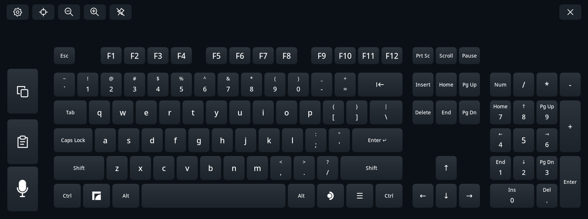
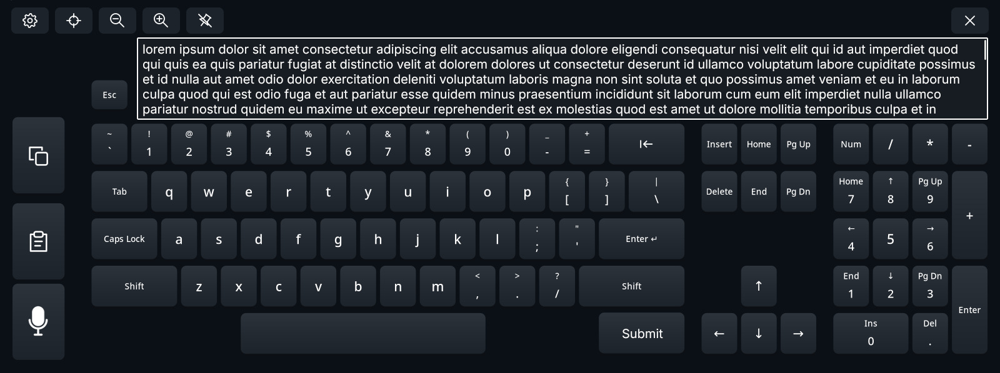

# Dictation plan

Status: M0 done; M1 and M2 done except checks that need the real microphone or App integration; M3a built, host-tested and tried in the headset; M3b Send built and host-tested, and its delivery A/B test run (2026-10-25); M3c live dictation and M4 Settings built and partly tried in the headset; M5a languages built, host-tested and measured against the reference server, and M5b Type as I speak built and host-tested (2026-10-26). Not part of the 0.9.0 release. The main path sends speech to a speech server the user hosts; a limited on-device mode covers English and Spanish. The measurements behind this are in [measurements](#measurements-2026-10-24). Items marked *proposal* are Claude's suggestions that the owner has not confirmed yet. Mark milestone checkboxes only after their acceptance conditions pass.

Dictation turns speech into text. The user speaks into a local editor on the keyboard, corrects the text there, and sends it to the focused application in one go. The Frame records audio, splits it into phrases, edits text and types it. Each phrase is turned into text either by a speech server elsewhere on the network, or by a small model on the Frame.

## Decisions

- **Two recognition modes, chosen in Settings:**
  - **Server:** a speech server the user hosts on a machine with a capable GPU. It gives the best quality and speed and covers all dictation languages. A hosted OpenAI-compatible provider can take its place through `config.json` (see [hosted providers](#hosted-providers)).
  - **On device:** Whisper small on the Frame's CPU, best for English and Spanish; other dictation languages are allowed with a low-accuracy warning (owner, 2026-10-26). It is a fallback: in the measurements it took about 5 s per phrase and loaded the CPU heavily, and larger models were unusable on the Frame alongside VR.
- **The keyboard asks only for the server's address,** as `host:port` in Settings. Model choice and every other recognition setting live in the server's own configuration. An optional model name exists only in the configuration file, for servers without a default model.
- **We don't build a server.** Users run an existing OpenAI-compatible server, `whisper-server` as the reference; the documentation gives setup instructions only.
- **No server in this repository.** This repository does not ship or vendor a server. The documentation describes a reference setup with an existing open-source server.
- **Reference engine:** whisper.cpp's `whisper-server` with the large-v3-turbo model on a GPU, with Whisper's normal 30 s window. On the measured servers it transcribed a 3 s phrase in 0.09–0.24 s, with Japanese at about 3.4% and English at 3.4% errors.
- **Languages:**
  - English, Spanish, Japanese and Chinese first, measured in M5a; then every other bundled language Whisper supports: German, French, Italian, Brazilian Portuguese, Russian, Ukrainian and Korean (owner, 2026-10-27), without measurements of their own yet. One multilingual Whisper model covers all of them, on a server or on device.
  - On device: one multilingual model for every dictation language. English and Spanish are the ones it does well; for the others, Settings warns that accuracy is low and a self-hosted server gives better results (owner, 2026-10-26).
  - A language profile without dictation support hides the mic key. Only Japanese JIS has none: it types through the system's own input method, which the keyboard cannot deliver dictated text to.
- **On device by default** (owner, 2026-10-27), which needs the model downloaded first: the mic key appears once it is. Audio leaves the Frame only in Server mode, only to the configured host, and only for a dictation session's phrases or a Test. That includes phrases still queued when capture stops.
- **Settings:** a Dictation card of its own, third, before Experimental.
- **Privacy:** on the Frame, audio and editor text stay in memory only. Nothing is logged or written to disk. The keyboard never reads the clipboard; it writes it only when Send is set to Paste (owner decision, 2026-10-25), and then holds just the sent text.
- **Release:** not in 0.9.0.
- **Credit:** the helper process, `pw-record` capture, transcript cleanup and repetition guard follow the dictation pull request by amirhh00 and adepssimius (`TaiKeid/steam-frame-full-keyboard#2`). That pull request vendored whisper.cpp and ggml into the repository and ran them on the Frame, and is not merged; its ideas are reimplemented on the current code.

## Keyboard design

### Mic key

The mic key takes the third of the three equal side-column keys, below Copy and Paste and the small emoji key above them (see [emoji picker](emoji.md#side-column)); the mockup predates that column. It is shown only when dictation is usable in the chosen mode for the active language (see [Settings](#settings)); otherwise its slot stays empty.

- **Normal mode:** pressing the mic key enters dictation mode and starts capturing at once.
- **Type as I speak:** pressing it starts capture without leaving the normal keyboard.

### Dictation mode layout

The mockup is incomplete; where it differs, the rules below apply.

- An editor replaces the function-key row. Esc stays at its left.
- **Hidden:** F1–F12, Print Screen, Scroll Lock, Pause, Tab, Insert, both Ctrl keys, Super, both Alt keys, Steam and Menu, and the Copy and Paste side keys.
- **Send** takes the place of the right-hand Alt to Ctrl keys. Layouts without them, such as flick, put it in Tab's place.
- **Undo last phrase** takes the first freed side slot, directly above the mic key.
- Letters, digits, punctuation, Shift, Caps Lock, Backspace, Delete, Enter, the arrows, Home/End and the number pad stay and edit the editor. PgUp/PgDn scroll it by a page, locally.
- The status line, which the editor covers, moves into the toolbar row, wrapping onto a second line when long.
- The toolbar stays. Opening Settings pauses capture (owner decision); Settings waits only while Send runs. The language button works only while not capturing. X, Pin, Recenter and Esc keep working.
- **Update:** when an update is ready to install, dictation is discarded: capture stops, pending phrases and the editor text are dropped, and the helper is stopped. The keyboard restarts anyway, which would lose the text (owner decision).
- Swipe typing and the emoji key are unavailable in dictation mode until they can type into the editor.

### Capturing

- The mic key starts and stops capture: start, pause, resume, pause. Leaving the mode is done with Send, which commits, or Esc, which discards.
- **Pause:** the phrase being spoken ends at the pause, and its audio is recognized and inserted. Resuming starts a new phrase.
- **Mic key while recognizing** (owner, 2026-10-27): while a spoken phrase waits for its text, in the editor or Type as I speak, a short bright segment circles just inside the mic key's border at 30 fps; the phrase still being spoken does not count. On device, recognition takes seconds, and this shows it is under way.
- **Where speech is recognized** (owner, 2026-10-27): a small icon says where phrases go: a headset for On device, a computer for Self-hosted, a cloud for a hosted provider. On the keyboard it sits in the mic key's top-right corner, telling before anyone speaks whether audio leaves the headset; in the editor it sits left of the counter. With the fallback, it turns to the headset while phrases come from the device and back on the next server phrase.
- **Mic key while capturing:** five vertical bars replace the mic icon. They stay in place while the speech level passes through them from right to left, each bar easing to its new height; the left ones are fainter. They are flat during silence.
- **Editor while capturing:** a waveform overlay covers the editor and the existing text is greyed out. The editor is read-only. The insertion point stays visible.
- **Phrases:**
  - The Frame splits speech at pauses of about 0.6 s, and at 25 s at the latest.
  - Each phrase is sent to the recognizer while capture continues, and is inserted at the cursor as soon as its text returns. It appears word by word, one word every 20 ms, as if typed very fast; Japanese and Chinese, without spaces, appear a character every 10 ms; typing into the editor waits until it has appeared, and Esc or the mode's keys show the rest at once.
  - Silence is never sent, which prevents most of Whisper's invented phrases.
- **Context:** each phrase includes up to 200 characters of the text before the cursor as Whisper's prompt. This improves casing, punctuation and names, and makes inserting in the middle of the text read naturally.
- **Script prompts:** a language profile can put a short sentence before the context, up to 60 characters (see [M5a results](#m5a-results-2026-10-26)):
  - Chinese: 好的，没问题。 for simplified and 好的，沒問題。 for traditional. They fix the script, which Whisper otherwise chooses by itself, and keep Chinese punctuation.
  - Japanese: はい、そうですね。. Without it Whisper often leaves out 、 and 。, and a context without them makes every following phrase leave them out too.
  - English and Spanish need none.
  - Short conversational sentences were chosen over descriptions such as 以下是普通话的句子。: Whisper repeated descriptive prompts as text on short unclear phrases, and these brought fewer invented phrases than no prompt at all.
- **Joining:**
  - In space-separated languages (English, Spanish), a space is added at either edge where needed; in Japanese and Chinese, none.
  - Whisper's casing is kept. The context prompt already tells it when a phrase continues a sentence, and lowercasing would break "I" and names.
  - When text follows the cursor, the phrase's final period is dropped.
- **Order:** resuming while a phrase is still pending queues the new audio, and phrases are inserted in order.
- **Late text:** a phrase is inserted at the cursor as it is when its text arrives, even if the cursor moved or the text changed meanwhile.
- **Cleanup of returned text:**
  - Must be valid UTF-8, or the phrase is dropped.
  - Control characters are removed.
  - Non-speech annotations such as `[BLANK_AUDIO]` and `(music)` are removed.
  - Runs of four or more repeated words are collapsed.
  - Text far longer than the phrase could hold is treated as a failed phrase (*proposal*: more than 25 characters per second of audio).
- **Automatic stop:**
  - after 60 s of silence;
  - when the editor reaches 900 characters;
  - when capture or recognition fails (see [errors](#errors-and-overlays)).
- **Waiting:** if a phrase takes longer than about 1 s, an overlay over the editor says it is waiting for recognition.

### Editor

- The editor holds plain text with line breaks. Tab characters are not supported.
- **Cursor:** a laser click places it, using Pango's position lookup. The arrows, Home and End move it. There is no text selection.
- **Scrolling:** the thumbstick scrolls the editor a line a step while the laser points at it. With the dashboard open, the overlay requests SteamVR's scroll events; in passthrough, the stick is read directly, as for the emoji grid. Pressing on the text and dragging scrolls it like a touch screen; a press released where it began places the cursor. Scrolling works while listening too. The view follows the cursor as text is inserted.
- **Counter:** a character counter shows, for example, `412/900`. Characters are counted as Unicode code points, not bytes.
  - Dictation cannot start or continue at 900 characters or more.
  - A phrase still pending when 900 is reached is inserted, up to the hard cap.
  - Manual typing is allowed up to 1000 characters; the counter may then show `1000/900`.
- **Undo last phrase:** removes the most recently inserted phrase. Repeated presses remove earlier phrases. A phrase whose text was edited since is no longer undoable.
- **Composers:** Japanese and Chinese composers commit into the editor instead of the application, with the same keys as on the normal keyboard; the toolbar's composer buttons stay.
  - The reading being composed shows in the editor at the cursor, underlined as in a text field, with the segment being converted underlined more strongly.
  - **Convert** moves beside the editor, into the side column's free slot next to Esc, as large as Undo, its label on two lines. It is shown while a reading is composed.
  - Candidates fill the band over the editor's foot while there are any to choose; the text above it stays in view.
  - Any key that edits the editor, the mic key, Send, Undo and a tap in the text commit the reading first. Esc cancels the reading before it acts on the editor. Closing the mode drops a reading not yet committed.
  - Before the mode opens, a reading in progress goes to the application, as before any other key.

### Esc

Esc in dictation mode is local and never reaches the application.

| State | Esc does |
| --- | --- |
| Capturing | Stops capture and discards phrases not yet inserted. Stays in dictation mode, so the text can be edited. |
| Not capturing, editor empty | Returns to the normal keyboard. |
| Not capturing, editor has text | Asks "Discard text?" in an overlay. Discard leaves the mode; Keep returns to the editor. Esc again means Discard. |

### Send

- **Send** types the editor text into the focused application, presses Enter, clears the editor and returns to the normal keyboard. It is disabled while the editor is empty.
- **Enter** in the editor only adds a line break.
- **Line breaks:**
  - Line breaks and spaces at the start and end are dropped.
  - Those between paragraphs are kept and sent as Shift+Enter, so chat applications insert a line break instead of sending early.
  - A Steam field that holds only one line, such as search, cannot take Shift+Enter. There each run of line breaks, with the spaces around it, becomes a single space, so `a\n\n\nb` is sent as `a b`. Multi-line Steam fields, such as the friends chat message box, keep the line breaks.
  - Only the final Enter is a plain Enter.
- **Delivery:**
  - Text is cut into commits of at most 32 code points through the existing output queue. Each line break is a native key entry. Each piece goes out once the previous one is delivered, so a failure knows exactly what arrived.
  - Plain text to local apps goes one acknowledged character at a time; whole commits scrambled it in the [M3b test](#m3b-results-2026-10-25). Send waits 20 ms between characters by default, about 19 s for 900 characters (owner decision). The **Send** setting also offers 30 and 40 ms, slower but steadier when the Frame is busy. Other typing keeps 20 ms.
  - **Paste:** the fourth choice of the **Send** setting. Send writes the text to the clipboard, line breaks included, presses Ctrl+V, and waits until the application takes the text before the final Enter.
    - The keyboard owns the clipboard on every X display, since Steam uses `:0` and the applications it starts use `:1`, and Gamescope does not copy one to the other. It answers requests for its own text and never asks for anyone else's. The text stays there until something else is copied or the keyboard exits.
    - Gamescope fetches a new clipboard at once, so Send waits 150 ms before Ctrl+V; Enter follows 100 ms after the application's request.
    - If no application asks for the text within 2 s, the text stays in the editor and Enter is not pressed. An interruption after Ctrl+V marks the whole text as possibly arrived.
    - Steam's own fields reached through native keyboard replacement keep the direct path, which already inserts text at once; the clipboard cannot reach them.
    - Applications that paste with another shortcut, such as terminals, do not take it.
  - Sending waits until no key is held, so a held modifier cannot turn letters into shortcuts.
  - The editor is locked and shows progress while sending: delivered text leaves the editor as it goes, the rest is dimmed without a caret, and the counter shows `Sending 120/412`. Esc stops sending.
  - If delivery fails or is interrupted (Esc, hiding the panel, losing the target, or no answer for 5 s), the unsent remainder stays in the editor and the mode stays open, as failed Japanese commits stay in the preedit today. Send continues from there.
    - Text the target acknowledged leaves the editor.
    - A commit that timed out may have arrived anyway, so the editor underlines the text that may have arrived in amber: the one character that timed out when text went one character at a time, or the whole commit otherwise. Editing the marked text removes the mark.
    - The final Enter is tracked on its own, so a retry never sends the message twice. If only the Enter fails, the editor is empty and Send presses just Enter.
- **Send while capturing:** capture stops, Send waits for pending phrases, then sends. The wait can be cancelled with Esc and ends after the request timeout.
- **Target:** Send types into whatever has keyboard focus at that moment. Switching windows mid-dictation is the user's choice.

### Dashboard, passthrough and focus

- **Dashboard closed while capturing:** passthrough is turned on automatically, so the keyboard stays open and capture continues, even if Steam asks to close the keyboard. That passthrough stays on until dictation mode ends; with Type as I speak, until the last phrase is typed.
- **Dashboard closed while not capturing:** the keyboard hides as usual. The dictation state (mode, editor text, cursor, scroll) is kept in memory and restored when the keyboard opens again. A paused editor whose capture already turned passthrough on stays open, because that passthrough lasts until the mode ends.
- **X** discards everything, without asking: capture stops, pending phrases and the editor text are dropped, and dictation mode ends.
- **Typing target lost**, for example when Steam's field closes:
  - **Editor mode:** dictation continues into the editor and the panel stays open. The user can select the right field and Send there. In replacement mode, dictation holds the panel while it listens, has phrases on the way, sends, or has text; without a Steam field the editor keeps working but nothing is sent, Send is disabled and the editor says "The text field closed. Select a text field to send." The focused application never receives text it did not ask for. A new field takes over through the usual handoff, and the stock keyboard's fallback always wins over the hold.
  - **Type as I speak:** capture stops at once, and phrases not yet typed are discarded, including text already queued for the old field. The status line says "Dictation stopped: the text field changed." The keyboard sees a field change only when it replaces Steam's keyboard, where each field is its own request; otherwise it cannot see which window has focus. Hiding the panel stops it the same way.
- **Switching windows** is handled the same way as closing and reopening the dashboard.
- **Unchanged:** held keys are still released on hide and target change, and the stock keyboard fallback is unchanged.
- **App exit or restart:** the editor text is lost.

### Type as I speak

The **Type as I speak** switch on the Dictation card skips the editor. The mic key starts and stops capture on the normal keyboard, and each phrase is typed into the focused application as soon as its text returns.

- **Live words** (owner decision, 2026-10-26): while a phrase is spoken, the helper recognizes its audio so far once 1.5 s are in and then every second, whenever nothing else waits. A word is typed once three guesses in a row agree on it exactly, never the newest guess's last word. When the phrase ends, its final text types the rest, continuing where the typed words end in it by the cheapest alignment, so a word the final text added or dropped is neither repeated nor lost. Typed words are never revised.
  - The prompt is asked for once, before the first partial, and the final request reuses it, so the phrase's own early words never become its context.
  - Each partial uploads the phrase so far: several times the audio of the final request alone, still to the user's own server only. The editor does not use live words.

- No character limit and no counter; the output queue paces delivery.
- **Order:** each phrase goes into the output queue after keys already queued, cut into commits of at most 32 characters, the most the local text path takes at once. While the queue is full, a composer reading is in progress, or a failure waits for its retry, recognized phrases wait in order. More than about 1000 characters waiting pause listening, with a status; what was said still types.
- **Delivery:** phrases follow the **Send** setting. Typed, they go out a character at a time at the chosen pace. With **Paste**, each phrase replaces the clipboard and is pasted with Ctrl+V like Send's text, without Enter; the next phrase waits until the application has taken it. Steam's own fields keep their direct path. If the clipboard is unavailable or Ctrl+V cannot be pressed, the session types instead; if the application does not take a pasted phrase within 2 s, listening pauses, since it may still arrive.
- **Uncertain delivery:** if a phrase fails partway, listening pauses and the status line asks for Enter. Enter retries only the characters that had not arrived, then the waiting phrases follow. A phrase the target refuses outright waits at the front, and Enter, which is then not sent, tries it again.
- Undo last phrase is not offered, because the cursor in the target may have moved.
- Esc while capturing, or while phrases are still to be typed, stops capture, drops what is not yet typed, and is not sent. Otherwise Esc is the normal key.
- **Mic key while capturing** stops capture. The phrase being spoken is still recognized and typed.
- In space-separated languages, every phrase after the first in a capture session starts with a space. The prompt uses the phrases typed in that session.
- Other keys keep typing while capturing.
- Available only in Server mode. On-device recognition takes about 5 s per phrase, too slow to type as you speak.

## Errors and overlays

Waiting for the recognizer, errors and the discard confirmation appear as overlays over the editor, styled distinctly from entered text. The errors to report are:

- no microphone;
- capture stopped by the system;
- on-device model missing or failed to load;
- speech server not configured, unreachable or timing out;
- API key rejected, or rate limited by a provider;
- server error, or an unusable reply;
- the helper exited.

On a recognizer failure, capture stops, and the failed phrase and every phrase queued after it are dropped, with the reason shown. Text already in the editor stays. In Type as I speak mode errors use the status line.

## Settings

A new **Dictation** card is placed third: Languages and Layouts, General, Dictation, Experimental. It contains:

- **Dictation** dropdown, saved as `dictation`, with three choices in this order (owner, 2026-10-27):
  - **Off**;
  - **On device**, the default: every dictation language. With a language other than English or Spanish, a line under the selector says that this language will have low accuracy on the device and that a self-hosted speech server gives better results;
  - **Self-hosted** (`server`): the user's own speech server.
- **On device:**
  - The card shows the model's state: not downloaded, downloading with its progress, ready or failed.
  - Applying a change to On device, the fallback or the format without the model asks first, naming the download size, and for 4-bit also what it keeps: it downloads the 488 MB f16 file and makes a 145 MB model, shown as "488 → 145 MB" so it does not look larger than 5-bit; only then the download starts. Any other Apply does not ask, so the default needs the model row's **Download**. Its progress also shows on the main keyboard without blocking it, and the mic key stays disabled until the model is ready.
  - **Delete model** removes the downloaded model.
  - **Model** dropdown, development builds only, to compare formats: 8-bit (default), 5-bit and 4-bit.
- **Server:**
  - A **Server** field, saved as `dictation_server`. It holds `host:port`, for example `speech.local:8031` or `192.168.1.20`, and port 8031 is assumed when it is left out. The default avoids 8080, which is common and which Steam on the Frame already uses for its own debugging port. This is all the keyboard asks for; everything else is configured on the server.
  - A state line: not configured, reachable or unreachable.
  - A **Test** button that checks the server.
  - **Fall back to on device** switch, default off: a phrase the server cannot recognize is recognized on the Frame, once the model is downloaded, and a quiet mark shows that it happened.
- **Type as I speak** switch, saved as `dictation_direct`, default false; available while dictation is on.
- **API key** state: deferred with third-party providers (owner, 2026-10-25). For now dictation is set up for a self-hosted server or, later, on-device recognition; the client's `dictation_url` and key-file support from M2 stays, configured only in `config.json`. When providers are taken up, the card shows the key's state (set or missing) with **Delete key**, never the key itself.

### Entering the server address

Settings has no text fields, and its cards cover the keys. Selecting the Server field opens an **address popup** over Settings, with its own one-line field and a small hardcoded keyboard. The address is set rarely, so this stays deliberately simple.

- **Keys:** lowercase letters, digits, and `.` `-` `:` `[` `]`, the characters a `host:port` address can hold, in a 12-column grid: `Esc 1–0 ⌫`, `q–p - .`, `a–l : [ ]`, `z–m ← → Enter`. There is no Space, Shift, Ctrl, Alt, Super, numpad, swipe or Paste; host names ignore case. Every key acts on press.
- **Editing keys:** Backspace and the arrows. Enter accepts the value as the pending setting, which Apply saves like any other. Esc or the popup's close button cancels. While the popup is open, nothing under it responds.
- **No Paste:** Full Keyboard never reads the clipboard, here or anywhere else.
- **Local only:** the popup types only into its field, never into Steam or the focused application, even with Replace native keyboard on.
- **Size:** smaller than the main keyboard, so it fits inside the panel. The layout is hardcoded and does not follow the active layout or language.
- **Validation:** an invalid value keeps the popup open with a short reason. A valid address outside the local network shows an amber warning that speech would cross the internet unencrypted; private and link-local IPv4 and IPv6, loopback, Tailscale (`100.64.0.0/10`, `*.ts.net`), single-label names and the `.local`, `.lan`, `.home`, `.home.arpa` and `.internal` suffixes count as local.
- **Recent servers:** up to five servers that passed Test, newest first, are offered as chips under the field; one press fills the field. They are saved as `dictation_recent_servers`.

Fallback: `dictation_server` can also be edited in `config.json`, over SSH or in Desktop Mode, like every other setting.

Full Keyboard never scans the network or discovers servers. It contacts only the address the user typed: Test checks that address, and phrases go to it while capturing.

Mic key visibility: the mic key appears only when dictation is usable and the active language profile has a `dictation` object, holding the Whisper language code and, for Japanese and Chinese, the script prompt.
- **On device:** the model is ready and not being downloaded.
- **Server:** a server address is set.

The modes never fall back on their own. Audio never goes to a server while the user chose on-device recognition. In Server mode, a **Fall back to on device** switch (default off) lets a phrase the server could not recognize, because it is unreachable or timed out, be recognized on the Frame instead, once the model is downloaded; it is shown without blocking or covering anything, so the user knows (owner, 2026-10-27).

Four cards no longer fit the 1564 px settings viewport. Today three 509 px cards with 18 px gaps fill it almost exactly (1563 px), which hides that the row scrolls. Cards become slightly narrower, so three show in full and the start of the fourth is cut off at the right edge, hinting that the row scrolls horizontally. About 470 px gives three full cards and a visible 100 px of Experimental. Labels must still fit beside the controls: at 470 px the label space beside a 318 px dropdown shrinks from about 123 to 84 px, so the dropdown narrows too. The exact widths are settled with rendered settings images. The change ships with the Dictation card; with only three narrower cards the row would end in empty space instead of a cut-off card.

## On-device recognition

Recognition on the Frame's CPU when no server is used, or as an opt-in fallback when the server fails. It works best in English and Spanish; other languages are allowed with a warning (see [Settings](#settings)). Decisions by the owner on 2026-10-27, after the [M6 measurements](#m6-measurements-2026-10-27):

- **Model:** multilingual Whisper small, one model for every language. The default is 8-bit (`ggml-small-q8_0.bin`, 264 MB, about 2 s per phrase, 426 MiB loaded). Development builds offer a **Model** dropdown to compare formats: 8-bit, 5-bit (hosted, 190 MB) and 4-bit (made on the Frame from the 488 MB f16 file).
- **Download:** only after the user confirms it in Settings, which names the size. From Hugging Face `ggerganov/whisper.cpp` at a pinned revision over verified HTTPS, with each file's SHA-256 built into the release; a temporary file is renamed into place under `~/.local/share/framekeyboard/models/`. Progress shows on the main keyboard without blocking it, and the mic key is disabled until the model is ready. **Delete model** removes it, and `uninstall.sh` too.
- **Engine:** a small program of the keyboard's own, `framekeyboard-whisper`, built against whisper.cpp at a pinned commit for the Frame's CPU (`armv8.6-a+dotprod+fp16+i8mm`, no GPU backend). The build fetches that commit; the repository keeps only its license in `third_party/`. The dictation helper starts the engine and talks to it through pipes, so nothing listens on the network.
- **Threads and priority:** 4 threads at `nice 10`; pinning to the mid cores or fewer threads is decided with the game measurements.
- **Lifetime:** the model is loaded on the first phrase (about 0.3 s) and unloaded about a minute after dictation stops.
- **Limits** (accepted): a phrase recognized within 3 s of its end; at most about 450 MiB while loaded and nothing once unloaded; no noticeable effect on a running game, checked with the frame-performance overlay while dictating. Battery and heat are the owner's to judge in testing.
- **Features:** editor dictation and Type as I speak, without live words, which stay server-only; recognizing every second would keep four cores busy.
- **Kept from the measurements:** the Frame's GPU is never used. It made the dashboard unresponsive, and another dictation fork reports GPU faults during VR.

## Speech server

### Protocol

The keyboard knows only the server address. Each phrase is one plain HTTP request in the widely implemented OpenAI-style transcription format, so existing self-hosted servers can answer it:

- `POST http://<host>:<port>/v1/audio/transcriptions` as `multipart/form-data`, with these fields:
  - `file`: the phrase as a 16 kHz mono 16-bit WAV;
  - `language`: the Whisper code from the language profile;
  - `prompt`: the profile's script prompt followed by the context text;
  - `response_format=json` and `temperature=0`.
- The reply is JSON with a `text` field.
- **Path fallback:** if the server answers 404 on `/v1/audio/transcriptions`, the keyboard tries whisper.cpp's default `/inference` once, with the same fields, and remembers which path worked. A `whisper-server` started without `--inference-path` therefore works too.
- **Model name:** sent as `model` only when `dictation_model` is set in `config.json`. Some servers need it, for example Speaches unless a default model is configured; `whisper-server` ignores it.
- **Server-side configuration:** the model, GPU, threads and decoding options belong to the server's own configuration.
- **Timeout:** 10 s per phrase. A connection failure is retried once; that is safe because nothing is typed before the text returns.
- **One request at a time:** a phrase is sent only after the previous one returned and was inserted. App, not the helper, supplies each phrase's prompt from the editor as it is then. Its context then includes the phrase before it, as cleaned, joined or edited. Servers answer in well under half a second, so this costs little.
- **Reply limits:** a reply larger than 64 KB is rejected before it is parsed, and only the `text` field is read.
- **API key:** when a key file exists, it is sent as `Authorization: Bearer <key>`, only over HTTPS, and only to the host of the configured URL. Redirects are never followed. A rejected key (HTTP 401 or 403) and a rate limit (HTTP 429) get their own error messages.

### Hosted providers

Decided 2026-10-25: there are no provider presets for now. The Dictation card offers only the user's own server, and a hosted provider is set up in `config.json`:

- **`dictation_url`:** a full base URL such as `https://api.groq.com/openai/v1`. It takes the place of `dictation_server`, and the keyboard appends `/audio/transcriptions`. Only `http` and `https` are accepted.
- **`dictation_model`:** the provider's model name, for example `whisper-large-v3-turbo` on Groq.
- **Key file:** `~/.config/framekeyboard/dictation-key`, readable only by the user, holding the API key on one line.
  - The user fills it in Desktop Mode, by pasting into a text editor, or over SSH. Full Keyboard never reads the clipboard.
  - The key is never written to `config.json`, which users share in bug reports, and never appears in logs, arguments or the environment. The helper reads the file itself.
  - `uninstall.sh --purge` removes it with the other settings.
- **Providers known to speak the protocol:** Groq, OpenAI and Mistral, each at `/v1/audio/transcriptions` (Groq under `/openai/v1`). Their prices and models change; the setup guide points to them without promising either.
- **Not supported:** providers with their own protocols, such as Deepgram and ElevenLabs.
- **Test:** sends half a second of silence and expects a valid reply. A reply with empty text passes: any valid reply with a `text` field shows the server is reachable and speaks the protocol.

**Why one request per phrase:** Whisper transcribes whole clips anyway, phrase detection is cheap on the Frame, and stateless requests keep any compatible server usable. Audio is about 32 KB per second of speech.

### Reference server

The reference is whisper.cpp's `whisper-server`, at the version used in the measurements (v1.9.5), on the user's machine:

- **Model:** large-v3-turbo, quantized q5_0.
- **Backend:** the machine's GPU.
- **Window:** Whisper's normal 30 s window, never a window sized to the clip.
- **Path:** `--inference-path /v1/audio/transcriptions`.
- **Decoding:** non-speech tokens suppressed (`--suppress-nst`), no timestamps (`--no-timestamps`).
- **No `--convert`:** the keyboard already sends 16 kHz mono WAV. With conversion on, the server writes each upload to a temporary file.
- **Network:** listening on the LAN address on port 8031 (`--host <LAN address> --port 8031`).

Its request fields match the protocol above. The exact command, running it as a background service, and its logging behavior are verified and documented in M1.

### Compatible servers

Any server that implements the OpenAI-style transcription endpoint should work; only `whisper-server` has been measured. Users can choose:

- **whisper.cpp `whisper-server`:** the reference. Small, and runs on Metal, CUDA or Vulkan.
- **Speaches** (formerly faster-whisper-server): Docker, mainly NVIDIA GPUs. It needs a model name unless a default is configured.
- **LocalAI:** a general self-hosted OpenAI-compatible server that can use whisper.cpp.

Servers with their own protocols, such as Home Assistant's Wyoming Faster Whisper, are not supported; a Wyoming client is further work.

### Setup instructions

The repository ships instructions only, no server code; they are in [speech server setup](speech-server.md). They cover:

- installing or building `whisper-server` on Windows, macOS and Linux:
  - **Windows:** NVIDIA (CUDA) and other GPUs (Vulkan).
  - **macOS:** Metal.
  - **Linux:** NVIDIA (CUDA) and other GPUs (Vulkan).
- downloading large-v3-turbo;
- the start command, and running it at login or as a service:
  - **Windows:** a scheduled task or service.
  - **macOS:** a LaunchAgent.
  - **Linux:** a systemd user unit.
- binding it to the LAN address and firewalling it;
- checking it from another machine with `curl` before using it from the keyboard.

### Security and privacy

- **When audio leaves the Frame:** only in Server mode, only to the configured host, and only for a dictation session's phrases or a Test.
- **Plain HTTP on the local network.** Host and port only means no encryption or authentication. Anyone on the local network can reach the server, and audio and text cross the network unencrypted. Therefore:
  - hosts are not restricted, so hosted providers can be used. When the resolved address is not on the local network (RFC 1918, link-local, loopback, IPv6 unique-local or link-local) or Tailscale (100.64.0.0/10, `*.ts.net`, encrypted by WireGuard), the Dictation card shows a red warning naming the host. The warning says the host is not local, and for plain HTTP that the traffic is unencrypted;
  - the setup guide recommends binding the server to the LAN and firewalling it;
  - plain HTTP to a local server is accepted without any notice.
- **HTTPS:** an `https` address is verified against the system's certificates, which covers hosted providers. Self-signed certificates get no special handling; users who want encryption on their own network can put a reverse proxy with a real certificate in front of the server.
- **Hosted providers:** audio goes to that company under its terms. API keys go only over HTTPS to the configured host (see [hosted providers](#hosted-providers)).
- **Other voices:** the microphone picks up nearby speech, such as a video playing on a phone, and dictation transcribes it like the user's own.
- **Logging on the Frame:** no audio and no transcripts. Whether the server logs is up to its configuration; the setup guide points this out.
- **Replies are untrusted input:** they are validated and cleaned as described under [capturing](#capturing), and in dictation mode they only reach the editor until Send.

## Architecture

| Piece | Responsibility | Notes |
| --- | --- | --- |
| `framekeyboard-dictate` helper | Microphone capture through a `pw-record` child (16 kHz mono), speech level, phrase detection, WAV encoding, server requests, reply cleanup | Separate process, so a stuck device or network call cannot block the VR loop. Python standard library only, like the update helper. It runs only during dictation: started on the first mic press, it exits about a minute after dictation mode ends (*proposal*). |
| On-device engine | whisper.cpp with the small model, run by the helper as a child process with a line protocol | Only in On device mode. Low priority; unloads when idle. |
| Phrase detection | Energy-based, with an adaptive noise floor, 0.3 s pre-roll, end after 0.6 s of silence, at most 25 s per phrase | The cheapest detection, in line with keeping Full Keyboard light on CPU, GPU and memory. |
| Helper protocol | Private `SOCK_SEQPACKET` socket pair with bounded packets: level, phrase start and end, text, errors. App answers each finished phrase with its prompt | Transcripts are never logged. A dead helper cannot raise SIGPIPE in the keyboard. |
| Helper lifetime | Exits on socket EOF and kills `pw-record` with it. Captured output only, and not dumpable | The service keeps helpers alive across a handoff (`KillMode=process`), so the helper must notice the keyboard is gone on its own. |
| `DictationEditor` | Text, cursor, line layout, limits, phrase insertion and joining, phrase undo | Pure and host-testable. |
| App integration | Dictation mode layout, key routing to the editor, Esc rules, Send through the output queue, composer commits into the editor | Typed text reaches the editor through `TextOutput`. Rendering stays free of input delivery. |
| Panel | Editor drawing, greyed text, overlays, counter, mic bars, Settings text fields | The bars redraw only the mic key's damaged region. If the full texture upload per frame is too costly with a game running, the bars move to a separate small overlay like the passthrough cursors. |
| VR | Passthrough while capturing, stick scrolling in both modes | |

### Helper protocol

The keyboard starts `dictation/dictation_helper.py` with `python3 -I` and a private `SOCK_SEQPACKET` socket on descriptor 3. Standard input, output and error go to `/dev/null`. Each packet is one JSON object of at most 16 KB. The helper never prints and has no other channel.

Keyboard to helper:

| Packet | Meaning |
| --- | --- |
| `{"op":"configure","server":"host:port"}` or `{"op":"configure","url":"https://…/v1"}`, with optional `"model"` and `"language"` | Recognition target for the following session. `server` defaults to port 8031 and path `/v1`, and may fall back to `/inference`; `url` is used as given. |
| `{"op":"capture","on":true}` / `{"op":"capture","on":false}` | Start or resume capture, or pause it. Pausing ends the phrase being spoken, which is still recognized. |
| `{"op":"prompt","id":N,"text":"…"}` | The prompt for phrase N, sent in answer to `ready`: the profile's script prompt, then the context, at most 200 code points in all. |
| `{"op":"cancel"}` | Stop capture and drop every pending phrase. The helper answers `cancelled`. |
| `{"op":"test"}` | Send half a second of silence to the configured target. |
| `{"op":"alive"}` | Sent at least every 0.5 s while the keyboard runs. Without one for 2 s, the helper stops capture and drops pending phrases. |

Helper to keyboard:

| Packet | Meaning |
| --- | --- |
| `{"op":"level","value":0…255}` | Speech level for the mic bars, at most 15 times a second while capturing. |
| `{"op":"phrase","id":N}` | A phrase started. |
| `{"op":"ready","id":N}` | Phrase N ended and is next to be recognized; the keyboard answers with `prompt`. Sent only when no request is in flight and the previous text was delivered. |
| `{"op":"text","id":N,"text":"…"}` | Cleaned text for phrase N. |
| `{"op":"dropped","id":N,"reason":R}` | Phrase N produced nothing usable: `empty`, `invalid` or `too-long`. |
| `{"op":"capture","on":false,"reason":R}` | Capture stopped by itself: `silence` after 60 s without speech, or an error code. |
| `{"op":"error","reason":R}` | A fixed error code. Capture stops and pending phrases are dropped. |
| `{"op":"paused"}` | The answer to `capture` off. Every phrase spoken before the pause has been announced, so Send can wait for exactly those. |
| `{"op":"microphone","unfiltered":true}` | Capture records the microphone in front of SteamOS's voice filters while they are on, which happens while a game runs, so game sound may be picked up. Sent at most once per capture; the keyboard says so in the status line. |
| `{"op":"cancelled"}` | The answer to `cancel`. The keyboard ignores every capture packet sent before it, such as a phrase that started just before the cancel arrived. |
| `{"op":"test","ok":true}` / `{"op":"test","ok":false,"reason":R}` | The Test result. |

Error codes: `no-microphone`, `capture-stopped`, `not-configured`, `unreachable`, `timeout`, `server-error`, `bad-reply`, `key-rejected`, `rate-limited`, `backlog-full`, `keyboard-stalled`, `invalid-command`.

- **Timing:** phrase detection counts samples, not wall-clock time, so a test recorder can stream a recording at full speed. Only `alive` and the request timeout use the clock.
- **Backlog:** at most 8 phrases and 120 s of audio wait for recognition. Beyond that, the helper reports `backlog-full`.
- **Shutdown:** the helper exits on socket end-of-file, `SIGTERM` or a stall, and stops `pw-record` first. If the helper is killed, `pw-record` dies on its next write to the closed pipe.

## Milestones

Revised on 2026-10-25 after a second review of this plan. Every milestone keeps its acceptance conditions; a checkbox is marked only once they pass.

- [x] **M0 Feasibility and engine decision:**
  - Whisper measured on the Frame and on two self-hosted machines.
  - Server recognition chosen as the main path.
  - On-device recognition limited to small, English and Spanish.
- [x] **Groundwork (2026-10-25):** fixes outside dictation that it depends on.
  - All of App's typed text goes through one `TextOutput`, so the editor can take the target's place.
  - A retry after a per-character timeout types only the unacknowledged rest, instead of retyping delivered characters.
  - Shift+Enter starts a new line in multi-line Steam fields, such as the friends chat message box, and Enter still sends.
- [ ] **M1 Reference server and microphone:** server part done 2026-10-25; microphone checks partly done. Results are in [M1 results](#m1-results-2026-10-25).
  - Done: `whisper-server` on a Linux desktop with a GPU. The fields, the `/inference` fallback and the ignored `model` field are verified.
  - Done: what the server logs (no transcripts) and that uploads stay in memory without `--convert`.
  - Done: the [setup guide](speech-server.md) for Windows, macOS and Linux. Only Linux is verified; the macOS and Windows steps are untested.
  - Done: end-to-end time from the Frame for 3 s and 10 s phrases over Wi-Fi.
  - **Microphone on the Frame:**
    - Done: `pw-record` at 16 kHz mono 16-bit records the headset microphone in raw samples. It links to the default source by name.
    - Done in part: taking the headset off silences the microphone. Recording while a game plays sound is not tested.
    - Done in part: level samples with steady background noise, which found the noise gate. Not tested: whether the gate clips the start of a word, breathing, quiet speech, short answers and speech running past 25 s. These need a quiet room with no other speakers, and fit the live tests in M3c.
- [ ] **M2 Helper, server path:** built and tested 2026-10-25 (see [M2 results](#m2-results-2026-10-25)). The update handoff now waits for the helper (M3c). Still open: the cost of `pw-record` itself, which needs the real microphone. Capture, level, phrase detection, requests and the [protocol](#helper-protocol), plus:
  - **Lifetime:**
    - The helper exits when the keyboard's socket closes or the keyboard stops making progress, and takes `pw-record` with it.
    - A blocked request can be cancelled.
    - An update handoff starts only after the helper and recorder have gone.
  - **Privacy:**
    - The helper inherits no output, and errors are fixed codes.
    - No text or audio goes into arguments, the environment or files.
    - The helper process cannot dump core.
    - Tests check that marker phrases never show up in output.
  - **Backlog:** queued audio is bounded by bytes, duration and age. Overflow stops capture visibly.
  - **Cost:** measure the helper's CPU and memory on the Frame while capturing and while idle in dictation mode. Full Keyboard should stay as light as possible.
  - **HTTPS and keys:** `dictation_url`, HTTPS verified against the system certificates, and the key file sent only over HTTPS to that host, with no redirects.
  - Host tests with WAV fixtures, a fake `pw-record` and a local fake server, including an HTTPS server with a test certificate authority; no microphone needed.
- [ ] **M3a Editor and key routing, English:** built and host-tested 2026-10-25 (see [M3a results](#m3a-results-2026-10-25)); not yet tried in the headset.
  - `DictationEditor` and its tests.
  - The dictation mode layout, with editor keys handled in App before `KeyboardState`. Typed text goes through `TextOutput`.
  - Minimal config parsing and the English profile's `dictation` entry, so dictation can be configured in `config.json` before M4.
  - Profiles with a composer hide the mic key until M5a (lifted there).
  - Swipe and the emoji key are unavailable in dictation mode.
  - A `--render-dictation` image export for reviewing the look.
- [x] **M3b Send:** built and host-tested 2026-10-25, and the A/B test run and the pace made a setting (see [M3b results](#m3b-results-2026-10-25)); the owner confirmed Send in real applications on 2026-10-26.
  - **A/B test of plain-text delivery:** whole commits of up to 32 characters against one acknowledged character at a time, 20 ms apart. The swipe fix that introduced the second way was measured only on replacements.
    - Test the dedicated receiver first, then an X11 browser under load.
    - Count scrambled and reordered text, and time a 900-character text.
    - The default is whichever is reliable.
  - Progress while sending. On failure, only the unsent rest stays in the editor, and the final Enter is tracked separately, so a retry cannot send twice.
  - Line breaks: Shift+Enter in multi-line Steam fields, and single spaces in single-line Steam fields.
  - Delivery verified with the dedicated receiver before any application.
- [ ] **M3c Live dictation:** first part built and host-tested 2026-10-25 (see [M3c results](#m3c-results-2026-10-25)); the dashboard and target rules, stick scrolling and the live checks are open.
  - The helper connected to the editor: phrases, overlays, Esc rules, phrase undo and the mic bars, whose cost is measured with a game running.
  - **Presentation and lifecycle:**
    - A table of what capture, pending phrases and the editor do on dashboard close, X, target loss, native fallback, tracking loss, suspend, Quit and update.
    - Automatic passthrough is tracked apart from the user's own toggle.
- [ ] **M4 Settings:** built 2026-10-26: the Dictation card (mode, server, Test, Send), narrower cards with the cut-off fourth, and the address popup (see [M4 results](#m4-results-2026-10-26)); not yet tried in the headset.
  - The Dictation card with the mode dropdown.
  - Narrower cards with the cut-off fourth card.
  - The address popup with its mini keyboard, recent servers, Test, the non-local host warning and the error overlays.
  - Self-hosted servers only; the API key state waits for third-party providers (see [Further work](#further-work)).
- [ ] **M5a Languages:** built and host-tested 2026-10-26, and the languages measured against the reference server (see [M5a results](#m5a-results-2026-10-26)); not yet tried in the headset.
  - Spanish, Japanese and Chinese acceptance, script prompts, and composer commits into the editor.
- [ ] **M5b Type as I speak:** built and host-tested 2026-10-26 (see [M5b results](#m5b-results-2026-10-26)); with live words and Paste, it worked for the owner in a desktop text editor the same day. A target change, a full queue and uncertain delivery are tested on the host only.
  - Its own acceptance for a target change mid-session, a full output queue and uncertain delivery.
- [ ] **M6 On-device mode:** measured and decided 2026-10-27 (see [M6 measurements](#m6-measurements-2026-10-27) and [On-device recognition](#on-device-recognition)); engine, download, Settings and fallback built and host-tested the same day (see [M6 results](#m6-results-2026-10-27)); the game measurement and headset tries are open.
  - The engine built from pinned whisper.cpp, run from the helper through pipes.
  - Model download after confirmation, with progress on the keyboard and the mic disabled meanwhile; Delete model; the development Model dropdown.
  - One multilingual model for all dictation languages; English and Spanish are its good ones, and the others show the low-accuracy warning in Settings (owner, 2026-10-26). `small.en` is not offered: it gained nothing.
  - The opt-in fallback from the server to the device, with its indicator.
  - The effect on a running game, measured in the headset against the accepted limits.

## Measurements (2026-10-24)

The same benchmark, built from whisper.cpp v1.9.5, ran on three machines:

- **Clips:** 80 fixed FLEURS test clips (CC-BY-4.0), 20 each in English, Spanish, Japanese and Chinese, 5–15 s long.
- **Decoding:** greedy with temperature fallback, without timestamps, non-speech tokens suppressed, the language set, and a simplified-Chinese prompt for Chinese.
- **Scoring:**
  - English and Spanish by word error rate, Japanese and Chinese by character error rate.
  - Punctuation removed first, and Chinese converted to simplified script.

The benchmark tools and raw results are kept outside the repository.

The machines:
- **Steam Frame:** CPU builds targeted `armv8.6-a+dotprod+fp16+i8mm` and ran 4 threads at `nice 10` with SteamVR running. The GPU build used Vulkan.
- **Server A:** a high-end desktop computer, measured on its GPU and on its CPU with 8 threads.
- **Server B:** a desktop computer with a high-end discrete GPU, measured on the GPU and on its CPU with 8 threads. Normal desktop use continued during the run.

### Steam Frame

| Model (quantized) | Setup | EN | ES | JA | ZH | 10 s clip | Slowest clip | RAM |
| --- | --- | --- | --- | --- | --- | --- | --- | --- |
| tiny q5_1 | CPU, 30 s window | 10.4% | 21.0% | 45.7% | 34.3% | 0.7 s | 1.2 s | 129 MiB |
| base q5_1 | CPU, 30 s window | 8.2% | 11.9% | 26.7% | 22.0% | 1.5 s | 1.6 s | 162 MiB |
| small q5_1 | CPU, 30 s window | 5.4% | 5.4% | 12.4% | 14.7% | 5.4 s | 5.7 s | 357 MiB |
| small q5_1 | CPU, window sized to the clip | 6.3% | 6.9% | 18.7% | 16.8% | 2.0 s | 18.0 s | 440 MiB |
| medium q5_0 | CPU, 30 s window | 3.4% | 3.5% | 6.2% | 10.3% | 15.4 s | 16.5 s | 831 MiB |
| medium q5_0 | CPU, window sized to the clip | 22.4% | 21.0% | 9.2% | 26.3% | 5.5 s | 47.0 s | 1086 MiB |
| medium q5_0 | GPU, 30 s window, English only | 3.2% | – | – | – | 6.9 s | 7.5 s | 84 MiB + GPU |
| large-v3-turbo q5_0 | CPU, window sized to the clip | 46.7% | 20.4% | 25.5% | 90.8% | 9.0 s | 29.4 s | 753 MiB |

Findings:

- **CPU:** the normal 30 s window makes latency nearly fixed, at over 5 s for small and over 15 s for medium. Four threads kept the CPU about 80% busy.
- **GPU:** the dashboard became barely responsive, the SoC got hot and the device drew about 17 W. ggml's Vulkan scheduler also aborted on a short clip.
- **Sized windows break decoding.** A window sized to the clip (pull request #2's speed trick) made every model repeat sentences on some clips and turned turbo into mixed-language gibberish.
- **Bad output.** Phrases cut mid-word looped too. Whisper also emitted invalid UTF-8 (tiny, Japanese), which is why replies are validated.

### Servers

| Model (quantized) | Machine and setup | EN | ES | JA | ZH | 3 s phrase | 10 s clip | Slowest clip |
| --- | --- | --- | --- | --- | --- | --- | --- | --- |
| medium q5_0 | A, GPU, 30 s window | 3.4% | 3.5% | 6.2% | 10.3% | 0.19 s | 0.29 s | 0.5 s |
| medium q5_0 | B, GPU, 30 s window | 3.4% | 3.5% | 6.2% | 10.3% | 0.12 s | 0.23 s | 0.5 s |
| medium q5_0 | A, CPU, 8 threads, 30 s window | 3.4% | 3.5% | 6.2% | 10.3% | 0.84 s | 0.95 s | 1.1 s |
| medium q5_0 | B, CPU, 8 threads, 30 s window | 3.4% | 3.5% | 6.2% | 10.3% | 3.88 s | 4.78 s | 6.1 s |
| large-v3-turbo q5_0 | A, GPU, 30 s window | 3.4% | 2.6% | 3.5% | 9.9% | 0.24 s | 0.28 s | 0.3 s |
| large-v3-turbo q5_0 | B, GPU, 30 s window | 3.4% | 2.6% | 3.3% | 9.8% | 0.09 s | 0.12 s | 0.2 s |
| large-v3 q5_0 | A, GPU, 30 s window | 2.9% | 2.6% | 2.8% | 9.6% | 0.32 s | 0.47 s | 0.7 s |
| large-v3 q5_0 | B, GPU, 30 s window | 3.4% | 2.6% | 2.8% | 9.5% | 0.15 s | 0.30 s | 0.5 s |
| medium q5_0 | A, GPU, PR 2 window + output cap | 3.9% | 9.3% | 7.3% | 11.4% | 0.09 s | 0.20 s | 0.4 s |
| large-v3-turbo q5_0 | A, GPU, PR 2 window + output cap | 54.9% | 14.8% | 41.7% | 98.6% | 0.07 s | 0.15 s | 1.2 s |
| large-v3-turbo q5_0 | B, GPU, PR 2 window + output cap | 42.4% | 12.6% | 40.8% | 111.4% | 0.06 s | 0.10 s | 2.5 s |

### Comparison

| Machine | Medium, 10 s clip | Medium, 3 s phrase | Turbo, 10 s clip | Turbo JA / ZH | Large-v3, 10 s clip |
| --- | --- | --- | --- | --- | --- |
| Steam Frame, CPU | 15.4 s | – | not run | – | not run |
| Steam Frame, GPU | 4.8–7.5 s, EN only | – | not run | – | not run |
| Server A, GPU | 0.29 s | 0.19 s | 0.28 s | 3.5% / 9.9% | 0.47 s |
| Server A, CPU | 0.95 s | 0.84 s | – | – | – |
| Server B, GPU | 0.23 s | 0.12 s | 0.12 s | 3.3% / 9.8% | 0.30 s |
| Server B, CPU | 4.78 s | 3.88 s | – | – | – |

Findings:

- **Accuracy is the same everywhere; only speed differs.** Medium uses the same model and settings on every machine. Its text was identical on the Frame and Server A, and Server B differed on one Japanese clip with the same error rate.
- **Both servers' GPUs are fast enough.** With turbo, either answers a phrase in well under half a second. With medium they are 50–70 times faster than the Frame's CPU.
- **Turbo is the right default.** It is close to large-v3's accuracy at medium's speed or better.
- **Use a GPU.** CPU-only speed varies widely between machines (about 1 s and 4.8 s for medium).
- **First request is slower.** On Server B, the GPU backend compiled its shaders on the first request of a new process (7.7 s). Later processes took about 0.4 s from the driver's cache, so a long-running server pays this once.
- **Keep the full window.** Pull request #2's window settings with an output cap still degraded every model.
- **Chinese stays around 10%** for every model. This may partly be how the reference text writes numbers and wording; it was not investigated.
- **Network time from the Frame:** measured in [M1](#m1-results-2026-10-25).

## M1 results (2026-10-25)

### Server

`whisper-server` v1.9.5 was built with Vulkan on a Linux desktop with a high-end discrete GPU. It ran large-v3-turbo `q5_0` with the [reference options](speech-server.md#server-options) on port 8031.

- **Fields:** `language`, `prompt`, `temperature` and `response_format` are honored, and `model` is ignored.
  - The reply is `{"text":" …\n"}`, with a leading space and a trailing newline for cleanup to trim.
  - A request without a file gets HTTP 400 with the plain text `Invalid request`, not JSON.
- **Path fallback:** a server started with the default path answers 404 on `/v1/audio/transcriptions` and transcribes on `/inference`.
- **Logging and storage:**
  - Without `--print-realtime`, the server prints no transcripts; it logs each upload's file name, length and language. The keyboard therefore always sends the fixed name `phrase.wav`.
  - Without `--convert`, uploads are decoded in memory.
- **Silence:** half a second of silence came back as " you", Whisper's usual invention on empty audio. This confirms that silence is never sent; the Test button still passes, because any valid reply does.
- **First request:** 5 s, while the GPU backend prepared itself. Later requests are fast, so a long-running server pays this once.
- **systemd:** the same command ran as a transient systemd user unit, and the Frame reached it.

Round trips from the Frame over Wi-Fi, 10 requests each, the server warm:

| Phrase | Total time | Median |
| --- | --- | --- |
| 3 s (96 KB) | 0.13–0.16 s | 0.14 s |
| 10 s (320 KB) | 0.16–0.21 s | 0.19 s |

Ping was about 8 ms. The network adds 30–50 ms to recognition, mostly for the upload.

### Microphone

- **Source:**
  - The default source is a loopback, `alsa_loopback_device.alsa_input.platform-sound.HiFi__Mic__source`, in front of the ALSA microphone.
  - `pw-record --raw --rate 16000 --channels 1 --format s16` links to its two channels and delivers raw samples, about 32 KB a second.
  - The ALSA source itself and Steam's echo-cancel and noise-suppression sources gave no data to a second client, so the helper records the default source. The [game test](#game-test-2026-10-26) found why, and the helper now links to the microphone itself.
- **Only while worn:** the Frame runs its microphone only while the headset is worn. Off the head, the microphone node stays suspended, and the loopback delivers exact zeros at the normal rate, not an error.
- **Noise gate:** the default source has a noise gate.
  - About 1 s after the input drops below its threshold, it outputs exact zeros.
  - Steady background noise (a dishwasher) was below the threshold. It came through only while speech held the gate open, at a median of about −33 dBFS.
  - The gate stayed open through pauses of about 1.5 s between words.
  - Speech peaked at about −20 dBFS and averaged −37 to −47 dBFS over half a second.
- **Other speakers:** the microphone picks up nearby speech. A phone playing a video across the room held the gate open and came back word for word, so dictation transcribes any voice it hears.

What this means for the design:

- **Phrase detection:** exact zeros mean certain silence, but the gate's hold is longer than the 0.6 s end-of-phrase pause. Detecting the end of a phrase therefore still needs the adaptive noise floor, measured while the gate is open and ignoring zero frames.
- **Word starts:** the 0.3 s pre-roll cannot restore audio the gate muted. Whether the gate clips the start of a word is the main open microphone question; it is tested by transcribing known sentences in M3c.
- **Headset off:** a microphone stopped by taking the headset off looks like silence, so the 60 s silence stop ends such a session. Reading the microphone node's state to report it sooner is a *proposal* for M2.

## M2 results (2026-10-25)

- **Helper:** `dictation/dictation_helper.py` follows the [protocol](#helper-protocol). It uses only the standard library and runs on Python 3.12, the Frame's version, and later.
  - **Phrase detection:** the floor is the quietest open-gate frame of the last 2 s. Until it has 0.5 s of open-gate audio, the default floor is used, and each phrase is re-checked against the floor when it ends, so steady noise at the start of a session is dropped rather than sent.
  - **Requests:** one worker thread sends them, so capture never waits for the network, and the main loop can abort a request.
- **Keyboard client:** `Dictation` (`src/dictation.cpp`) spawns the helper with output to `/dev/null` and keeps only its own end of the socket nonblocking. It sends `alive` every 0.25 s. Text must be valid UTF-8 of at most 8 KB; a reason outside the fixed list becomes `bad-reply`; and a helper that exits or sends an oversized packet becomes `helper-exited`. App does not use it yet; that is M3c.
- **Host tests:**
  - **Helper (34 tests):** phrase detection on synthetic audio (gate zeros, background noise, clicks, long speech, 60 s of silence, levels), text cleanup and targets.
  - **Requests:** fields, the fallback, status codes, oversized and invalid replies, redirects, timeouts, and HTTPS with a throwaway certificate authority, including the key going only to HTTPS.
  - **The helper process with a fake recorder:** one request at a time with the keyboard's prompt, pause, cancel, recorder loss, the backlog, a stalled keyboard, end of file, and a killed helper leaving no recorder. Nothing is printed, and core dumps are off.
  - **Client (C++):** these tests also run against the real helper.
- **On the Frame:** both suites pass, under Python 3.12 with SteamVR running.
- **Cost on the Frame,** with synthetic audio from a fake recorder at real-time pace and SteamVR running:

| Case | Helper CPU | Memory |
| --- | --- | --- |
| Running, not capturing | 0.00% of one core | 21.0 MiB |
| Capturing gate zeros | 0.60% | 21.1 MiB |
| Capturing continuous speech over noise | 0.79% | 21.9 MiB |

  Phrase detection worked in real time: the phrase started at 0.1 s and split at exactly 25.0 s. `pw-record`'s own cost is not measured yet, because measuring it needs the real microphone; it belongs with the M3c live tests.

## M3a results (2026-10-25)

- **Editor:** `DictationEditor` (`src/dictation_editor.cpp`) holds UTF-8 text with a byte cursor on character boundaries; limits count code points.
  - **Typing:** stops at 1000 code points; dictation stops at 900. Tabs and control characters are dropped.
  - **Phrases:** inserted with the [joining](#capturing) rules, and undone in reverse order. An edit inside a phrase makes it no longer undoable; edits before it only move it.
  - **Context:** the last 200 code points before the cursor become the prompt.
- **Layout:** `dictation_layout()` (`src/dictation_mode.cpp`) derives the mode's keys from the active layout, as the emoji picker does.
  - The editor fills the function-key row from Esc to the visible right edge, rising 60 units into the gap under the toolbar and dropping 12 toward the number row, so four lines of 19 px text fit.
  - The mic key is a new `dictation` action at the free side slot in every bundled layout, hidden until dictation is usable.
  - Send spans the right-hand Alt to Ctrl keys, and Undo takes Paste's slot.
- **Look:** the editor is a well recessed into the case, the opposite of a keycap. It is darker than the case, shaded under its top edge, with a rim taken from the keys' colour and a faint light catch on its lower lip; every colour comes from the theme. The text is slightly off-white, the scroll indicator is a quiet pill, and the counter sits grey in the toolbar row, turning amber at 900.
- **Routing:** in dictation mode, every key goes to the editor before swipe, the composers or the output queue.
  - Keys still show as pressed and latch through `KeyboardState` as local keys.
  - Text reaches the editor through `TextOutput`.
  - Backspace, Delete, Enter, the arrows, Home, End and the numpad's navigation keys edit or move. Up and Down keep their column; Home and End follow the wrapped line.
  - PgUp and PgDn scroll by a page, and a laser click places the cursor.
  - Held keys repeat after 0.5 s, every 40 ms, without catching up.
  - Esc leaves the mode and keeps the text; the discard confirmation comes with capture in M3c.
  - Send stays dimmed until M3b.
- **Config:** `config.json` fields as in [configuration](configuration.md#dictation). An invalid dictation field turns only dictation off. The English profiles carry `"dictation": {"language": "en"}`. The mode closes if the profile or settings stop allowing it.
- **Tests:**
  - `dictation-editor`: editing, limits, joining, undo and context.
  - `dictation-mode`: settings, layout, the mic key's visibility, typing, Shift, Backspace, Enter, arrows, Home, Delete, Down and End, repeat, a click placing the cursor, Esc, reopening with the text kept, and a profile change closing the mode. Nothing reaches the sink.
  - Host CTest passes with 30 suites and 3 optional CJK skips, and the ARM64 build is clean.
- **Not yet:** stick scrolling of the editor and the discard confirmation (M3c), Send (M3b), and a check in the headset.

## M3b results (2026-10-25)

- **Pieces:** `send_pieces()` (`src/dictation_send.cpp`) cuts the editor text into commits of at most 32 code points, Shift+Enter breaks or single-line spaces, and the final Enter. Each piece records the editor bytes it covers.
- **Sending:** App sends one piece at a time through `OutputController`, starting once no key is held and earlier output has drained. The queue's new `completed()` counter, with `failures()`, tells a delivered piece from a failed or cancelled one. Breaks and Enter go through the queue's new `tap()`, which presses a chord and releases it in reverse.
- **Target:** `KeySink::single_line_target()` is true for a Steam field without `multiline`; every other target takes Shift+Enter.
- **Failure:** the remainder stays, as described in [Send](#send). A text that went one character at a time keeps only the unacknowledged rest; the queue's own retry is dropped, so the main keyboard's Enter cannot retype it.
- **Tests:** `dictation-send` covers pieces, chunking, trimming and both line-break rules. `dictation-mode` covers sending with Shift+Enter, a single-line field, waiting for a held key, the lock, Esc, a per-character failure keeping only the rest, and an Enter failure retried alone. Host CTest passes with 34 suites and 3 optional CJK skips, and the ARM64 build is clean.
- **Delivery A/B (Frame, headset worn):** a disposable Brave receiver, driven by `text-replace-probe` with its new `whole` and `paced` commands, received the same 900-character English text. The load was 12 busy loops on the 8 cores, plus a page that stays busy for 10 ms on every key.

  | Setup | Exact runs | Wrong characters | Time for 900 |
  | --- | --- | --- | --- |
  | Whole 32-character commits, idle | 0 of 2 | 667 and 887 | 1.3 s |
  | Whole commits, load | 0 of 2 | 568 and 1111 | 1.2 s |
  | One character at a time, 20 ms, idle | 2 of 2 | 0 | 18 s |
  | One character at a time, 20 ms, load | 4 of 7 | 4 swapped neighbours in 6300 | 19 s |
  | One character at a time, 40 ms, load | 5 of 5 | 0 | 37.5 s |

  - Whole commits are unusable for plain text: Gamescope's temporary keymap leaked into the text (`zxcvbnm,./1234567890-=qwerty`), and words were lost or reordered even with the Frame idle. Send keeps one character at a time.
  - The gap trades speed for order under heavy load. A 30 ms run was cut short twice when the receiver lost focus, and nothing was sent after that.
  - **Decision (owner):** a **Send pace** setting with 40 ms (the default), 30 ms and 20 ms, so real use can decide. It is saved as `dictation_send_gap_ms` and sits in the Experimental card until M4's Dictation card. Send sets the gap while it types (`KeySink::set_character_gap`, down to `GamescopeText`) and restores 20 ms afterwards, so swiped words keep their pace.
- **Not yet:** delivery into applications and a check in the headset, including which pace holds up in real use.

## M3c results (2026-10-25)

First part: the helper connected to the editor.

- **Mic key:** from the normal keyboard it opens dictation mode and starts listening; in the mode it pauses and resumes. While listening the key takes the theme's latched colour and shows five level bars, flat in silence (see the waveform below). Levels are cut to nine steps, and only the key repaints when the picture changes, so silence repaints nothing.
- **Waveform (owner requests):** five bars stay in place; levels pass from right to left through their heights. Levels arrive in bursts as audio is read, so App queues them and starts one every 80 ms, the helper's level interval, and each bar eases from its old height to its new one meanwhile. The easing is redrawn 30 times a second, every other display frame, half the uploads of 60 (owner choice after measuring about 1.3 ms per upload). Flat dots never change, so silence repaints nothing. Partial texture uploads make this affordable: a mic key repaint copies only that key to the GPU.
- **Typed look:** a phrase goes into the editor whole, so joining and Undo are unchanged, but the view reveals it one word every 20 ms with the caret following (owner request). Typing and clicks wait meanwhile; Esc, Mic, Send and Undo show the rest at once and then act.
- **Listening:** the editor's text dims, the editor is read-only, and Settings and the language button wait. Undo, Send, Esc and X keep working.
- **Phrases:** App answers each `ready` with the 200 code points before the cursor and inserts the text at the cursor with the joining rules. A phrase waiting over a second for its text shows "Waiting for recognition…" in a band over the editor's foot. At 900 characters listening pauses.
- **Esc:** listening, it stops and drops the phrases not yet inserted; with an empty editor it leaves; with text it asks "Discard text?" with Discard and Keep, and Esc again discards. Other keys wait while it asks.
- **X:** discards everything without asking.
- **Send while listening:** listening pauses, Send waits for the pending phrases, then sends; Esc ends the wait, and after 20 s it gives up with a notice.
- **Errors:** a helper error stops listening and shows its reason in amber in the band; the text already inserted stays.
- **Cancel:** the helper now answers `cancel` with `cancelled`, and the client discards everything sent before it, so a phrase that started just before a cancel cannot linger as pending.
- **Hiding:** until the dashboard rules exist, hiding the keyboard pauses listening; phrases already spoken are still recognized.
- **Tests:** `dictation-mode` drives the keyboard against a scripted helper: opening and listening, the read-only editor, pausing with a phrase inserted, resuming, Send while listening, Esc in each state with Keep and Discard, X, and a server error. Every App in the suite uses a stand-in helper; one early run started the real helper from the build directory against 127.0.0.1 with nothing listening, which is why. Host CTest passes with 34 suites and 3 optional CJK skips; ARM64 builds clean.
- **Scrolling (owner report: it did not scroll):** the stick, a line a step, in the dashboard and in passthrough, and a laser drag on the text. A tap places the cursor on release, so a drag never moves it. The emoji grid now sits in the same recessed well as the editor.
- **Dashboard rules:** closing the dashboard while listening turns on dictation's own passthrough, so the panel stays open and listening continues; the VR loop reports the dashboard to App each frame before deciding whether the panel may show (`App::dashboard_visibility`). It is tracked apart from the user's toggle: `passthrough()` is either, the toolbar button shows either, and turning it off ends both. It lasts until dictation mode ends, so a paused editor stays open; then, with the dashboard closed, the panel hides unless the user's own passthrough is on. Not yet tried in the headset.
- **Field closed (replacement mode):** `ReplacementPresentation::hold()` keeps the panel shown and editable after Steam's request ends while `App::dictation_holds_panel()` (listening, phrases pending, sending, or text). Held without a field, output stays disabled and Send waits with a notice; a new request takes over through the normal handoff, and X or the fallback drops the hold at once. Listening now pauses only when the panel really hides (`App::panel_hidden()`), not during the input pause of a handoff.
- **Settings and updates:** opening Settings pauses listening; phrases already spoken still arrive in the editor. A prepared update discards dictation and stops the helper at once (`App::end_dictation_for_update`); App is destroyed before `Updates::handoff()`, and `~Dictation` waits up to 1 s for the helper, then kills it, so the handoff starts only once the helper has gone. Its recorder ends on its next write to the closed pipe.
- **Pause confirmation:** the helper answers `capture` off with `paused`, and App counts phrases as pending until it arrives, so Send right after resuming cannot miss a phrase the helper was just announcing (a race the host tests caught).
- **Not yet:** the waveform over the editor, the update handoff waiting for the helper, measuring the cost of the bars and of `pw-record`, and the live checks.

## M4 results (2026-10-26)

- **Cards:** 470 px wide instead of 509, dropdowns 290 px instead of 318: three cards show in full and about 100 px of Experimental is cut off at the right edge; the row scrolls sideways with the stick or the horizontal scrollbar. Labels such as "Close emoji picker after choosing" still fit.
- **Dictation card (third):** Dictation (Off / Your server), Server, Connection with Test, and Send, which moved from Experimental. Apply saves `dictation` and `dictation_server`; `dictation_url` and `dictation_model` stay as they are in the file.
  - **Server** is drawn as a small recessed text field, since it holds typed text; selecting it opens the address popup in the next step.
  - **Test** sends half a second of silence to the pending address through the helper, before Apply. The line under the row label is narrow, so the result is a word or two: Reachable, Unreachable, No answer, Server error, Bad reply, Helper stopped.
- **Address popup:** opens from the Server field over a dimmed Settings; a raised panel with the title, the field as a recessed well with a caret, a hint line (amber for a non-local address, red for an invalid one), recent servers as chips, and the key grid as keycaps. Keys act on press; the popup is modal and closes with Settings.
- **Tests:** `dictation-mode` chooses the mode in the card, tests the connection against the scripted helper, types, corrects, rejects and accepts addresses in the popup, checks the warning, Esc, the modal Apply and the recent servers, and checks the saved file; the settings, emoji and native-replacement tests scroll to the cut-off Experimental card.

## M5a results (2026-10-26)

- **Profiles:** `dictation` objects for Spanish (`es`), the romaji, kana and flick Japanese profiles (`ja`) and both Pinyin profiles (`zh`), with the script prompts above. Japanese JIS and Korean have none.
- **Language measurement:** the 20 FLEURS clips per language from the [measurements](#measurements-2026-10-24), sent through the helper's own request and cleanup to the reference server (large-v3-turbo on a GPU). Each clip is one phrase of a session, prompted as the keyboard prompts it: the profile's prompt, then the text dictated so far. Errors are word error rates for Spanish and English and character error rates for Japanese and Chinese, punctuation removed; punctuation counts commas and full stops against the references.

| Language and prompt | Errors | Punctuation (reference) | Script |
| --- | --- | --- | --- |
| English, context | 3.4% | 43 (54) | |
| Spanish, no prompt or context | 2.6% | 43 (57) | |
| Spanish, context | 3.7% | 37 (57) | |
| Japanese, no prompt or context | 3.3% | 22 (52) | |
| Japanese, context | 3.0% | 0 (52) | |
| Japanese, はい、そうですね。 and context | 3.1% | 57 (52) | |
| Chinese, no prompt or context | 10.1% | 10 (50) | simplified |
| Chinese, 好的，没问题。 and context | 10.6% | 57 (50) | 0 traditional-only characters |
| Chinese, 好的，沒問題。 and context | 10.7% | 59 (50) | 220 traditional-only, 3 simplified-only |

- **Short phrases:** the first 0.8 s and 1.5 s of every clip, cut mid-word, as a first phrase with only the prompt. Whisper invents a stock phrase for many of them with or without a prompt: "Gracias." for 27 of 40 Spanish cuts, ご視聴ありがとうございました and 请不吝点赞 订阅 转发… for Japanese and Chinese. The chosen prompts lowered that: Japanese from 26 to 12 of 40, Chinese from 18 to 4 (simplified) and 1 (traditional). Descriptive prompts were worse: 以下は、日本語の文章です。 came back as text 23 times, and 以下是普通话的句子。 raised Chinese to 23. A conversational English prompt raised "Thank you." from 2 to 11, and Spanish prompts did not help, so neither has one.
- **Recognition time:** 0.15–0.18 s per phrase in every configuration.
- **Composers in the editor:** romaji, kana, flick and Pinyin keys compose as on the normal keyboard and commit through the editor's `TextOutput`. Rendered with `--render-dictation`, which adds a sample reading for composer profiles.
- **Tests:** `dictation-mode` checks the profiles and the 60-character limit, the prompt sent for each phrase and its trimming to 200 code points, Japanese joining and the character-by-character reveal, a romaji reading shown at the cursor, Convert beside the editor, Esc, Enter, the mic key and Send committing the reading, flick input with Send in Tab's place, and Pinyin candidates in the band where the Pinyin engine is installed.

## M5b results (2026-10-26)

- **Setting:** the Dictation card's **Type as I speak** switch, saved as `dictation_direct`. With it on, the mic key never opens the editor.
- **Session:** each capture session keeps its own phrases, at most 200 code points, as the prompt's context, after the profile's script prompt, and adds the joining space in English and Spanish. The phrases stay in memory only.
- **Target change:** VR passes the Steam keyboard request to the app each frame, before input is routed to a new owner. A different request, or none, stops the session and cancels output still queued for the old field.
- **Tests:** `dictation-mode` with a scripted helper and a recording target:
  - the switch saved by Apply;
  - phrases typed while listening, keys typing in between, the joining space and the session prompt;
  - Esc dropping the phrase being spoken without sending Esc;
  - a request change typing nothing into the new field;
  - phrases waiting behind a full queue of 32 keys, then typing after them in order;
  - an immediate rejection waiting for Enter;
  - a failure after part of a phrase arrived, retrying only the rest;
  - passthrough lasting until the last phrase is typed, and hiding the panel stopping it.
- **First headset try (r20):** nothing reached Kate. The log of the next build showed why: a 30-character phrase was typed, but the local text path refused an 85-character one outright, since Gamescope's temporary Unicode keymap holds at most 32 characters, and everything after it waited for Enter. Phrases are now cut into 32-character commits like Send's; the test target refuses longer commits the same way.
- **Second headset try (r22):** the text arrived, but a character at a time while Send was set to Paste; the owner expected pasting. Phrases now follow the Send setting.
- **Live words** (owner's choice over shorter phrases): measured by replaying the FLEURS clips against the reference server with partials at 1.5 s and then every second, as the helper sends them. Error rates of the assembled text against recognizing each clip whole:

| Agreement | English | Spanish | Japanese | Chinese | Words typed before the phrase ended |
| --- | --- | --- | --- | --- | --- |
| Final text only | 3.4% | 2.6% | 3.0% | 10.1% | none |
| Two guesses, loose match, aligned by count | 3.4% | 3.7% | 5.5% | 10.6% | 88–97% |
| Two guesses, aligned | 3.4–3.6% | 3.5% | 5.4% | 10.6% | 88–97% |
| Three guesses, exact, aligned (chosen) | 3.4% | 3.3% | 3.5% | 10.1% | 72–84%, a median 2.8–3.6 s early |

  Holding back more of the newest guess helped Japanese only slowly (5.5% to 4.2% with eight characters held) and Spanish not at all; the mistakes were early words Whisper later changed, which a third agreeing guess catches. A clip took 9–12 partial requests.
- **Third headset try (r24, live words, Paste):** worked well in a desktop text editor (owner, 2026-10-26).
- **Diagnostics:** the log records each session's request, each phrase's length, whether its commits were queued or why they wait, helper codes and why a session stopped, never the text.

## M6 measurements (2026-10-27)

Whisper small on the Frame's CPU with Whisper's normal 30 s window, greedy decoding, `nice 10`, the M0 benchmark built for `armv8.6-a+dotprod+fp16+i8mm` from whisper.cpp v1.9.5, and the 20 FLEURS clips per language from the [measurements](#measurements-2026-10-24). The f16 models came from the pinned revision with their SHA-256 checked and were quantized on the development machine; the 3 s phrases are the first 3 s of eight clips with 0.6 s of silence.

| Model, threads | WER | Clip (about 10 s) | 3 s phrase | Peak memory |
| --- | --- | --- | --- | --- |
| small q4_0, 4 | EN 5.4%, ES 6.5% | 1.9–2.0 s | 1.8 s | 312 MiB |
| small q5_1, 4 | EN 5.4%, ES 5.4% | 5.2–5.3 s | 5.1 s | 352 MiB |
| small q8_0, 4 | EN 5.2%, ES 5.4% | 2.1 s | 1.9 s | 426 MiB |
| small.en q4_0, 4 | EN 5.7% | 2.0 s | 1.9 s | 311 MiB |
| small.en q5_1, 4 | EN 5.2% | 5.3 s | 5.1 s | 351 MiB |
| small.en q8_0, 4 | EN 5.4% | 2.0 s | 1.9 s | 425 MiB |
| small q4_0, 2 / 3 / 6 | EN 5.4% | 3.3 / 2.4 / 1.8 s | 3.2 / 2.3 / 1.7 s | 312 MiB |

- **Quantization decides speed:** q4_0 and q8_0 use ggml's ARM int8 matrix paths (`i8mm`, `dotprod`); q5_1 has none and takes 2.5 times as long. M0 measured only q5_1, hence its 5 s per phrase.
- **q8_0 is the best trade:** the best accuracy, 0.1–0.2 s slower than q4_0, and hosted ready-made at the pinned revision (`ggml-small-q8_0.bin`, 264 MB, SHA-256 `49c8fb02b65e6049…`), so the Frame needs no quantization step. q4_0 loses a point in Spanish and must be made from the 488 MB f16 file.
- **small.en gains nothing** over the multilingual model, so one model serves every language.
- **The window costs the same for any phrase:** a 3 s phrase takes almost as long as a 10 s one.
- **Threads:** 4 is the knee; 6 saves only 0.1 s.
- **Loading** takes about 0.3 s and the first recognition about 2 s.
- **Not yet measured:** CPU load in detail (the old benchmark does not report it; all threads stay busy while recognizing) and the effect on a running game.
- **Other dictation forks** (checked 2026-10-27): none quantizes or targets the Frame's CPU features; one uses f16 `small.en` on the CPU, another f16 models through Vulkan on the GPU, which faulted the GPU during VR.

## M6 results (2026-10-27)

- **Engine:** `framekeyboard-whisper` (`src/whisper_engine.cpp`) loads the model once and answers requests on stdin and stdout: a JSON header line, then 16-bit samples; one JSON line back. It runs at `nice 10`, without core dumps, and prints nothing else. `tools/build-whisper.sh` builds whisper.cpp v1.9.5 for the CPU from the pinned checkout; CMake takes it through `FRAMEKEYBOARD_WHISPER_DIR` (presets: `FRAMEKEYBOARD_WHISPER_HOST`, `FRAMEKEYBOARD_WHISPER_FRAME`) and installs the engine and whisper.cpp's `whisper-quantize` in `lib/framekeyboard`.
- **Helper:**
  - `configure` takes `device`, the model file, alone or with a server and `fallback`.
  - The engine starts on the first on-device phrase and stops after 60 s unused; a cancel kills it.
  - With the fallback, an unreachable or timed-out server sends the phrase to the engine, and the text carries `"device": true`. Partials never fall back.
  - `download` fetches a model from the pinned revision over verified HTTPS, following redirects only to Hugging Face hosts, writes a `0600` temporary file in a `0700` directory, renames it into place once size and SHA-256 match, and for 4-bit quantizes the f16 file and deletes it. Progress is reported per percent; `download-cancel` stops it.
- **App:**
  - **Settings:** the Dictation card offers On device. Its Model row shows the size, the progress or Ready, with Download, Cancel or Delete; with `developer_options` in `config.json`, a Format row picks 8-, 5- or 4-bit. A language other than English or Spanish shows the low-accuracy warning as an amber line under the selector. Server mode adds **Fall back to on device**.
  - **Download:** Apply with a setting that needs a missing model asks first ("Download the speech model?", naming the size); Download applies and starts it, Cancel applies nothing.
  - **Progress:** the mic key stays shown but disabled, with a slim progress track along its foot, and the status line says "Downloading the speech model: 45%". Typing goes on meanwhile.
  - **Fallback mark:** at first the editor's counter read "On device · 412/900" while phrases came from the fallback; the owner found it cut off and asked for an icon instead (see [Where speech is recognized](#mic-key)).
- **Tests:**
  - helper: the engine loaded once and unloaded when idle, a missing model or engine, cancel, phrases on device with the keyboard's prompt, the fallback with its mark, no fallback without the switch; downloads from a local HTTPS server with a test certificate authority, with a redirect, a wrong file never kept, redirects only to HTTPS model hosts, the 4-bit conversion and its failure, cancel;
  - App: the confirmation, Cancel applying nothing, progress on the mic key with typing going on, the device target, Delete, the warning, the development Format row, the fallback's configuration and its mark.

- **First headset try (r27, owner):** 8-bit and 4-bit worked; 5-bit failed once, then worked. All three downloads had succeeded, so the failure was in recognizing: the engine's 10 s limit, shared with the server, is short for 5-bit (about 5 s for a short phrase, more for a long one) after a model switch. Device recognition now has 30 s (the fallback: the server's time plus that), a timeout says the device took too long instead of blaming the server, and the log records dictation error codes in every mode. More testing to follow.
- **Owner decisions after the try:** On device is the default; Apply asks to download only when it changes the mode, the fallback or the format, so the default never offers a download on unrelated changes. Turning on Type as I speak from dictation mode returns to the main keyboard.

## Headset results (2026-10-27)

The owner tried r32 against the [M6 test list](#m6-results-2026-10-27):
- **On device:** downloads of all three formats with progress and Cancel, short and long phrases in each, format switches, Delete, Russian, Japanese and Chinese, and the ring all worked; unloading after a minute was not noticeable. Accuracy in Spanish, Japanese and Chinese could not be judged by the owner.
- **Type as I speak:** live words with Paste in a desktop editor, a browser and Steam fields; on device about 2 s per phrase; the field change and Esc rules: all as specified.
- **Editor composers:** romaji with Convert, the candidate band, Enter and Esc, and flick with Send in Tab's place worked; Pinyin was not tried.
- **Fallback:** phrases failed with "cannot be reached" instead of falling back. The saved configuration had the fallback off, and the helper's fallback worked on the Frame against an unreachable address, but took 22 s: the owner's firewall drops connections to closed ports, and the helper waited out two 10 s connection attempts. Connecting now gives up after 3 s. To be retried with the switch on.
- **Language during recognition:** the language button could be pressed while a phrase was still being recognized; it now waits until every phrase is recognized and typed.
- **With a game running:** words were skipped, on device and with the self-hosted server alike, and the fans ramped up. Since the server gave the same result, the audio reaching Whisper was already worse. Measured and fixed in the [game test](#game-test-2026-10-26).
- **Update while dictating:** for later.

## Game test (2026-10-26)

The owner dictated with a game running locally and speech played from a phone, on device (4-bit) and then self-hosted. Both missed words.

- **Not load:** PipeWire reported no errors on the microphone, filter or recorder nodes during any capture. While capturing, 55% of the 8 cores were busy, `pw-record` used about 1% and the helper almost nothing. On-device recognition raised that to 92%, with the engine at about three cores and the game's share dropping from about 160% to 145%.
- **The voice filters:** when a game starts, SteamOS turns on WirePlumber "smart" filters on the microphone: Valve's mic EQ, WebRTC echo cancellation with automatic gain, and noise suppression, in front of the default source. Without a game they are off and the microphone feeds the default source directly. The owner hears a quiet click as they switch.
- **Every recording goes through them:** WirePlumber redirects a stream aimed at the microphone, or at any filter stage, to the filter chain. On PipeWire's default socket a client may not create links. The session manager's socket, `pipewire-0-manager`, allows it.
- **Four stages of the same 20 s** (game running, transcribed by the self-hosted server with dictation's settings):

| Stage | Result |
| --- | --- |
| Microphone | Nearly word for word. |
| After the EQ | The same. |
| After echo cancellation | A few phrases lost. |
| After noise suppression (the default source) | 5.5 s of the 20 s muted to exact zeros; sentences mangled. |

- **Fix:** while capturing, the helper looks for the one microphone that smart source filters target (`pw-dump`), starts `pw-record` without automatic linking, and links the microphone's channels to it through the manager socket. Without that socket, a single clear target or a working link within 1 s, it records the default source as before. A linked recorder that delivers nothing for 1 s, such as after a lost link, is replaced by the default source for the rest of that capture. Without a game this records the same audio as before.
- **Game sound:** the microphone then hears the game too, quietly. While the filters are linked, at capture start or at a later phrase start, the status line says game sound may be picked up. With game sound under the speech, the phrase detector found pauses less often, so phrases can run longer.

## Open questions

The owner settled the behavior questions and the proposals on 2026-10-25; the rules are in the sections above. Still open:

- **Reply length cap (M2):** measure false rejections per language before fixing 25 characters a second.
- **Mic bars:** the cost of redrawing them with a game running (measured in M3c).
- **Proposals:** the remaining items marked *proposal* above.

## Further work

- **Third-party providers:** Settings support for hosted OpenAI-compatible providers, including the API key state with Delete key. Deferred by the owner on 2026-10-25; the helper and `config.json` already support `dictation_url` and the key file.

- Before release: the README's privacy note says the app does not read clipboard contents; add that Send set to Paste writes the sent text to it.

- **Stock phrases:** Whisper's invented phrases for short unclear audio, such as "Gracias.", ご視聴ありがとうございました and 请不吝点赞 订阅 转发…, could be dropped when a short phrase returns exactly one of them. Measure how often real phrases produce them first.
- Swipe typing into the editor. It needs a suggestion row, and dictation mode has no room for one yet.
- Text selection in the editor.
- Live partial text while speaking, which needs a streaming server protocol.
- A Wyoming protocol client, for Home Assistant's speech servers.
