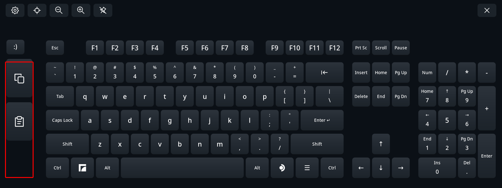
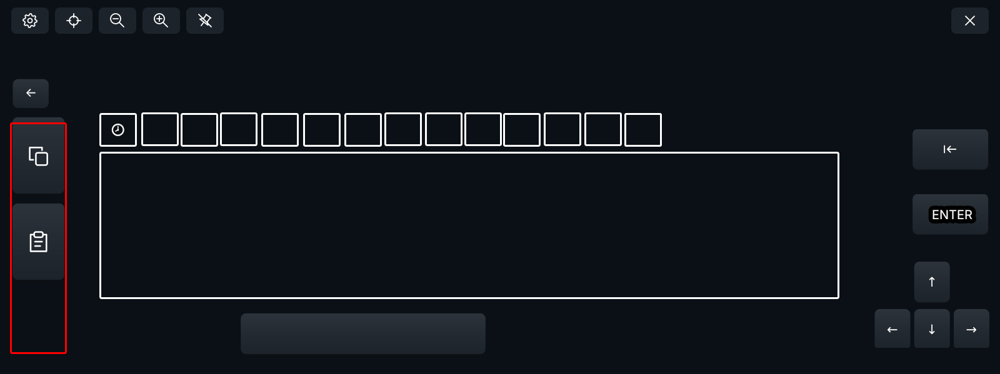

# Emoji picker plan

Status: implemented on `feature/emojis` (2026-10-25), with host tests; not yet tested in the headset. Mark milestone checkboxes only after their acceptance conditions pass. Items marked *proposal* are not yet confirmed by the owner. User-facing behavior is described in [configuration](configuration.md#emoji-picker).

The emoji picker is a second view of the keyboard. An emoji key in the side column switches to it. The view shows a scrollable grid of emoji with category tabs, a space bar, and Backspace, Enter and arrow keys, so a user can type a short message without switching back.

## Side column



The left side column changes in every layout, whether or not the picker is available:

1. A small **emoji key** at the top, where the mockup's `:)` placeholder is. It shows a smiley line icon in the toolbar's icon style.
2. Three tall keys of equal size below it: **Copy**, **Paste**, and **Dictation**.

Dictation is not implemented, so its slot is left empty: no key, no placeholder drawing. [Dictation](dictation.md) fills the slot later.

The emoji key is disabled (drawn with the theme's disabled color, not clickable) when the active input mode can't type Unicode text: the uinput backend, external JIS, or a Unicode transport that isn't ready. If that happens while the picker is open, the keyboard returns to the main layout. The desktop preview, which never types, still opens the picker.

## Picker view



- **Side column:** the same, except that the emoji key becomes a Back key that returns to the main layout.
- **Category row:** across the top of the main area. Recent comes first, with a clock icon, followed by the Unicode groups: Smileys & Emotion, People & Body, Animals & Nature, Food & Drink, Travel & Places, Activities, Objects, Symbols, Flags. Each tab has its own line icon. If the tabs don't fit, they scroll horizontally, and Recent stays fixed at the left like a frozen table column.
- **Grid:** one horizontal strip covering every category in tab order, filled column by column. Tapping a tab scrolls the grid to that category. The highlighted tab follows the scroll position.
- **Bottom:** a space bar under the grid.
- **Right side:** Backspace and Enter, with the arrow keys below them.
- **Compact (no numpad) mode:** the keyboard keeps its compact width, unlike Settings, which widens it. The grid shrinks to fit: fewer columns are visible at once.
- **Toolbar:** unchanged, except that the language key is disabled while the picker is open.

The view's geometry is generated from the active layout's case size, key unit and side column, rather than from a separate layout file (*proposal*).

## Interaction

- **Typing:** an emoji is typed when the trigger is released over the same cell. If the laser moves more than a few millimeters during the press, it becomes a scroll and nothing is typed. The picker stays open, unless the close-on-select setting is on.
- **No repeat:** holding an emoji never repeats it. A hold opens the skin-tone popup instead (below).
- **Scrolling:** two ways to scroll, both moving the grid horizontally:
  - Dragging with the trigger held. A quick drag keeps the grid gliding after release and slowing down, like a phone list: the speed over the last 0.1 s before release (at least 300 px/s) decays with a 0.35 s time constant, so the glide covers about a third of a second of that speed. A pause before releasing leaves nothing to glide. A glide that runs past an end overshoots on a critically damped spring and settles back on the end, like iOS lists; it overshoots at most about 65 px. A press on the gliding grid stops it (back on the end, if past one) and types nothing; the stick also stops it. A drag can start anywhere in the grid, including the empty space between categories.
  - The thumbstick of the controller whose laser is on the grid. In the dashboard this arrives as scroll events. In passthrough, the keyboard reads the stick itself.
  - The stick and the tab row scroll without gliding. Scrolling stops at the ends.
- **Swipe typing:** belongs to the main layout and is inactive in the picker. No trail is drawn.
- **Haptics:** none in the grid, tabs or tone popup. A tick for every emoji under a sweeping laser became a constant rattle. The picker's keys keep theirs. In the dashboard, SteamVR itself ticks the controller: the Frame controller's dashboard binding turns the stick into discrete scroll steps, each with a tick, or into smooth scrolling. Turning the panel's scroll events off did not stop the ticks. So the panel asks for discrete steps only while a laser is over something that scrolls (the grid, tabs that overflow, an overflowing Settings card or list) and for smooth scrolling elsewhere, whose events it ignores; smooth scrolling gives no ticks (confirmed in the headset). At an end of the grid, the same switch follows the stick: the keyboard reads the pointing controller's stick tilt from its render model, and once it leans past 10% toward the end the grid is at, it switches to smooth scrolling before SteamVR's first step. Which tilt scrolls which way is learned from the steps SteamVR sends; until then right counts as forward and up as back.

### Skin tones

Holding an emoji that supports skin tones for 500 ms (*proposal*) opens a popup above it with six variants. While held, the laser may wander 16 px (about 1 cm) before the press becomes a scroll, instead of the usual 10 px:

- the default yellow first;
- then the five tones from light to dark.

Releasing over a variant types it and makes that tone the keyboard-wide choice. From then on, every toned emoji in the grid and in Recent is drawn and typed with that tone. Emoji with more than one person use the same tone for each of them. The choice is saved with the recent emoji.

### Recent

- **Space:** Recent always takes six columns, full or empty, so the categories after it never move as it fills. It holds up to 29 emoji with five rows, stored without a tone so the global tone applies.
- **Layout:** most recent first, filled down each column and then across, like the rest of the grid. With five rows and 17 emoji:

  ```txt
  1 6  11 16
  2 7  12 17
  3 8  13
  4 9  14
  5 10 15          ×
  ```

- **Clear:** a clear icon button in the bottom-right cell of Recent's six columns, inside the scrolling grid. It is not shown at all while Recent is empty. Pressing it empties Recent at once, with no confirmation (*proposal*). An empty Recent shows "Recently used emoji / appear here" in its place.
- **Order:** an emoji chosen from another category appears at the front of Recent at once. One chosen from Recent itself keeps its place, so Recent never shifts under the laser while you use it.
- **Storage:** `emoji.json` beside `placement.json`, not in `config.json`, holding the recent emoji and the skin tone. It is written when the picker closes or Recent is cleared. It is a record of typed content, so it is never logged.

### Entering and leaving

- **Entering the picker:** releases every held key and latched modifier, cancels pending dead-key accents, and finishes or cancels any Japanese/CJK composition. This uses the existing release path, so nothing leaks into the target.
- **Hide or reopen:** the keyboard always reopens on the main layout. The picker's category and scroll position are not kept.
- **Settings:** opening Settings from the picker returns to the main layout when Settings closes (*proposal*).

## Setting

**Close emoji picker after choosing**: a checkbox in the General card, saved as the optional global boolean `emoji_close_on_select`. It defaults to false.

## Delivery

Each emoji is sent as one text commit, through the same path as accented and IME text:

- **Steam typing targets** (native replacement): the whole string goes to Steam's text field in one `insertText`.
- **Gamescope** (libei): the whole string goes in one input-method commit. Emoji never qualify for the per-character mode, which is only used when every character is on the ordinary keymap. Gamescope then types the code points through a temporary keymap, one key event each, in order. Steam's own keyboard uses the same Gamescope input-method protocol.
- **Length:** the longest sequences (ZWJ families, subdivision flags) are about 10 code points, within Gamescope's 32-character limit.

Whether an X11 or Wayland application joins a ZWJ sequence or keeps a variation selector depends on that application's text widget. Acceptance tests this in a few common targets.

## Emoji data and coverage

- **Source:** a table generated from Unicode's `emoji-test.txt`, keeping the fully-qualified entries. It records each emoji's group and order and whether it takes skin tones. The Unicode version is pinned, and the Unicode license and attribution go in `third_party/`.
- **Coverage:** only emoji the system color emoji font can draw are shown. The worker loads that font (`Noto Color Emoji`, else fontconfig's `emoji` alias) and shapes each sequence and each tone with HarfBuzz, keeping those that come out as one visible glyph with no missing glyph. A toned emoji missing any tone keeps only its default. A category with nothing left is hidden. Shaping against the one font, without Pango's per-text fallback search, took the check of all 3,513 sequences from 1.1 s to a few milliseconds on the development host.
- **No font:** if the font cannot draw 😀, nothing counts as drawable and the emoji key is disabled.

## Rendering and performance

- **Glyph cache:** color emoji fonts store glyphs as large bitmaps, which are slow to scale on every draw. Each emoji is rasterized once at cell size into a cache, and the grid copies from that cache. The cache depends on the theme and the panel's pixel scale, not on the keyboard's size in the world, so resizing keeps it.
- **Async:** a worker thread checks and rasterizes, starting when the picker first opens:
  - cells nearest the middle of the view first, outward from there;
  - only the nearest 300 missing images per request, about three screens; a new request comes only when the first visible column, the tone, the content or the tone popup changes;
  - with its own Pango font map, HarfBuzz buffer and Cairo surfaces, since none is shared across threads;
  - cells not yet ready draw empty, and the grid redraws as images arrive.
- **Memory:** images are about 42 px square on the bundled layouts, 7 KB each. At most 8 MB are kept, about 1,180 images; a request releases those no longer among the nearest that fit. The panel draws an image only between requests, so it never draws a released one.
- **First open:** on the development host, the check and the first 300 images take about 0.2 s of worker time; the VR loop never waits for them.
- **Redraw:** only while scrolling, hovering, pressing or filling the cache. Nothing redraws when the view is idle.

## Milestones

- [ ] Side column: emoji key, three equal keys, reserved dictation slot, in every layout file.
- [ ] Emoji data table, font coverage check, and Unicode attribution.
- [ ] Picker view with tabs, grid, frozen Recent tab and the compact width.
- [ ] Release-to-type, drag and thumbstick scrolling, no repeat.
- [ ] Async glyph cache with memory cap.
- [ ] Skin-tone popup and global tone.
- [ ] Recent emoji storage and clearing.
- [ ] Close-on-select setting.
- [ ] Disabled states: Unicode transport, language key, missing font.
- [ ] Docs: configuration, acceptance, architecture, changelog.

## Acceptance

- In uinput mode, the emoji key is disabled. If the Unicode transport is lost while the picker is open, the keyboard returns to the main layout.
- Typing works in a Steam text field, a Wayland text field and an X11 text field: a single emoji, a toned emoji, a ZWJ family and a flag, each arriving whole.
- A drag over the grid types nothing, and holding an emoji never repeats it.
- No held key or modifier reaches the target after entering the picker.
- The first open shows the grid without a stall in the VR loop; frame time stays within budget while scrolling.
- Idle CPU with the picker open matches the main layout.
