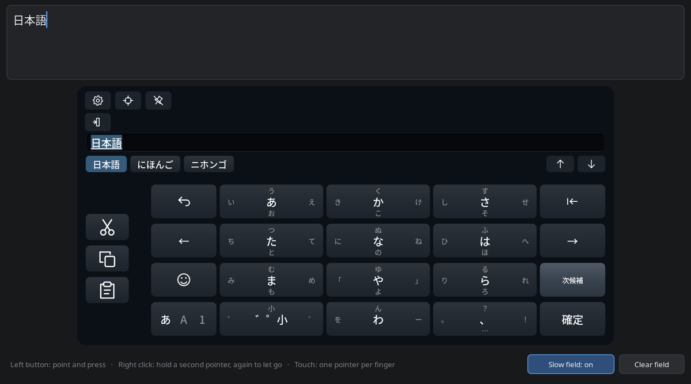

# Desktop simulator

The simulator runs Full Keyboard in a window on a Linux PC, typing into a text field above it. It is for trying the keyboard without a Steam Frame: for native speakers checking Japanese and Korean input, and for AI agents that drive it through computer use. It runs the keyboard's own code, the same as on the headset, but everything it types stays in its own field. Nothing reaches other applications or the system clipboard, and only Japanese learning keeps typed phrases on disk, in the simulator's own settings folder.

It runs on Linux x86-64. Windows and browser versions may follow.

## Build and run

The dependencies are those of a [host build](building.md#dependencies), apart from SteamVR and Vulkan, which the simulator does not need. Its own preset builds only the simulator:

```sh
cmake --preset simulator
cmake --build --preset simulator
./build/simulator/framekeyboard-simulator --layout ja-flick-12 --language ja-flick
```

In a development build, `cmake --build build/host --target framekeyboard-simulator` builds it beside the other programs, as `build/host/framekeyboard-simulator`. An [AppImage](#appimage) runs it without building anything.

The window shows the text field at the top and the keyboard below it. The keyboard's × shows, so the toolbar lays out as on the headset, but it closes nothing; close the window to quit. Below the keyboard are two buttons of the simulator's own: **Slow field** and **Clear field**. Click in the field to move its caret. The PC's own keyboard does nothing in the window: everything is typed with the on-screen keyboard.



## Pointers

| Input | Acts as |
| --- | --- |
| Left mouse button | A laser and its trigger: point, press, and drag to flick or swipe. The scroll wheel scrolls the candidates, the emoji grid and Settings |
| Right click | A second laser that stays pressed where you clicked, until the next right click releases it. Hold Shift, Ctrl or a key with it, and press keys with the left button |
| Touch screen | Each finger is a laser of its own, for two-handed typing |

Moving off the keyboard is the laser leaving the panel: a key still held is let go without typing, except a repeating key such as Backspace, which repeats until the button is released. A click outside the keyboard, in the field or on the simulator's buttons, is a laser click elsewhere: it ends ↶'s chance to reopen the phrase just typed, as on the headset, and so does moving over the field. Leaving the window altogether does not, since nothing outside it reaches the field, and neither does a move outside the window, or onto its edge, with the button up, as a pointer-driving tool parks the mouse after each click. When another window takes the focus while the button is held, the press is let go unless the pointer comes back into the window or releases within half a second; a motion far outside the window that some desktops send with the focus change is ignored meanwhile, so a flick or swipe in progress carries on. **Clear field** also cancels the keyboard's open reading, so the next word starts anew.

With `FRAMEKEYBOARD_SIMULATOR_TRACE=1` set, the simulator writes the window's pointer events to stderr: presses, releases and moves with their positions, window events by SDL number, and when ↶'s chance to reopen a phrase opens or ends, after which event. It shows what a pointer-driving tool really sends. Nothing typed is written.

## Options

| Option | Effect |
| --- | --- |
| `--layout ID` | Start with this layout |
| `--language ID` | Start with this language. Without `--layout`, a layout that can type it is chosen |
| `--theme ID` | Start with this theme |
| `--list` | List the layout, language and theme IDs |
| `--slow-field` | Start with the slow field on |
| `--debug` | Accepted; [debug mode](building.md#debug-mode) is always on in the simulator |
| `--anthy-dictionary FILE` | Use this Anthy dictionary; see [Japanese](#japanese) |
| `--config-dir PATH` | Keep settings here instead |
| `--data-dir PATH` | Read extra profiles from here |
| `--duration SECONDS` | Quit after this time |
| `--japanese-candidates` | Print what Japanese input offers for phrases read from standard input, without a window; see [Japanese candidates](#japanese-candidates) |
| `--chinese-candidates` | Print the conversion and candidates of Pinyin or Zhuyin readings read from standard input, without a window; see [Chinese candidates](#chinese-candidates) |
| `--chinese-engine NAME` | With `--chinese-candidates`, compare this engine too: `pyzy`, `libime`, `mcbopomofo`, or `all`; give it again for more |
| `--chinese-method ID` | With `--chinese-candidates`, type the readings with this input method only, such as `chinese-zhuyin`; give it again for more |
| `--candidates N` | How many candidates it lists for each phrase and segment, 12 live and 6 a segment by default, 12 for each Chinese reading |
| `--mozc-server PATH` | With `--japanese-candidates`, convert with this `mozc_server` rather than the bundled one, Anthy only while it can't answer |
| `--anthy-only` | With `--japanese-candidates`, convert with Anthy alone, to compare it with Mozc |
| `--no-word-forms` | With `--japanese-candidates`, leave out the usual forms of words within segments, to compare |

A chosen layout, language or theme is applied and saved, as **Apply and save** in Settings would, so the next run starts with it. Settings, the emoji picker and the language button are the keyboard's own, as on the headset. The simulator keeps its settings in `~/.config/framekeyboard-simulator` (`$XDG_CONFIG_HOME/framekeyboard-simulator`), and refuses to use an installed keyboard's `~/.config/framekeyboard`. Custom profiles go in its `layouts`, `languages` and `themes` subfolders, as described in the [configuration reference](configuration.md).

## Slow field

Steam's own text fields confirm each key the keyboard sends before taking the next one, which takes a moment. The slow field does the same: it answers every key press and every piece of text "waiting" for about 30 ms before taking it, and the keyboard holds the rest back meanwhile, as it does on the headset. Use it to check how typing and ↶ behave in Steam's fields. Turn it on with `--slow-field` or the **Slow field** button.

## Japanese

Kanji conversion uses [Mozc](japanese.md#mozc) where the build has its server (`FRAMEKEYBOARD_MOZC_HOST`, [building](building.md)), keeping its profile in the simulator's config folder, and Anthy otherwise, as on the headset. Unlike the headset, which converts with Anthy at once while Mozc isn't answering, the simulator waits up to 3 seconds for Mozc, started again if it went, so a test sees what Mozc offers. Candidates Anthy converted anyway have an orange border (Settings → Debug → **Mark Anthy suggestions**). Anthy is the library `libanthy.so.0` and its dictionary. Install your distribution's Anthy package, or point the simulator at an Anthy unpacked somewhere else:

```sh
A=/path/to/unpacked/anthy
LD_LIBRARY_PATH=$A/usr/lib ./build/simulator/framekeyboard-simulator \
  --anthy-dictionary $A/usr/share/anthy/anthy.dic --layout ja-flick-12 --language ja-flick
```

`FRAMEKEYBOARD_ANTHY_DICTIONARY=FILE` does the same as `--anthy-dictionary`. The dictionary must match the library's version. Without Mozc or Anthy the keyboard still composes kana, and says "Japanese conversion needs the Anthy library" when you convert. As on the headset, Anthy always learns ([Japanese learning](japanese.md#learning)), but the simulator keeps what it learns in `.anthy` inside its own config folder, not in your home, so it neither copies nor touches your desktop's input method's learning. The JIS language relies on a system input method and cannot type in the simulator.

### Japanese candidates

`--japanese-candidates` checks conversion much faster than typing in the window. It reads phrases from standard input, one a line, types each as the keyboard would, and prints its live candidates and what 変換 converts it to, segment by segment, each candidate separated by `|`. A line with Latin letters is typed as romaji, so `konnichiha` reads こんいちは, as on the keyboard. Any other line is typed as kana, as the flick and JIS kana layouts do, and spaces are left out. Empty lines and lines starting with `#` are copied as they are, for notes. It uses the same Mozc, Anthy, phrase lists and emoji as the keyboard, with learning off, so every run offers what a new profile does, and leaves no learned history. Mozc gets a fresh temporary profile on every run; its server stops before that folder is removed, including if reporting fails. Anthy uses an anonymous personality, keeping only its lock file in the simulator's settings folder. Each line says which engine converted it: `(Mozc)`, or `(Anthy)` with `--anthy-only`, without a Mozc server, or where Mozc didn't answer within 3 seconds.

```sh
printf 'じかんがあう\nkyouhaiitenkidane\n' | ./Full_Keyboard_simulator-*.AppImage --japanese-candidates
```

```text
じかんがあう
  live (Mozc)  時間が合う | 時間が | 次官が | …
  変換 (Mozc)  [時間が | 次官が | …] [合う | 会う | あう | …]
kyouhaiitenkidane → きょうはいいてんきだね
  live (Mozc)  今日はいい天気だね | …
  変換 (Mozc)  [今日はいい天気だね | …]
```

### Chinese candidates

`--chinese-candidates` does the same for Chinese: it reads readings from standard input, one a line, and prints, for each input method, the conversion and the candidates for its start. Each output line names the engine. A line in Zhuyin symbols is typed on the standard Zhuyin keys. A space gives a syllable written without a tone mark the first tone, as one left open at the end gets; after a tone mark it only separates. A Latin line is typed as Pinyin, Simplified and Traditional, without its spaces and tone digits; with `--chinese-method chinese-zhuyin` it is the Zhuyin keys themselves instead, and with `chinese-cangjie` or `chinese-quick` those methods' keys. By default each method converts with the engine the keyboard uses ([Chinese engines](languages.md#chinese-engines)). `--chinese-engine` lists each engine named that has the method and is built. Nothing is learned, and the report writes no settings. Empty lines and lines starting with `#` are copied as they are.

```sh
printf 'nihao\nㄋㄧˇ ㄏㄠˇ\n' | ./Full_Keyboard_simulator-*.AppImage --chinese-candidates --chinese-engine all --candidates 5
```

```text
nihao
  chinese-pinyin-simplified (pinyin)  你好  [你好 | 利好 | 你 | 里 | 李 | … 45 more]
  chinese-pinyin-simplified (libime)  你好  [你好 | 拟好 | 你毫 | 你 | 拟 | … 45 more]
  chinese-pinyin-traditional (pinyin)  你好  [你好 | 利好 | 你 | 里 | 李 | … 45 more]
  chinese-pinyin-traditional (libime)  你好  [你好 | 擬好 | 你毫 | 你 | 擬 | … 45 more]
ㄋㄧˇ ㄏㄠˇ
  chinese-zhuyin (pinyin)  你好  [你好 | 利好 | 你 | 里 | 李 | … 45 more]
  chinese-zhuyin (mcbopomofo)  你好  [你好 | 妳好 | 你 | 妳 | 擬 | … 26 more]
```

PyZy's module is `pinyin`.

#### Experimental Pinyin ranking

Pinyin's residual-ranking experiment is off by default and ships without model
weights. `FRAMEKEYBOARD_PINYIN_NBEST=20` tests wider libime search alone.
`FRAMEKEYBOARD_PINYIN_RERANK_DIRECTORY=/path/to/models` enables wider search and
residual ranking when both method models load. The directory holds
`simplified.fkpr` and `traditional.fkpr`. Legacy files start with the eight ASCII
bytes `FKPYR001`, followed by exactly 32,768 little-endian IEEE float32 weights.
Counted version `FKPYR002` adds a little-endian unsigned 32-bit feature count
after the magic, then exactly that many float32 weights. Only 32,768 and
131,072 features are supported. Hashing uses each loaded model's actual size.
The two scripts may use different supported sizes; both files must validate
before either model is enabled, and native mutable learning remains shared.
The selected wider Traditional experiment uses the unchanged validated 32k
Simplified model beside the frozen 131k Traditional model. The rejected wider
Simplified research candidate is not part of that runtime bundle.
Missing, malformed or nonfinite weights in either file leave residual ranking
off for both methods, so they keep shared learning ownership. Keep the model
bundle fixed while the simulator runs. Unset both variables to return to normal search.

The experiment scores complete-input candidates and keeps the winning sentence
first. Prefix words and full-word correction choices precede the other multiword
sentence hypotheses, which remain reachable in the expanded list. Its menu is
bounded to 70 choices to leave room for the extra hypotheses alongside the normal
50 choices. Selected words stay selected. Space, candidate selection, punctuation,
learning and sending the front of a long reading use the same winning source.
Enter still types Pinyin's remaining letters as entered.

An isolated complete native conversion of one character keeps libime's own
default, including its learned preference. The residual is meant to compare
sentences. This guard does not change a reading with a selected prefix or text
already sent from its front, and every homophone remains selectable.

The experiment also keeps a complete native winner backed by learned whole-word
frequency or a fully supported learned word-transition path, including both
sentence boundaries and the candidate's canonical Pinyin. Familiar components
alone do not qualify. This respects libime's existing personal preferences;
it adds no personal-text file. A supported transition path can recombine earlier
transitions, so it does not prove that the entire sentence was previously typed.
Existing learning controls, profile separation and clearing still apply.

Use a scratch simulator config and fixed model hashes when comparing normal
search, wider search and residual ranking. Model training and benchmark data are
not part of the package. Accuracy, incremental decoding cost and headset behavior
need separate measurement before enabling this experiment by default.

#### Experimental Zhuyin residual ranking

With `FRAMEKEYBOARD_ZHUYIN_SENTENCES=1`, setting
`FRAMEKEYBOARD_ZHUYIN_RERANK_MODEL=/path/to/model.fkzr` also enables a fixed
residual over tone-compatible proposals and McBopomofo's unforced conversion.
The separate model starts with `FKZYR001` and exactly 32,768 little-endian
IEEE float32 weights. Pinyin models, missing files, malformed payloads and
nonfinite weights leave the existing sentence experiment unchanged. Weights
are external and are not included in the package. Both experiments remain off
by default.

This model uses character ngrams, proposal order, length, native-source identity
and the existing phrase-fit heuristic. It does not use libime word segmentation
or native language-model scores. Its native hypothesis comes from a fresh grid
with user and learned overrides only, never from an earlier proposed sentence.
Runs with user or learned choices keep the existing hybrid policy. Punctuation
separates runs; unsafe native spans or incompatible readings use that policy too.

Scoring follows the existing completed-reading proposal cache. Starting or
clearing an unfinished syllable preserves the last converted prefix and keeps
the raw symbols at the cursor. Completing a syllable or changing completed
readings can recompute the unselected text, including after a long reading sends
its front. No new per-key inference, timer or personal history is added.
Use a scratch profile and measure live key-by-key output and incremental cost
separately from offline candidate scoring before considering a default change.

#### Experimental table context

`FRAMEKEYBOARD_TABLE_CONTEXT_COUNTS=/path/to/context-counts.bin` enables the
default-off contextual Quick/Cangjie experiment. The external file contains
sorted little-endian records of four unsigned 32-bit values: three Unicode
code points and a positive public-corpus count. A zero first code point marks
a bigram. Duplicate, unsorted, invalid or oversized data falls back to native
ordering. Data is not included in the AppImage; the experiment uses the same
pinned [CC BY 4.0 source](../third_party/chinese-ranks/README.md) as the ranks.
Keep the counts file fixed while the process runs; restart after changing it.

The frozen ranking weights are eight for Quick and four for Cangjie, with a
half-weight trigram only after two prior characters. Quick's first choice and
Cangjie's common exact matches stay ahead of reordered alternatives. Offered
characters remain selectable.

Context comes from acknowledged output, including Quick's automatic front
sending. Admission alone is insufficient. Acknowledgements affect the next
normal code lookup, never a menu beneath a press. Observed caret/native edits,
field/window/profile changes, sensitive fields, cancellation and uncertain
delivery clear future context. Already-presented choices remain fixed until
normal reading mutation; actual target/profile resets retain their existing
composition-discard policy. New lookups for unknown direct targets use native ordering. The
simulator identifies its own single private receiver; clicking its field or
Clear field invalidates context. No field or system clipboard text is read,
and no personal context file is written. Out-of-band edits without an existing
input/focus/pointer signal cannot be inferred.

## AppImage

An AppImage holds the simulator, the libraries it needs and Japanese completion's words and kaomoji, and optionally Mozc, swipe typing, the Chinese engines, Anthy with its dictionary, the emoji dictionary and the Cangjie and Quick tables, in one file that runs without installing anything:

```sh
chmod +x Full_Keyboard_simulator-0.16.0-x86_64.AppImage
./Full_Keyboard_simulator-0.16.0-x86_64.AppImage --layout ja-flick-12 --language ja-flick
```

It takes the same options as the simulator and keeps its settings in the same folder. Without FUSE, add `--appimage-extract-and-run`. It runs only on systems at least as new as the one that built it: its libraries are that system's, so it needs C and C++ runtime libraries at least as new, and a CPU those libraries were compiled for. The build prints the glibc version it needs. It does not include swipe typing unless built with the swipe engine, nor Mozc unless built with its server, and never dictation.

`scripts/simulator-appimage.sh` builds it into `out/simulator/`, with a `SHA256SUMS` file. It builds the `simulator` preset, copies the simulator and its composition engines into an AppDir, and bundles every library they load apart from the system's own C and C++ runtimes, graphics drivers and display, sound and system-service connections. `libstdc++` and `libgcc_s` stay on the host: child programs such as bubblewrap, Mozc and Python inherit the AppImage's library path, and bundling older runtimes could mask the versions they or graphics plugins need. The glibc scan includes Mozc's server as well as the simulator and modules. `usr/share/licenses/BUNDLED.txt` inside it lists each bundled library's package, version and license, beside the packages' license files. It needs:

| Variable | What |
| --- | --- |
| `FRAMEKEYBOARD_APPIMAGETOOL` | appimagetool. 1.9.1 from [AppImage/appimagetool](https://github.com/AppImage/appimagetool/releases/tag/1.9.1), `appimagetool-x86_64.AppImage`, SHA-256 `ed4ce84f0d9caff66f50bcca6ff6f35aae54ce8135408b3fa33abfc3cb384eb0`, works; its extracted `AppRun` needs no FUSE |
| `FRAMEKEYBOARD_APPIMAGE_RUNTIME` | The type2 runtime put in front of the image. 20251108 from [AppImage/type2-runtime](https://github.com/AppImage/type2-runtime/releases/tag/20251108), `runtime-x86_64`, SHA-256 `2fca8b443c92510f1483a883f60061ad09b46b978b2631c807cd873a47ec260d` |
| `FRAMEKEYBOARD_ANTHY_ROOT` | Optional: an unpacked Anthy package, with `usr/lib/libanthy.so.0` and `usr/share/anthy/anthy.dic`, to bundle. The AppImage then converts Japanese with it unless `FRAMEKEYBOARD_ANTHY_DICTIONARY` names another dictionary |
| `FRAMEKEYBOARD_IBUS_ROOT` | Optional: unpacked `libibus` and `ibus` packages, with `usr/lib/libibus-1.0.so.5` and `usr/share/ibus/dicts/emoji-ja.dict`, to bundle for Japanese emoji candidates, which the Steam Frame has of its own. `FRAMEKEYBOARD_EMOJI_DICTIONARY` names another dictionary at run time |
| `FRAMEKEYBOARD_IBUS_TABLE_ROOT` | Optional: an unpacked `ibus-table-chinese` package, with `usr/share/ibus-table/tables/cangjie5.db` and `quick5.db`, to bundle for Cangjie and Quick, which the Steam Frame has of its own. `FRAMEKEYBOARD_TABLE_DIRECTORY` names another folder of tables at run time |
| `FRAMEKEYBOARD_EXECUTORCH_HOST` | Optional: includes swipe typing, as for a [host build](building.md#dependencies) |
| `FRAMEKEYBOARD_MOZC_HOST` | Optional: includes Mozc's server, so Japanese converts with Mozc, as for a [host build](building.md#dependencies); without it, Anthy converts alone |
| `FRAMEKEYBOARD_CHINESE_HOST` | Optional: the Chinese engines' host prefix ([building](building.md#dependencies)). Includes libime, OpenCC and McBopomofo with their libraries, data and licences; without it, Pinyin and Zhuyin need a PyZy on the system |

The optional Anthy, IBus and Chinese-table roots must match the pinned package
payloads in `scripts/simulator-appimage/{anthy,ibus,ibus-table-chinese}.sha256`.
Those files record the package versions and archive hashes as well as each
bundled file's hash. Packaging verifies the bytes before building; an incomplete,
modified or different-version root is rejected. See [upkeep](upkeep.md) before
changing a pin.

Download the tool and the runtime outside the source tree, check their SHA-256, and extract appimagetool with `--appimage-extract` or `unsquashfs`. A bundled Anthy is LGPL 2.1 and its dictionary GPL 2, and many bundled libraries are LGPL: whoever passes the AppImage on must also offer their sources. [Anthy's notes](../third_party/anthy/README.md) say where its source is; the others are the sources of the package versions in `BUNDLED.txt`.

## Korean and Chinese

Two-set Hangul (`ko-kr`) needs libhangul when building: the build makes its engine when pkg-config finds `libhangul`, and without it choosing two-set Korean says the Hangul engine is unavailable. Chinese Pinyin and Zhuyin need PyZy (`pyzy-1.0`) the same way. Install the development files, then configure and build again. Cangjie and Quick need no build support, but read SQLite (`libsqlite3.so.0`) tables installed by ibus-table in `/usr/share/ibus-table/tables` ([languages](languages.md#chinese-and-korean-composition)); `FRAMEKEYBOARD_TABLE_DIRECTORY` names another folder holding `cangjie5.db` and `quick5.db`, such as an unpacked `ibus-table-chinese` package's, and the AppImage brings its own.

## What it does not simulate

- **VR placement.** Moving, resizing and auto leveling are off. Pin, Recenter, Stay open over apps and Focus mode still show in the toolbar but have nothing to act on.
- **Haptics and haptic sounds.**
- **Steam.** Native keyboard replacement, Start with SteamOS and updates have no effect here. The field is not one of Steam's; the slow field only imitates their timing.
- **Dictation.** The mic key shows only once dictation is set up in Settings, which downloads a speech model or needs a speech server. It would then listen through the PC's microphone. Dictation has not been checked in the simulator.
- **Swipe typing**, unless the build includes the swipe engine ([building](building.md#dependencies)); without it, Settings keeps swipe typing off.
- **A full text editor.** The field has no undo or rich text, and ↑ and ↓ move between lines separated by line breaks, not wrapped lines.

## Privacy

- The field's text stays in the window's memory. It is never logged, saved or sent, and closing the window discards it. Japanese learning keeps the phrases it learns, as on the headset.
- Cut, Copy and Paste send Ctrl+X, Ctrl+C and Ctrl+V to the field, which uses a clipboard of its own. The system clipboard is never read or written; dictation's paste Send also writes the field's clipboard.
- Settings, additional languages, Japanese learning and emoji Recent and Favorites are saved in the simulator's settings folder, as on the headset. Dictation models, if downloaded, go to `~/.local/share/framekeyboard-simulator/models`.

## For AI agents

To check many Japanese phrases, use [`--japanese-candidates`](#japanese-candidates) rather than typing each in the window. Everything works with a mouse: click to press, drag to flick, right click to hold a second pointer. The caret does not blink, so every screenshot shows it. The window keeps the keyboard's proportions (1600 by 1000) at whatever size it is given. `--slow-field` reproduces Steam's delivery timing.

## Code and tests

The simulator lives in `src/simulator/`; its AppImage's launcher, desktop entry and icon in `scripts/simulator-appimage/`. `field.cpp` is the text field and the sink that takes the keyboard's output; `simulator.cpp` draws the window's contents and routes pointers to `App`, using only Cairo and Pango; `platform_linux.cpp` finds its folders and points Anthy at a dictionary; `main.cpp` is the SDL window. A Windows port needs its own `platform` file and a `keyboard_core` that builds there.

The `simulator` CTest checks the field's editing keys, caret and clipboard, the slow field's confirmations, and the keyboard typing through the simulator: flick, Enter, ↶ in normal and slow fields, English with a held Shift, Copy and Paste, and leaving the keyboard. `build/host/simulator-tour DIR` renders the window in a few typed states to PNG files for review, with real candidates when Anthy is set up as above.
